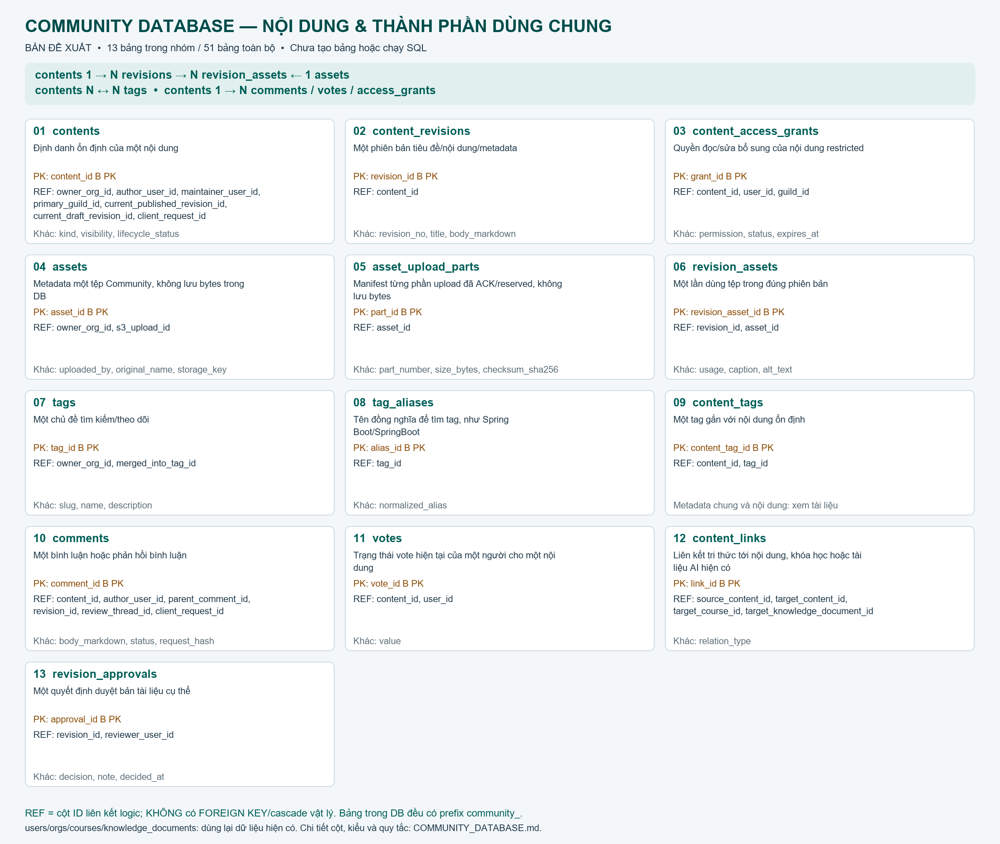
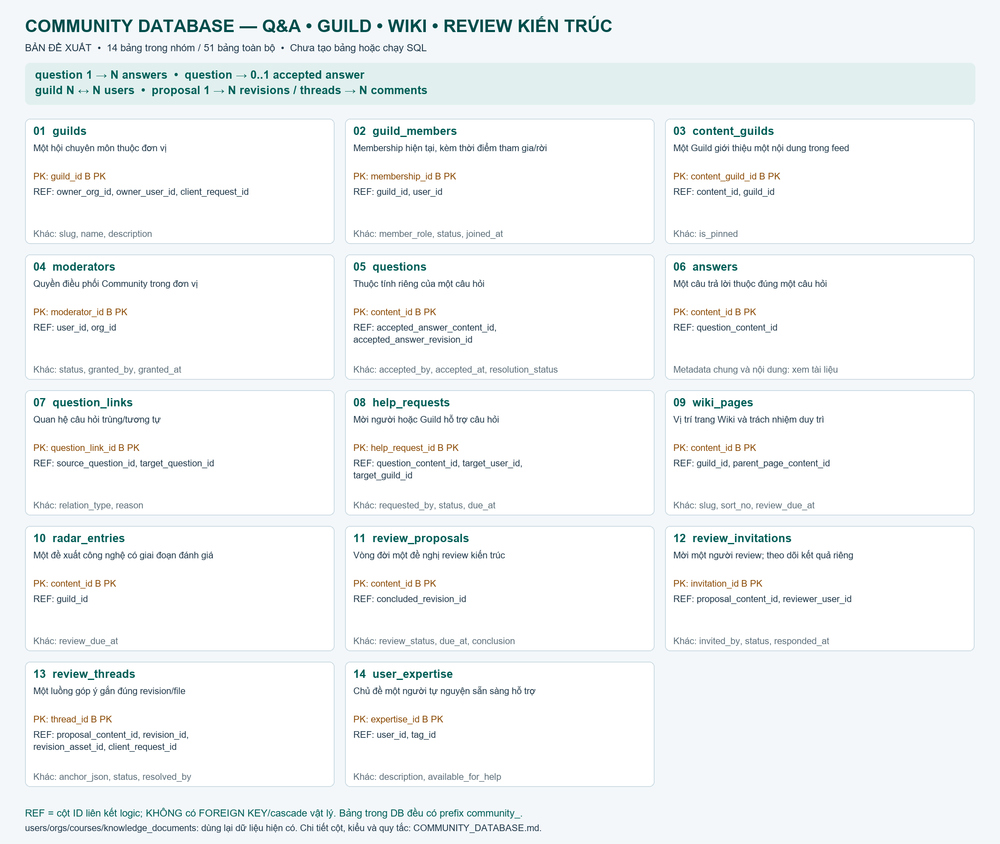
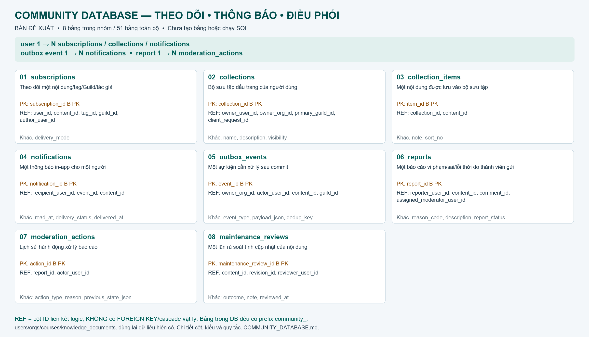
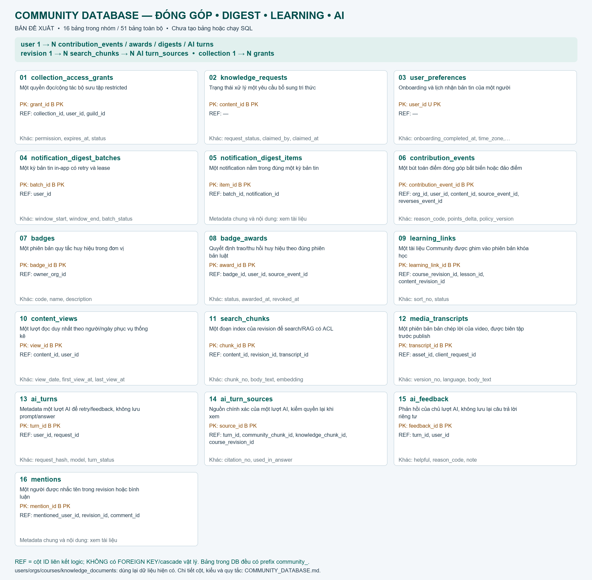
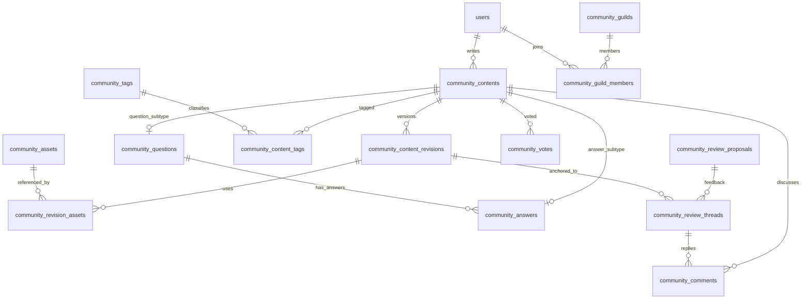

# Thiết kế DB Community — thiết kế toàn bộ phạm vi trước code

Trạng thái source: **đã có baseline SQL, mapping 51 bảng và C01–C141**; giới hạn kiểm chứng ở tài liệu API.
Baseline thủ công tại [learning_hub_community.sql](../sql/learning_hub_community.sql), trạng thái API tại
[COMMUNITY.md](COMMUNITY.md). Chưa tạo bảng hoặc sửa dữ liệu trên server.
Phạm vi đầy đủ gồm **51 bảng mới**; thứ tự xây dựng theo phụ thuộc kỹ thuật. Không sửa 26 bảng Learning hoặc dữ liệu
Identity trong baseline này. Schema `learning_hub`, prefix `community_` phân biệt Q&A với ngân hàng câu hỏi thi.

## Quyết định chính

- Quan hệ bằng cột ID thông thường; **không FOREIGN KEY/REFERENCES/cascade vật lý**. Mũi tên/REF trên sơ đồ chỉ mô tả quan hệ nghiệp vụ. Các grain chống trùng bên dưới là yêu cầu service kiểm tra nguyên tử, chưa phải quyết định thêm UNIQUE constraint.
- Dùng lại `users` (user_id varchar(20), giữ số 0 đầu), `orgs`, `teams`, `courses` qua adapter công khai. Guild khác team công tác và learning_group giao học. Không tạo tài khoản hay role Identity mới trong thiết kế này. Quyền moderator Community được quản lý riêng theo scope hiện có.
- Một định danh nội dung ổn định và nhiều revision. Bản đã xuất bản không sửa tại chỗ; sửa tạo revision mới. Có thể đồng thời có bản published và draft. Phê duyệt phải gắn đúng revision.
- Q&A có bảng riêng cho quan hệ câu hỏi/câu trả lời và accept. Blog, video sharing, bài học sau sự cố và đề nghị bổ sung tài liệu dùng nội dung chung; không tạo bảng giống nhau cho từng loại.
- Tái sử dụng hạ tầng `storage` S3 và quy trình kiểm file phù hợp; **không lấy assets Learning làm tệp Community ngay** vì quyền hiện tại gắn khóa học/enrollment. Metadata Community riêng; chỉ tách thành media service dùng chung khi thực sự triển khai và kiểm tra tương thích.
- Tag, vote, theo dõi, bookmark, báo cáo nội dung dùng chung. Thống kê tính từ dữ liệu gốc có ACL; bổ sung ledger đóng góp/huy hiệu và index AI Community riêng, không dùng kho Knowledge toàn app cho nội dung private.

**Xem đủ cột từng bảng:** [Từ điển dữ liệu 51 bảng](#community-columns). Mỗi cột có kiểu PostgreSQL, NULL, mặc định đề xuất và ý nghĩa/liên kết logic.

## Sơ đồ để xem trước

Mỗi ô ghi bảng, PK, các cột REF và mục đích. Mỗi bảng đều có tiền tố `community_` trong DB; sơ đồ rút gọn tiền tố cho dễ đọc.









Bản vector có thể phóng to: [sơ đồ 1](../diagrams/community-db-01-content.svg), [sơ đồ 2](../diagrams/community-db-02-business.svg), [sơ đồ 3](../diagrams/community-db-03-operations.svg), [sơ đồ 4](../diagrams/community-db-04-integration.svg).

## Kiểu dữ liệu và cột chung

- `B`: bigint; `U`: varchar(20) user ID hiện có; `S`: varchar có giới hạn; `T`: text; `TS`: timestamptz; `J`: jsonb; `I`: integer; `D`: date; `BOOL`: boolean.
- PK bigint mặc định `GENERATED BY DEFAULT AS IDENTITY`; các bảng subtype dùng content_id làm PK, không sinh ID khác; user_preferences dùng user_id varchar(20) hiện có làm PK, không tự tăng. Các ID tham chiếu là scalar, không FK.
- Các bảng có `created_by U`, `updated_by U`, `create_time TS`, `update_time TS`, `row_version B` (optimistic lock). Với worker, created_by/updated_by là actor code từ context tin cậy: userId hoặc principal kỹ thuật được cấu hình tường minh; không giả lập user đăng nhập hoặc tự tạo account.
- Bảng nội dung, revision, bình luận và asset có `deleted_at TS?`, `deleted_by U?`; không xóa vật lý nội dung đang được tham chiếu. Dấu `?` là cho phép null; field khác mặc định bắt buộc, ngoại trừ ghi chú rõ bên dưới.
- Chuỗi code/slug 100 ký tự, title/name 255, status/type 30; URL/key 1000; body/reason dùng text. JSON chỉ lưu metadata phụ, không lưu danh sách user/tag/answer thay bảng liên kết.

## 1. Nội dung và thành phần dùng chung — 13 bảng

| Bảng | Một dòng dùng để làm gì | Cột nghiệp vụ chính, ngoài cột chung |
|---|---|---|
| `community_contents` | Định danh ổn định của một nội dung | `content_id B PK`, `kind S`, `owner_org_id B`, `author_user_id U`, `maintainer_user_id U`, `visibility S`, `primary_guild_id B?`, `current_published_revision_id B?`, `current_draft_revision_id B?`, `lifecycle_status S`, `last_activity_at TS`, `client_request_id uuid`, `request_hash S` |
| `community_content_revisions` | Một phiên bản tiêu đề/nội dung/metadata | `revision_id B PK`, `content_id B`, `revision_no I`, `title S`, `body_markdown T`, `summary T?`, `context_json J`, `revision_status S`, `change_note T?`, `published_at TS?`, `published_by U?` |
| `community_content_access_grants` | Quyền đọc/sửa bổ sung của nội dung restricted | `grant_id B PK`, `content_id B`, `user_id U?`, `guild_id B?`, `permission S`, `status S`, `expires_at TS?` — đúng một user/guild |
| `community_assets` | Metadata một tệp Community, không lưu bytes trong DB | `asset_id B PK`, `owner_org_id B`, `uploaded_by U`, `original_name S`, `storage_key S?`, `mime_type S`, `size_bytes B`, `checksum_sha256 S?`, `media_type S`, `status S`, `duration_seconds numeric?`, `page_count I?`, `media_checked_at TS?`, `playback_key S?`, `playback_size_bytes B?`, `playback_mime_type S?`, `playback_checksum_sha256 S?`, `upload_id uuid`, `request_hash S`, `s3_upload_id T?`, `upload_total_bytes B`, `uploaded_bytes B`, `chunk_size_bytes I`, `upload_expires_at TS`, `upload_completed_at TS?`, `processing_attempts I`, `processing_available_at TS?`, `processing_lease_token uuid?`, `processing_lease_expires_at TS?`, `processing_error_code S?`, `cleanup_status S`, `cleanup_attempts I`, `cleanup_last_error_code S?`, `cleanup_after TS?`, `cleanup_lease_token uuid?`, `cleanup_lease_expires_at TS?` |
| `community_asset_upload_parts` | Manifest từng phần upload đã ACK/reserved, không lưu bytes | `part_id B PK`, `asset_id B`, `part_number I`, `size_bytes B`, `checksum_sha256 S`, `etag S?`, `part_status S`, `reservation_token uuid?`, `reservation_expires_at TS?` |
| `community_revision_assets` | Một lần dùng tệp trong đúng phiên bản | `revision_asset_id B PK`, `revision_id B`, `asset_id B`, `usage S`, `caption T?`, `alt_text S?`, `sort_no I` |
| `community_tags` | Một chủ đề tìm kiếm/theo dõi | `tag_id B PK`, `owner_org_id B`, `slug S`, `name S`, `description T?`, `status S`, `merged_into_tag_id B?` |
| `community_tag_aliases` | Tên đồng nghĩa để tìm tag, như Spring Boot/SpringBoot | `alias_id B PK`, `tag_id B`, `normalized_alias S` |
| `community_content_tags` | Một tag gắn với nội dung ổn định | `content_tag_id B PK`, `content_id B`, `tag_id B` |
| `community_comments` | Một bình luận hoặc phản hồi bình luận | `comment_id B PK`, `content_id B`, `author_user_id U`, `parent_comment_id B?`, `revision_id B?`, `review_thread_id B?`, `body_markdown T`, `status S`, `client_request_id uuid`, `request_hash S` |
| `community_votes` | Trạng thái vote hiện tại của một người cho một nội dung | `vote_id B PK`, `content_id B`, `user_id U`, `value smallint` (-1 hoặc +1); bỏ vote xóa dòng, audit giữ thay đổi |
| `community_content_links` | Liên kết tri thức tới nội dung, khóa học hoặc tài liệu AI hiện có | `link_id B PK`, `source_content_id B`, `target_content_id B?`, `target_course_id B?`, `target_knowledge_document_id B?`, `relation_type S` (related/summarizes/supersedes/fulfills/learning_reference) — đúng một target |
| `community_revision_approvals` | Một quyết định duyệt bản tài liệu cụ thể | `approval_id B PK`, `revision_id B`, `reviewer_user_id U`, `decision S`, `note T?`, `decided_at TS` |

`kind`: question / answer / article / recording / wiki / radar / architecture_review / lesson_learned / knowledge_request.
`visibility`: organization / guild / restricted. `lifecycle_status`: active / closed / archived / hidden.
`revision_status`: draft / submitted / published / superseded / rejected. Không trộn lifecycle với quyền hoặc trạng thái giải quyết Q&A.
`permission`: reader / editor; editor không đồng nghĩa approver/moderator. `decision`: approved / changes_requested / rejected.
`context_json` là metadata có phiên bản, bất biến sau submitted. Dùng allowlist theo kind: công nghệ và phiên bản, môi trường áp dụng, giới hạn, ngày seminar/diễn giả hoặc hiện tượng/nguyên nhân/phòng ngừa sự cố. Các dữ liệu cần liên kết/query thường xuyên vẫn có bảng/cột riêng.

Revision của recording bắt buộc có một revision_assets.usage=primary_video, cùng các attachment tùy chọn; speaker/date/description trong context_json theo schema. Bài viết dùng usage=inline_image/attachment; review dùng usage=design_file.

Tệp Markdown trỏ bằng revision_asset_id, không lưu URL S3 public hay signed URL hết hạn. Tên tệp không phải storage key. Chỉ asset ready đã kiểm chứng mới được xuất bản; manifest được chuẩn hóa ở community_asset_upload_parts. Contract upload/worker/cleanup đã chốt tại [Community API](COMMUNITY.md#media); pipeline vẫn chưa triển khai.

## 2. Q&A, Guild, Wiki và Architecture Review — 14 bảng

| Bảng | Một dòng dùng để làm gì | Cột nghiệp vụ chính, ngoài cột chung |
|---|---|---|
| `community_guilds` | Một hội chuyên môn thuộc đơn vị | `guild_id B PK`, `owner_org_id B`, `slug S`, `name S`, `description T?`, `owner_user_id U`, `visibility S` (organization/private), `join_policy S` (open/approval/invite), `status S`, `client_request_id uuid`, `request_hash S` |
| `community_guild_members` | Membership hiện tại, kèm thời điểm tham gia/rời | `membership_id B PK`, `guild_id B`, `user_id U`, `member_role S` (owner/moderator/member), `status S` (pending/active/left/rejected), `joined_at TS?`, `left_at TS?`, `approved_by U?`, `invited_by U?`, `invited_at TS?`, `invitation_expires_at TS?` |
| `community_content_guilds` | Một Guild giới thiệu một nội dung trong feed | `content_guild_id B PK`, `content_id B`, `guild_id B`, `is_pinned BOOL` — không tự cấp quyền xem |
| `community_moderators` | Quyền điều phối Community trong đơn vị | `moderator_id B PK`, `user_id U`, `org_id B`, `status S`, `granted_by U`, `granted_at TS`, `revoked_at TS?` — không phải ADMIN Identity |
| `community_questions` | Thuộc tính riêng của một câu hỏi | `content_id B PK`, `accepted_answer_content_id B?`, `accepted_answer_revision_id B?`, `accepted_by U?`, `accepted_at TS?`, `resolution_status S` (unanswered/answered/solved), `closed_reason T?` |
| `community_answers` | Một câu trả lời thuộc đúng một câu hỏi | `content_id B PK`, `question_content_id B` |
| `community_question_links` | Quan hệ câu hỏi trùng/tương tự | `question_link_id B PK`, `source_question_id B`, `target_question_id B`, `relation_type S` (duplicate/related), `reason T?` |
| `community_help_requests` | Mời người hoặc Guild hỗ trợ câu hỏi | `help_request_id B PK`, `question_content_id B`, `requested_by U`, `target_user_id U?`, `target_guild_id B?`, `status S` (pending/accepted/declined/resolved/cancelled), `due_at TS?`, `responded_by U?`, `responded_at TS?` — đúng một target |
| `community_wiki_pages` | Vị trí trang Wiki và trách nhiệm duy trì | `content_id B PK`, `guild_id B`, `parent_page_content_id B?`, `slug S`, `sort_no I`, `review_due_at D?` |
| `community_radar_entries` | Một đề xuất công nghệ có giai đoạn đánh giá | `content_id B PK`, `guild_id B`, `review_due_at D?` |
| `community_review_proposals` | Vòng đời một đề nghị review kiến trúc | `content_id B PK`, `review_status S` (draft/open/in_review/concluded/closed), `due_at TS?`, `concluded_revision_id B?`, `conclusion T?`, `concluded_by U?`, `concluded_at TS?` |
| `community_review_invitations` | Mời một người review; theo dõi kết quả riêng | `invitation_id B PK`, `proposal_content_id B`, `reviewer_user_id U`, `invited_by U`, `status S` (pending/accepted/declined/completed/cancelled), `responded_at TS?`, `expires_at TS?` |
| `community_review_threads` | Một luồng góp ý gắn đúng revision/file | `thread_id B PK`, `proposal_content_id B`, `revision_id B`, `revision_asset_id B?`, `anchor_json J`, `status S` (open/resolved), `resolved_by U?`, `resolved_at TS?`, `resolution_note T?`, `client_request_id uuid`, `request_hash S` |
| `community_user_expertise` | Chủ đề một người tự nguyện sẵn sàng hỗ trợ | `expertise_id B PK`, `user_id U`, `tag_id B`, `description T?`, `available_for_help BOOL` — không tự cấp quyền/năng lực đã được chứng nhận |

Quyền cấp/thu hồi org moderator do SUPER_ADMIN hoặc ADMIN có scope bao phủ org thực hiện, không tự cấp cho chính mình. Guild moderator chỉ điều phối nội dung trong Guild của mình; không quản trị tài khoản Identity.

Guild owner phải có membership owner active và còn hiệu lực thực tế; chuyển owner nguyên tử. Nếu owner bị khóa/chuyển org, Guild chuyển effective read-only tới khi OM chỉ định owner hợp lệ, không chặn thao tác khóa/chuyển user của Identity. Thành viên rời rồi quay lại cập nhật cùng membership, lịch sử ghi audit.

Một Wiki có thể có nhiều trang con; backend chặn chu trình và yêu cầu trang cha cùng Guild. Chuỗi câu hỏi duplicate và merged_into_tag_id cũng phải chặn chu trình. Một câu hỏi có nhiều câu trả lời, chỉ một accept tại một thời điểm. Moderator được xử lý vi phạm nhưng không tự accept thay người hỏi. Người tạo/mời hỗ trợ không mặc nhiên được trả lời thay tác giả.

Đề nghị review vẫn dùng revision Markdown + revision_assets cho JDL/sơ đồ. anchor_json có schema cho section/line/page/region; thread luôn giữ revision cũ, không tự nhảy sang bản mới. Mời review chỉ gửi được cho người đã có quyền đọc; lời mời không tự mở quyền.

## 3. Theo dõi, thông báo, điều phối và độ mới — 8 bảng

| Bảng | Một dòng dùng để làm gì | Cột nghiệp vụ chính, ngoài cột chung |
|---|---|---|
| `community_subscriptions` | Theo dõi một nội dung/tag/Guild/tác giả | `subscription_id B PK`, `user_id U`, `content_id B?`, `tag_id B?`, `guild_id B?`, `author_user_id U?`, `delivery_mode S` (instant/digest/muted) — đúng một target |
| `community_collections` | Bộ sưu tập dấu trang của người dùng | `collection_id B PK`, `owner_user_id U`, `owner_org_id B`, `name S`, `description T?`, `visibility S` (private/organization/guild/restricted), `primary_guild_id B?`, `status S`, `client_request_id uuid`, `request_hash S` |
| `community_collection_items` | Một nội dung được lưu vào bộ sưu tập | `item_id B PK`, `collection_id B`, `content_id B`, `note T?`, `sort_no I` |
| `community_notifications` | Một thông báo in-app cho một người | `notification_id B PK`, `recipient_user_id U`, `event_id B`, `content_id B?`, `read_at TS?`, `delivery_status S` (pending/delivered/suppressed), `delivered_at TS?`, `delivery_mode S` |
| `community_outbox_events` | Một sự kiện cần xử lý sau commit | `event_id B PK`, `owner_org_id B`, `event_type S`, `actor_user_id U?`, `content_id B?`, `guild_id B?`, `payload_json J`, `dedup_key S`, `event_status S`, `available_at TS`, `attempt_count I`, `lease_token uuid?`, `lease_expires_at TS?`, `last_error_code S?`, `processed_at TS?` |
| `community_reports` | Một báo cáo vi phạm/sai/lỗi thời do thành viên gửi | `report_id B PK`, `reporter_user_id U`, `content_id B?`, `comment_id B?`, `reason_code S`, `description T?`, `report_status S`, `assigned_moderator_user_id U?`, `resolved_at TS?` — đúng một target |
| `community_moderation_actions` | Lịch sử hành động xử lý báo cáo | `action_id B PK`, `report_id B`, `actor_user_id U`, `action_type S`, `reason T`, `previous_state_json J`, `new_state_json J`, `occurred_at TS` — append-only |
| `community_maintenance_reviews` | Một lần rà soát tính cập nhật của nội dung | `maintenance_review_id B PK`, `content_id B`, `revision_id B`, `reviewer_user_id U`, `outcome S` (current/needs_update/obsolete), `note T?`, `reviewed_at TS`, `next_review_due_at D?` |

Không lưu title/excerpt/file URL riêng tư trong notification/outbox payload. Worker resolve người nhận theo subscription, tạo notification idempotent theo (event, recipient) và kiểm quyền lại khi giao/đọc. Muted không nhận nhắc từ subscription; thông báo trực tiếp cần quy tắc riêng khi code.

Collection chia sẻ không cấp quyền xem nội dung bên trong. API phải lọc trước count/pagination và không để lộ title, ghi chú, tác giả hoặc số lượng mục không được phép đọc.

## 4. Phạm vi mở rộng đầy đủ — 16 bảng

| Bảng | Một dòng dùng để làm gì | Cột nghiệp vụ chính, ngoài cột chung |
|---|---|---|
| `community_collection_access_grants` | Một quyền đọc/cộng tác bộ sưu tập restricted | `grant_id B PK`, `collection_id B`, `user_id U?`, `guild_id B?`, `permission S`, `expires_at TS?`, `status S` |
| `community_knowledge_requests` | Trạng thái xử lý một yêu cầu bổ sung tri thức | `content_id B PK`, `request_status S`, `claimed_by U?`, `claimed_at TS?`, `due_at TS?`, `fulfilled_at TS?`, `closed_reason T?` |
| `community_user_preferences` | Onboarding và lịch nhận bản tin của một người | `user_id U PK`, `onboarding_completed_at TS?`, `time_zone S`, `digest_frequency S`, `digest_local_time time`, `digest_weekday I?`, `next_digest_at TS?`, `notification_preferences_json J` |
| `community_notification_digest_batches` | Một kỳ bản tin in-app có retry và lease | `batch_id B PK`, `user_id U`, `window_start TS`, `window_end TS`, `batch_status S`, `lease_token uuid?`, `lease_expires_at TS?`, `attempt_count I`, `delivered_at TS?`, `last_error_code S?` |
| `community_notification_digest_items` | Một notification nằm trong đúng một kỳ bản tin | `item_id B PK`, `batch_id B`, `notification_id B` |
| `community_contribution_events` | Một bút toán điểm đóng góp bất biến hoặc đảo điểm | `contribution_event_id B PK`, `org_id B`, `user_id U`, `content_id B`, `source_event_id B`, `reason_code S`, `points_delta I`, `policy_version I`, `reverses_event_id B?`, `occurred_at TS` |
| `community_badges` | Một phiên bản quy tắc huy hiệu trong đơn vị | `badge_id B PK`, `owner_org_id B`, `code S`, `name S`, `description T?`, `rule_version I`, `rule_json J`, `status S` |
| `community_badge_awards` | Quyết định trao/thu hồi huy hiệu theo đúng phiên bản luật | `award_id B PK`, `badge_id B`, `user_id U`, `status S`, `awarded_at TS`, `revoked_at TS?`, `revoke_reason T?`, `source_event_id B` |
| `community_learning_links` | Một tài liệu Community được ghim vào phiên bản khóa học | `learning_link_id B PK`, `course_revision_id B`, `lesson_id B?`, `content_revision_id B`, `sort_no I`, `status S` |
| `community_content_views` | Một lượt đọc duy nhất theo người/ngày phục vụ thống kê | `view_id B PK`, `content_id B`, `user_id U`, `view_date D`, `first_view_at TS`, `last_view_at TS` |
| `community_search_chunks` | Một đoạn index của revision để search/RAG có ACL | `chunk_id B PK`, `content_id B`, `revision_id B`, `transcript_id B?`, `chunk_no I`, `body_text T`, `embedding vector(1024)?`, `embedding_model S`, `index_status S`, `start_seconds numeric?`, `end_seconds numeric?` |
| `community_media_transcripts` | Một phiên bản bản chép lời của video, được biên tập trước publish | `transcript_id B PK`, `asset_id B`, `version_no I`, `language S`, `body_text T`, `segments_json J`, `status S`, `published_at TS?`, `client_request_id uuid`, `request_hash S` |
| `community_ai_turns` | Metadata một lượt AI để retry/feedback, không lưu prompt/answer | `turn_id B PK`, `user_id U`, `request_id uuid`, `request_hash S`, `model S`, `turn_status S`, `source_count I`, `duration_ms B`, `completed_at TS?` |
| `community_ai_turn_sources` | Nguồn chính xác của một lượt AI, kiểm quyền lại khi xem | `source_id B PK`, `turn_id B`, `community_chunk_id B?`, `knowledge_chunk_id B?`, `course_revision_id B?`, `citation_no I`, `used_in_answer BOOL` |
| `community_ai_feedback` | Phản hồi của chủ lượt AI, không lưu lại câu trả lời riêng tư | `feedback_id B PK`, `turn_id B`, `user_id U`, `helpful BOOL`, `reason_code S?`, `note T?` |
| `community_mentions` | Một người được nhắc tên trong revision hoặc bình luận | `mention_id B PK`, `mentioned_user_id U`, `revision_id B?`, `comment_id B?` |

Bảng user_preferences dùng user_id varchar(20) làm PK, không sinh ID bigint. Contribution events append-only, đảo bằng dòng mới points_delta đối dấu/reverses_event_id, không sửa tổng điểm tại chỗ. Huy hiệu và leaderboard không cấp quyền hoặc quy đổi tài chính. Search chunks không phải kho công khai: mọi retrieval phải resolve content/parent ACL và published pointer hiện tại. knowledge_chunk_id tham chiếu knowledge_document_chunks.chunk_id hiện có; chỉ dùng dữ liệu caller được module Knowledge cho đọc.

## Quan hệ chính và ví dụ



Ký hiệu `||--o{` là 1 → 0..n, không ép phải có dữ liệu con và không tạo FK.

Ví dụ: người A đăng câu hỏi 101 có tag SpringBoot/Oracle; B đăng answer content 102, C đăng 103. answers chứa (102,101) và (103,101), questions(101).accepted_answer_content_id=102. B sửa câu trả lời thì tạo revision mới của content 102, không tạo answer khác; accepted_answer_revision_id giữ bản mà A đã chấp nhận, UI báo khi có bản mới chưa được A xác nhận lại. A có thể đổi accept sang 103; accept/unaccept lưu audit cùng transaction. Khi answer được accept bị ẩn/xóa, cùng transaction bỏ accept và tính lại trạng thái câu hỏi.

Ví dụ review: proposal content 201 có revision 301 (JDL v1) và 302 (JDL v2). Góp ý về dòng 30 của JDL v1 trỏ revision_id=301 + revision_asset_id tương ứng; v2 xuất bản không làm mất vị trí và ý nghĩa phản biện cũ.

## Quyền xem và ràng buộc cần bảo đảm ở backend

Ma trận quyền, chuyển trạng thái, tác động mất quyền, idempotency, upload và tình huống nghiệm thu được định nghĩa tại **[COMMUNITY.md](COMMUNITY.md)**. Đó là nguồn contract nghiệp vụ để triển khai; phần dưới giữ ràng buộc lưu trữ.

- Question/answer/comment/thread/file kế thừa ACL gốc; membership/link/bookmark/invitation không tự cấp quyền. current_published_revision_id và current_draft_revision_id phải thuộc đúng content; subtype phải đúng kind.
- Phần thân và context_json của revision submitted/published/superseded không sửa tại chỗ. Wiki documentClass/approvalScope, Radar technologyName/technologyVersion/stage/approvalScope/effectiveFrom và mọi thuộc tính cần duyệt nằm trong context_json của revision. Bảng wiki/radar chỉ giữ vị trí/ID và lịch vận hành review_due_at, không giữ bản sao thuộc tính đã duyệt.
- accepted_answer_content_id thuộc đúng question; accepted_answer_revision_id thuộc answer và đã xuất bản. Bốn trường accept cùng null hoặc cùng hợp lệ. Ẩn/xóa mềm bản được accept phải bỏ accept và tính lại resolution_status trong cùng transaction.
- Một vote mỗi (content,user), value ±1; một membership hiện tại mỗi (guild,user). Alias/tag merge, Wiki parent, comment parent và chuỗi duplicate không được tạo chu trình. Parent comment/review thread phải cùng content/revision.
- Luồng ghi dùng optimistic version + khóa grain tin cậy. Vote/accept/publish/moderation/outbox ghi nguyên tử. Không tạo UNIQUE/FK vật lý khi chưa được thống nhất. Audit thay đổi cùng transaction; không reset dữ liệu để xử lý lỗi.
- client_request_id trên contents/comments, upload_id trên assets được tra theo actor với request_hash SHA-256 của JSON canonical trước khi tạo lại. Cùng key khác payload báo xung đột; cùng payload trả tài nguyên cũ sau khi kiểm quyền hiện tại. Không đưa key actor khác vào kết quả. Grant/tag/vote dùng thao tác SET idempotent theo grain.
- Upload manifest một dòng mỗi (asset_id,part_number); size/hash part bất biến. Worker có lease token, retry giới hạn, ACK sau S3 + commit. Cleanup chỉ xóa object không còn tham chiếu dưới lease/reservation; không xóa DB metadata/tệp đang dùng hoặc abort upload ready.
- Search dùng full-text PostgreSQL simple + tag alias, lọc ACL trước limit/count/snippet. Không index nội dung private vào kho Knowledge dùng chung hiện có. Không lưu URL ký/title/excerpt riêng tư trong notification/outbox.

## Grain chống trùng và index dự kiến

Các grain dưới đây cần service bảo vệ dù không FK/UNIQUE vật lý. UNIQUE chỉ bổ sung khi được thống nhất, không ngầm tạo trong bản thiết kế.

| Bảng/luồng | Grain và index ứng viên |
|---|---|
| content/comment create | (created_by,client_request_id); request_hash giữ nguyên cho retry |
| upload/manifest | upload_id + uploaded_by; (asset_id,part_number), kiểm size/hash và reservation |
| revisions | (content_id, revision_no); index content_id + revision_no desc |
| guilds/tags | (owner_org_id, slug chuẩn hóa); alias theo (owner_org_id của tag, normalized_alias) |
| guild_members | (guild_id,user_id), giữ một membership hiện tại |
| access_grants | (content_id,user_id) hoặc (content_id,guild_id), giữ một permission hiện tại |
| votes | (content_id,user_id); index content_id + value |
| content_tags/content_guilds | (content_id,tag_id) / (content_id,guild_id) |
| revision_assets | (revision_id,asset_id,usage,sort_no); primary recording tối đa một video |
| answers | index (question_content_id,content_id) |
| comments | (content_id,parent_comment_id,create_time,comment_id); review_thread_id |
| wiki_pages | (guild_id,slug), index parent_page_content_id + sort_no |
| question_links | (source_question_id,target_question_id,relation_type), duplicate tối đa một target hiện tại |
| help_requests/review_invitations | một yêu cầu đang mở cho mỗi question/target hoặc proposal/reviewer |
| expertise | (user_id,tag_id) |
| subscriptions | (user_id, đúng một target); reverse index cho fanout theo target |
| collection_items | (collection_id,content_id) |
| notifications/outbox | (event_id,recipient_user_id) / dedup_key; index unread theo recipient; pending + available_at |
| approvals | một quyết định hiện tại mỗi (revision_id,reviewer_user_id); đổi quyết định lưu audit |
| contents/feed | (owner_org_id,lifecycle_status,last_activity_at,content_id), primary_guild_id khi lọc Guild |
| reports/maintenance | report_status + assigned_moderator_user_id; content_id + reviewed_at |

Không lưu vote_count/answer_count/view_count làm nguồn sự thật; dùng dữ liệu vote/answer và content_views đã khử trùng. Chỉ thêm projection/cache/index sau khi đo query trên dữ liệu đại diện; tổng hợp phải có cách đối soát với vote/answer gốc.

## Grain của phần mở rộng

| Bảng/luồng | Grain và bất biến |
|---|---|
| collection grants/items | một grant mỗi collection/principal; một item mỗi collection/content, ACL collection không mở ACL content |
| Guild/thread/collection/transcript create | (created_by,client_request_id), payload hash bất biến; cùng key không tạo lại |
| preferences | PK user_id; một lịch digest hiện tại, clocks UTC tính từ IANA timezone |
| digest batches/items | (user,window_start,window_end), một notification chỉ thuộc một batch, retry không giao trùng |
| contributions | append-only theo source_event/user/reason, mỗi credit chỉ một reversal; desired state reconcile dưới khóa nguồn |
| badges/awards | (org,code,rule_version); một award hiện tại mỗi (badge,user), audit giữ thu hồi/trao lại |
| learning links | (course_revision,lesson?,content_revision), chỉ sửa khóa draft, ghim phiên bản nguồn |
| views | (content,user,UTC date), first/last không tăng unique count khi refresh |
| search chunks | (revision,transcript?,chunk_no,embedding_model); chỉ current published, dataset ready nguyên tử |
| transcripts | (asset,version_no); published bất biến, chặn sửa dùng chung ngoài quyền |
| AI turns/sources/feedback | (user,request_id), (turn,citation_no), (turn,user); source đúng một Community chunk/Knowledge chunk/Learning revision |
| mentions | đúng một revision/comment, một người chỉ một mention mỗi nguồn; không gửi trong draft/code block |

Cần chuẩn bị script PostgreSQL được review có pgvector trước khi tạo search_chunks; không tự chạy extension/DDL khi khởi động. Không mở index riêng tư cho user DB hoặc công cụ AI truy cập ngoài policy. Dữ liệu prompt/answer không được lưu vào turn metadata, chỉ hash/thời gian/source ID; cache trả lời có hạn và kiểm ACL lại theo contract API.

## Metadata cần duyệt đã thống nhất

Phạm vi là **toàn bộ chức năng đã thống nhất**, không giới hạn theo giai đoạn. 35 bảng nền trước đây cộng 16 bảng cho chia sẻ collection, onboarding/digest, ghi nhận đóng góp, liên kết Learning, thống kê và AI. Tất cả có contract; thứ tự code chỉ theo phụ thuộc kỹ thuật, không loại tính năng.

Ví dụ context_json của một revision Wiki (các giá trị là minh họa schema):

```json
{"wiki":{"documentClass":"standard","approvalScope":"Nội bộ Guild Backend"},"technologies":[{"name":"Java","version":"17"}]}
```

Ví dụ context_json của một revision Radar:

```json
{"radar":{"technologyName":"Thư viện mẫu","technologyVersion":"1.x","stage":"trial","approvalScope":"Môi trường thử nghiệm của Guild","effectiveFrom":"2026-11-01"}}
```

Tất cả trường trên thuộc revision; đổi stage/phiên bản/phạm vi phải tạo draft mới, submit lại và duyệt revision mới. Lịch nhắc review_due_at có thể đổi độc lập nhưng không thay nội dung đã duyệt. Phê duyệt theo revision_id cụ thể; superseded giữ quyết định cũ để tra lịch sử. Người đóng góp revision không được tự duyệt, đối chiếu tác giả và audit chỉnh sửa; moderator không bypass quy tắc này.

## Bao phủ chức năng và nguồn contract

- Kho Q&A, Blog, recording, Wiki/Radar, kiến trúc, lesson_learned và knowledge_request dùng 9 kind của contents; request có subtype quản lý claim/fulfill và review có revision/anchor riêng.
- Guild/membership/invite, collection ACL, theo dõi/digest/mentions/onboarding, danh bạ và moderation đều có API ở [COMMUNITY.md](COMMUNITY.md).
- Ledger/huy hiệu ghi nhận đóng góp, thống kê dựa trên dữ liệu được phép xem; tìm kiếm liên module, liên kết khóa học và AI có nguồn/feedback không bỏ lại cho phạm vi sau.
- Giữ giả định Guild thuộc một org, thành viên cùng org. Tổ chức và tài khoản dùng dữ liệu Identity hiện có, không seed/cấp quyền hoặc đổi schema khi thiết kế. Toàn bộ là đặc tả, chưa có API/DDL Community chạy.

<a id="community-columns"></a>
## Từ điển dữ liệu chi tiết — đủ cột cho 51 bảng

Phần này liệt kê **toàn bộ cột**, kể cả audit/version và xóa mềm, không chỉ các cột REF trên sơ đồ tổng quan. Đây vẫn là bản đề xuất, chưa phải DDL đang chạy.

`NULL = Có` nghĩa là cột có thể để trống; `Không` nghĩa là bắt buộc. Điều kiện điền đồng thời/loại trừ nhau vẫn do backend kiểm. Cột REF chỉ là bigint/varchar thông thường, không có khóa ngoại vật lý. Mặc định dưới đây là đề xuất cho lúc triển khai, chưa áp dụng vào DB.

Quy ước actor: created_by/updated_by lưu userId hoặc actor code kỹ thuật được cấu hình tường minh (varchar(20)); các cột *_user_id vẫn chỉ tham chiếu users.user_id. Worker chỉ bật khi có app.community.worker.actor-id hợp lệ và được thiết lập trusted context, thiếu cấu hình thì fail fast; không tự dùng SYSTEM/anonymous hay tạo account/role. Audit ghi actor kỹ thuật và initiator ID riêng nếu có.

Ảnh liệt kê đủ cột (bốn bảng mỗi ảnh, có cả audit/version):
- [Bảng 01–04](../diagrams/community-db-columns-01.png)
- [Bảng 05–08](../diagrams/community-db-columns-02.png)
- [Bảng 09–12](../diagrams/community-db-columns-03.png)
- [Bảng 13–16](../diagrams/community-db-columns-04.png)
- [Bảng 17–20](../diagrams/community-db-columns-05.png)
- [Bảng 21–24](../diagrams/community-db-columns-06.png)
- [Bảng 25–28](../diagrams/community-db-columns-07.png)
- [Bảng 29–32](../diagrams/community-db-columns-08.png)
- [Bảng 33–36](../diagrams/community-db-columns-09.png)
- [Bảng 37–40](../diagrams/community-db-columns-10.png)
- [Bảng 41–44](../diagrams/community-db-columns-11.png)
- [Bảng 45–48](../diagrams/community-db-columns-12.png)
- [Bảng 49–51](../diagrams/community-db-columns-13.png)

### Mục lục bảng

1. [community_contents](#cd-01) — Định danh ổn định của một nội dung
2. [community_content_revisions](#cd-02) — Một phiên bản tiêu đề/nội dung/metadata
3. [community_content_access_grants](#cd-03) — Quyền đọc/sửa bổ sung của nội dung restricted
4. [community_assets](#cd-04) — Metadata một tệp Community, không lưu bytes trong DB
5. [community_asset_upload_parts](#cd-05) — Manifest từng phần upload đã ACK/reserved, không lưu bytes
6. [community_revision_assets](#cd-06) — Một lần dùng tệp trong đúng phiên bản
7. [community_tags](#cd-07) — Một chủ đề tìm kiếm/theo dõi
8. [community_tag_aliases](#cd-08) — Tên đồng nghĩa để tìm tag, như Spring Boot/SpringBoot
9. [community_content_tags](#cd-09) — Một tag gắn với nội dung ổn định
10. [community_comments](#cd-10) — Một bình luận hoặc phản hồi bình luận
11. [community_votes](#cd-11) — Trạng thái vote hiện tại của một người cho một nội dung
12. [community_content_links](#cd-12) — Liên kết tri thức tới nội dung, khóa học hoặc tài liệu AI hiện có
13. [community_revision_approvals](#cd-13) — Một quyết định duyệt bản tài liệu cụ thể
14. [community_guilds](#cd-14) — Một hội chuyên môn thuộc đơn vị
15. [community_guild_members](#cd-15) — Membership hiện tại, kèm thời điểm tham gia/rời
16. [community_content_guilds](#cd-16) — Một Guild giới thiệu một nội dung trong feed
17. [community_moderators](#cd-17) — Quyền điều phối Community trong đơn vị
18. [community_questions](#cd-18) — Thuộc tính riêng của một câu hỏi
19. [community_answers](#cd-19) — Một câu trả lời thuộc đúng một câu hỏi
20. [community_question_links](#cd-20) — Quan hệ câu hỏi trùng/tương tự
21. [community_help_requests](#cd-21) — Mời người hoặc Guild hỗ trợ câu hỏi
22. [community_wiki_pages](#cd-22) — Vị trí trang Wiki và trách nhiệm duy trì
23. [community_radar_entries](#cd-23) — Một đề xuất công nghệ có giai đoạn đánh giá
24. [community_review_proposals](#cd-24) — Vòng đời một đề nghị review kiến trúc
25. [community_review_invitations](#cd-25) — Mời một người review; theo dõi kết quả riêng
26. [community_review_threads](#cd-26) — Một luồng góp ý gắn đúng revision/file
27. [community_user_expertise](#cd-27) — Chủ đề một người tự nguyện sẵn sàng hỗ trợ
28. [community_subscriptions](#cd-28) — Theo dõi một nội dung/tag/Guild/tác giả
29. [community_collections](#cd-29) — Bộ sưu tập dấu trang của người dùng
30. [community_collection_items](#cd-30) — Một nội dung được lưu vào bộ sưu tập
31. [community_notifications](#cd-31) — Một thông báo in-app cho một người
32. [community_outbox_events](#cd-32) — Một sự kiện cần xử lý sau commit
33. [community_reports](#cd-33) — Một báo cáo vi phạm/sai/lỗi thời do thành viên gửi
34. [community_moderation_actions](#cd-34) — Lịch sử hành động xử lý báo cáo
35. [community_maintenance_reviews](#cd-35) — Một lần rà soát tính cập nhật của nội dung
36. [community_collection_access_grants](#cd-36) — Một quyền đọc/cộng tác bộ sưu tập restricted
37. [community_knowledge_requests](#cd-37) — Trạng thái xử lý một yêu cầu bổ sung tri thức
38. [community_user_preferences](#cd-38) — Onboarding và lịch nhận bản tin của một người
39. [community_notification_digest_batches](#cd-39) — Một kỳ bản tin in-app có retry và lease
40. [community_notification_digest_items](#cd-40) — Một notification nằm trong đúng một kỳ bản tin
41. [community_contribution_events](#cd-41) — Một bút toán điểm đóng góp bất biến hoặc đảo điểm
42. [community_badges](#cd-42) — Một phiên bản quy tắc huy hiệu trong đơn vị
43. [community_badge_awards](#cd-43) — Quyết định trao/thu hồi huy hiệu theo đúng phiên bản luật
44. [community_learning_links](#cd-44) — Một tài liệu Community được ghim vào phiên bản khóa học
45. [community_content_views](#cd-45) — Một lượt đọc duy nhất theo người/ngày phục vụ thống kê
46. [community_search_chunks](#cd-46) — Một đoạn index của revision để search/RAG có ACL
47. [community_media_transcripts](#cd-47) — Một phiên bản bản chép lời của video, được biên tập trước publish
48. [community_ai_turns](#cd-48) — Metadata một lượt AI để retry/feedback, không lưu prompt/answer
49. [community_ai_turn_sources](#cd-49) — Nguồn chính xác của một lượt AI, kiểm quyền lại khi xem
50. [community_ai_feedback](#cd-50) — Phản hồi của chủ lượt AI, không lưu lại câu trả lời riêng tư
51. [community_mentions](#cd-51) — Một người được nhắc tên trong revision hoặc bình luận

<a id="cd-01"></a>
### 01. `community_contents`

Định danh ổn định của một nội dung.

| Cột | Kiểu PostgreSQL | NULL | Mặc định đề xuất | Ý nghĩa / liên kết logic |
|---|---|---|---|---|
| `content_id` **PK** | `bigint` | Không | IDENTITY | Khóa chính tự tăng, định danh duy nhất của bản ghi. |
| `kind` | `varchar(30)` | Không | Service cung cấp | Loại nội dung: question, answer, article, recording, wiki, radar, architecture_review, lesson_learned, knowledge_request. |
| `owner_org_id` | `bigint` | Không | Service cung cấp | Đơn vị sở hữu; là gốc kiểm tra phạm vi dữ liệu. REF → `orgs.org_id`. |
| `author_user_id` | `varchar(20)` | Không | Service cung cấp | Tác giả của nội dung hoặc bình luận; không lấy từ request để giả danh. REF → `users.user_id`. |
| `maintainer_user_id` | `varchar(20)` | Không | Service cung cấp | Người phụ trách cập nhật và rà soát nội dung, có thể khác tác giả. REF → `users.user_id`. |
| `visibility` | `varchar(30)` | Không | Service cung cấp | Phạm vi người được xem; service kiểm tra cùng trạng thái nội dung. Giá trị: organization / guild / restricted. |
| `primary_guild_id` | `bigint` | Có | NULL | Guild xác định phạm vi khi visibility=guild; bắt buộc trong trường hợp đó. REF → `community_guilds.guild_id`. |
| `current_published_revision_id` | `bigint` | Có | NULL | Phiên bản đã xuất bản đang được hiển thị cho người đọc. REF → `community_content_revisions.revision_id`. |
| `current_draft_revision_id` | `bigint` | Có | NULL | Phiên bản nháp đang sửa; không trả cho người đọc thông thường. REF → `community_content_revisions.revision_id`. |
| `lifecycle_status` | `varchar(30)` | Không | Service cung cấp | Vòng đời nội dung: active, closed, archived, hidden. |
| `last_activity_at` | `timestamptz` | Không | Service cung cấp | Thời điểm tương tác gần nhất để sắp xếp feed; backend cập nhật. |
| `client_request_id` | `uuid` | Không | Service cung cấp | UUID do client tạo cho lần tạo tài nguyên; cùng actor và payload trả lại tài nguyên cũ. |
| `request_hash` | `varchar(64)` | Không | Service cung cấp | SHA-256 hex 64 ký tự của payload canonical để phát hiện key bị dùng lại khác nội dung. |
| `created_by` | `varchar(20)` | Không | Backend xác định | Actor tạo bản ghi: userId hoặc principal kỹ thuật được cấu hình và thiết lập context tường minh; không nhận từ payload. |
| `updated_by` | `varchar(20)` | Không | Backend xác định | Actor cập nhật gần nhất từ context tin cậy; worker dùng principal cấu hình, append-only giữ như lúc tạo. |
| `create_time` | `timestamptz` | Không | now() | Thời điểm tạo do DB sinh. |
| `update_time` | `timestamptz` | Không | now() khi tạo; backend khi sửa | Thời điểm cập nhật do JPA lifecycle/backend quản lý. |
| `row_version` | `bigint` | Không | 0 | Version chống ghi đè đồng thời; không phải revision_no của nội dung. |
| `deleted_at` | `timestamptz` | Có | NULL | Thời điểm xóa mềm; null khi chưa xóa. |
| `deleted_by` | `varchar(20)` | Có | NULL | Người xóa mềm; đi cùng deleted_at. REF → `users.user_id`. |

<a id="cd-02"></a>
### 02. `community_content_revisions`

Một phiên bản tiêu đề/nội dung/metadata.

| Cột | Kiểu PostgreSQL | NULL | Mặc định đề xuất | Ý nghĩa / liên kết logic |
|---|---|---|---|---|
| `revision_id` **PK** | `bigint` | Không | IDENTITY | Khóa chính tự tăng, định danh duy nhất của bản ghi. |
| `content_id` | `bigint` | Không | Service cung cấp | ID nội dung ổn định mà bản ghi này thuộc về. REF → `community_contents.content_id`. |
| `revision_no` | `integer` | Không | Service cung cấp | Số phiên bản tăng dần trong cùng nội dung, bắt đầu từ 1. |
| `title` | `varchar(255)` | Không | Service cung cấp | Tiêu đề hiển thị của phiên bản nội dung. |
| `body_markdown` | `text` | Không | Service cung cấp | Nội dung Markdown, hỗ trợ code block; sanitize khi render. |
| `summary` | `text` | Có | NULL | Tóm tắt ngắn; chỉ hiển thị sau khi kiểm quyền. |
| `context_json` | `jsonb` | Không | '{}'::jsonb | Metadata theo schema/allowlist của kind: công nghệ, phiên bản, môi trường, giới hạn, diễn giả/ngày seminar hoặc bài học sự cố. |
| `revision_status` | `varchar(30)` | Không | Service cung cấp | Trạng thái phiên bản: draft, submitted, published, superseded, rejected. |
| `change_note` | `text` | Có | NULL | Mô tả thay đổi so với phiên bản trước. |
| `published_at` | `timestamptz` | Có | NULL | Thời điểm xuất bản; chỉ có sau khi xuất bản. |
| `published_by` | `varchar(20)` | Có | NULL | Người thực hiện xuất bản phiên bản. REF → `users.user_id`. |
| `created_by` | `varchar(20)` | Không | Backend xác định | Actor tạo bản ghi: userId hoặc principal kỹ thuật được cấu hình và thiết lập context tường minh; không nhận từ payload. |
| `updated_by` | `varchar(20)` | Không | Backend xác định | Actor cập nhật gần nhất từ context tin cậy; worker dùng principal cấu hình, append-only giữ như lúc tạo. |
| `create_time` | `timestamptz` | Không | now() | Thời điểm tạo do DB sinh. |
| `update_time` | `timestamptz` | Không | now() khi tạo; backend khi sửa | Thời điểm cập nhật do JPA lifecycle/backend quản lý. |
| `row_version` | `bigint` | Không | 0 | Version chống ghi đè đồng thời; không phải revision_no của nội dung. |
| `deleted_at` | `timestamptz` | Có | NULL | Thời điểm xóa mềm; null khi chưa xóa. |
| `deleted_by` | `varchar(20)` | Có | NULL | Người xóa mềm; đi cùng deleted_at. REF → `users.user_id`. |

<a id="cd-03"></a>
### 03. `community_content_access_grants`

Quyền đọc/sửa bổ sung của nội dung restricted.

| Cột | Kiểu PostgreSQL | NULL | Mặc định đề xuất | Ý nghĩa / liên kết logic |
|---|---|---|---|---|
| `grant_id` **PK** | `bigint` | Không | IDENTITY | Khóa chính tự tăng, định danh duy nhất của bản ghi. |
| `content_id` | `bigint` | Không | Service cung cấp | ID nội dung ổn định mà bản ghi này thuộc về. REF → `community_contents.content_id`. |
| `user_id` | `varchar(20)` | Có | NULL | Tài khoản được liên kết với bản ghi. REF → `users.user_id`. |
| `guild_id` | `bigint` | Có | NULL | Guild liên quan; service kiểm tra đúng đơn vị và quyền. REF → `community_guilds.guild_id`. |
| `permission` | `varchar(30)` | Không | Service cung cấp | Quyền cộng tác: reader hoặc editor; không tự cấp quyền duyệt/điều phối. |
| `status` | `varchar(30)` | Không | Service cung cấp | Trạng thái: active / revoked. |
| `expires_at` | `timestamptz` | Có | NULL | Hết thời điểm này grant không còn hiệu lực; null là chưa đặt hạn. |
| `created_by` | `varchar(20)` | Không | Backend xác định | Actor tạo bản ghi: userId hoặc principal kỹ thuật được cấu hình và thiết lập context tường minh; không nhận từ payload. |
| `updated_by` | `varchar(20)` | Không | Backend xác định | Actor cập nhật gần nhất từ context tin cậy; worker dùng principal cấu hình, append-only giữ như lúc tạo. |
| `create_time` | `timestamptz` | Không | now() | Thời điểm tạo do DB sinh. |
| `update_time` | `timestamptz` | Không | now() khi tạo; backend khi sửa | Thời điểm cập nhật do JPA lifecycle/backend quản lý. |
| `row_version` | `bigint` | Không | 0 | Version chống ghi đè đồng thời; không phải revision_no của nội dung. |

Điền đúng một trong `user_id` / `guild_id`; không được đồng thời trống hoặc đồng thời có giá trị.

<a id="cd-04"></a>
### 04. `community_assets`

Metadata một tệp Community, không lưu bytes trong DB.

| Cột | Kiểu PostgreSQL | NULL | Mặc định đề xuất | Ý nghĩa / liên kết logic |
|---|---|---|---|---|
| `asset_id` **PK** | `bigint` | Không | IDENTITY | Khóa chính tự tăng, định danh duy nhất của bản ghi. |
| `owner_org_id` | `bigint` | Không | Service cung cấp | Đơn vị sở hữu; là gốc kiểm tra phạm vi dữ liệu. REF → `orgs.org_id`. |
| `uploaded_by` | `varchar(20)` | Không | Service cung cấp | Tài khoản tải tệp lên; không mặc nhiên được xem nội dung riêng đang dùng tệp. REF → `users.user_id`. |
| `original_name` | `varchar(255)` | Không | Service cung cấp | Tên tệp hiển thị; không sử dụng làm storage key. |
| `storage_key` | `varchar(1000)` | Có | NULL | Key object nguồn trong kho S3 private; không trả trực tiếp cho FE. |
| `mime_type` | `varchar(100)` | Không | Service cung cấp | MIME do backend xác minh; không tin tên/Content-Type do client khai báo. |
| `size_bytes` | `bigint` | Không | Service cung cấp | Dung lượng tệp tính bằng byte; không âm. |
| `checksum_sha256` | `varchar(64)` | Có | NULL | SHA-256 dạng hex 64 ký tự của tệp nguồn; bắt buộc khi xác minh ready. |
| `media_type` | `varchar(30)` | Không | Service cung cấp | Phân loại media: video, pdf, image hoặc attachment. |
| `status` | `varchar(30)` | Không | Service cung cấp | Trạng thái: uploading / completing / processing / ready / failed / aborted / expired. |
| `duration_seconds` | `numeric(12,3)` | Có | NULL | Thời lượng video theo giây do backend kiểm; lớn hơn 0 khi video ready. |
| `page_count` | `integer` | Có | NULL | Số trang PDF do backend kiểm; ít nhất 1 khi PDF ready. |
| `media_checked_at` | `timestamptz` | Có | NULL | Thời điểm hoàn tất kiểm nội dung/metadata tệp. |
| `playback_key` | `varchar(1000)` | Có | NULL | Key rendition phát video nếu có; không phải URL public. |
| `playback_size_bytes` | `bigint` | Có | NULL | Dung lượng rendition đã kiểm để trả Content-Length/Range; không âm. |
| `playback_mime_type` | `varchar(100)` | Có | NULL | MIME rendition đã kiểm; không suy từ MIME file gốc. |
| `playback_checksum_sha256` | `varchar(64)` | Có | NULL | SHA-256 hex 64 ký tự của rendition để tạo ETag/check tính toàn vẹn. |
| `upload_id` | `uuid` | Không | Service cung cấp | UUID định danh phiên upload, không phải ID của bảng khác. |
| `request_hash` | `varchar(64)` | Không | Service cung cấp | SHA-256 hex 64 ký tự của payload canonical để phát hiện key bị dùng lại khác nội dung. |
| `s3_upload_id` | `text` | Có | NULL | ID multipart từ S3, chỉ backend sử dụng. |
| `upload_total_bytes` | `bigint` | Không | Service cung cấp | Tổng byte dự kiến của file; kiểm theo giới hạn media. |
| `uploaded_bytes` | `bigint` | Không | 0 | Tổng byte các part đã ACK, tính từ manifest, không cộng hai lần. |
| `chunk_size_bytes` | `integer` | Không | 8388608 | Kích thước phần chuẩn, 8 MiB; phần cuối có thể nhỏ hơn. |
| `upload_expires_at` | `timestamptz` | Không | now() + interval '24 hours' | Hạn upload; mặc định 24 giờ từ lúc khởi tạo. |
| `upload_completed_at` | `timestamptz` | Có | NULL | Thời điểm multipart/object hoàn tất; chưa đồng nghĩa ready. |
| `processing_attempts` | `integer` | Không | 0 | Số lần worker xử lý, tối đa 3 lần cho lỗi hạ tầng trong một lượt. |
| `processing_available_at` | `timestamptz` | Có | NULL | Thời điểm worker được nhận lượt xử lý/retry, phục vụ backoff. |
| `processing_lease_token` | `uuid` | Có | NULL | Token của worker kiểm file đang nhận quyền xử lý. |
| `processing_lease_expires_at` | `timestamptz` | Có | NULL | Hết hạn lease xử lý, mặc định 300 giây và gia hạn mỗi 60 giây. |
| `processing_error_code` | `varchar(100)` | Có | NULL | Mã lỗi ổn định phục vụ hiển thị/thử lại; không lưu secret/stack trace. |
| `cleanup_status` | `varchar(30)` | Không | none | Trạng thái dọn object: none / pending / processing / cleaned / failed. |
| `cleanup_attempts` | `integer` | Không | 0 | Số lần cleanup trong một lượt, tối đa 3; worker ghi nguyên tử với lease. |
| `cleanup_last_error_code` | `varchar(100)` | Có | NULL | Mã lỗi cleanup gần nhất, không chứa S3 key/secret. |
| `cleanup_after` | `timestamptz` | Có | NULL | Thời điểm sớm nhất được dọn object mồ côi/hết hạn. |
| `cleanup_lease_token` | `uuid` | Có | NULL | Token worker cleanup để chặn kết quả của worker cũ. |
| `cleanup_lease_expires_at` | `timestamptz` | Có | NULL | Hạn lease cleanup; phải kiểm lại trước ghi kết quả. |
| `created_by` | `varchar(20)` | Không | Backend xác định | Actor tạo bản ghi: userId hoặc principal kỹ thuật được cấu hình và thiết lập context tường minh; không nhận từ payload. |
| `updated_by` | `varchar(20)` | Không | Backend xác định | Actor cập nhật gần nhất từ context tin cậy; worker dùng principal cấu hình, append-only giữ như lúc tạo. |
| `create_time` | `timestamptz` | Không | now() | Thời điểm tạo do DB sinh. |
| `update_time` | `timestamptz` | Không | now() khi tạo; backend khi sửa | Thời điểm cập nhật do JPA lifecycle/backend quản lý. |
| `row_version` | `bigint` | Không | 0 | Version chống ghi đè đồng thời; không phải revision_no của nội dung. |
| `deleted_at` | `timestamptz` | Có | NULL | Thời điểm xóa mềm; null khi chưa xóa. |
| `deleted_by` | `varchar(20)` | Có | NULL | Người xóa mềm; đi cùng deleted_at. REF → `users.user_id`. |

<a id="cd-05"></a>
### 05. `community_asset_upload_parts`

Manifest từng phần upload đã ACK/reserved, không lưu bytes.

| Cột | Kiểu PostgreSQL | NULL | Mặc định đề xuất | Ý nghĩa / liên kết logic |
|---|---|---|---|---|
| `part_id` **PK** | `bigint` | Không | IDENTITY | Khóa chính tự tăng, định danh duy nhất của bản ghi. |
| `asset_id` | `bigint` | Không | Service cung cấp | Tệp nguồn được tham chiếu, kiểm ACL theo nơi đang sử dụng. REF → `community_assets.asset_id`. |
| `part_number` | `integer` | Không | Service cung cấp | Số phần upload, bắt đầu từ 1; tối đa theo total bytes và part size. |
| `size_bytes` | `bigint` | Không | Service cung cấp | Dung lượng tệp tính bằng byte; không âm. |
| `checksum_sha256` | `varchar(64)` | Không | Service cung cấp | SHA-256 dạng hex 64 ký tự của tệp nguồn; bắt buộc khi xác minh ready. |
| `etag` | `varchar(255)` | Có | NULL | ETag do S3 trả về; không thay SHA-256. |
| `part_status` | `varchar(30)` | Không | Service cung cấp | reserved / uploaded; ACK chỉ khi S3 và manifest đã commit. |
| `reservation_token` | `uuid` | Có | NULL | Token cho lần ghi part, không dùng token cũ để ACK. |
| `reservation_expires_at` | `timestamptz` | Có | NULL | Hạn reservation; được thu hồi theo timeout/grace đã chốt trong contract. |
| `created_by` | `varchar(20)` | Không | Backend xác định | Actor tạo bản ghi: userId hoặc principal kỹ thuật được cấu hình và thiết lập context tường minh; không nhận từ payload. |
| `updated_by` | `varchar(20)` | Không | Backend xác định | Actor cập nhật gần nhất từ context tin cậy; worker dùng principal cấu hình, append-only giữ như lúc tạo. |
| `create_time` | `timestamptz` | Không | now() | Thời điểm tạo do DB sinh. |
| `update_time` | `timestamptz` | Không | now() khi tạo; backend khi sửa | Thời điểm cập nhật do JPA lifecycle/backend quản lý. |
| `row_version` | `bigint` | Không | 0 | Version chống ghi đè đồng thời; không phải revision_no của nội dung. |

<a id="cd-06"></a>
### 06. `community_revision_assets`

Một lần dùng tệp trong đúng phiên bản.

| Cột | Kiểu PostgreSQL | NULL | Mặc định đề xuất | Ý nghĩa / liên kết logic |
|---|---|---|---|---|
| `revision_asset_id` **PK** | `bigint` | Không | IDENTITY | Khóa chính tự tăng, định danh duy nhất của bản ghi. |
| `revision_id` | `bigint` | Không | Service cung cấp | Phiên bản cụ thể được tham chiếu; phải thuộc đúng nội dung. REF → `community_content_revisions.revision_id`. |
| `asset_id` | `bigint` | Không | Service cung cấp | Tệp nguồn được tham chiếu, kiểm ACL theo nơi đang sử dụng. REF → `community_assets.asset_id`. |
| `usage` | `varchar(30)` | Không | Service cung cấp | Vai trò tệp: primary_video, inline_image, attachment hoặc design_file. |
| `caption` | `text` | Có | NULL | Chú thích tại lần sử dụng tệp này. |
| `alt_text` | `varchar(255)` | Có | NULL | Mô tả thay thế cho ảnh để hỗ trợ truy cập. |
| `sort_no` | `integer` | Không | Service cung cấp | Thứ tự hiển thị trong bản cha; số nguyên không âm. |
| `created_by` | `varchar(20)` | Không | Backend xác định | Actor tạo bản ghi: userId hoặc principal kỹ thuật được cấu hình và thiết lập context tường minh; không nhận từ payload. |
| `updated_by` | `varchar(20)` | Không | Backend xác định | Actor cập nhật gần nhất từ context tin cậy; worker dùng principal cấu hình, append-only giữ như lúc tạo. |
| `create_time` | `timestamptz` | Không | now() | Thời điểm tạo do DB sinh. |
| `update_time` | `timestamptz` | Không | now() khi tạo; backend khi sửa | Thời điểm cập nhật do JPA lifecycle/backend quản lý. |
| `row_version` | `bigint` | Không | 0 | Version chống ghi đè đồng thời; không phải revision_no của nội dung. |

<a id="cd-07"></a>
### 07. `community_tags`

Một chủ đề tìm kiếm/theo dõi.

| Cột | Kiểu PostgreSQL | NULL | Mặc định đề xuất | Ý nghĩa / liên kết logic |
|---|---|---|---|---|
| `tag_id` **PK** | `bigint` | Không | IDENTITY | Khóa chính tự tăng, định danh duy nhất của bản ghi. |
| `owner_org_id` | `bigint` | Không | Service cung cấp | Đơn vị sở hữu; là gốc kiểm tra phạm vi dữ liệu. REF → `orgs.org_id`. |
| `slug` | `varchar(100)` | Không | Service cung cấp | Mã đường dẫn chuẩn hóa; kiểm trùng trong phạm vi sở hữu. |
| `name` | `varchar(255)` | Không | Service cung cấp | Tên hiển thị cho người dùng. |
| `description` | `text` | Có | NULL | Mô tả chi tiết, không thay nội dung phiên bản khi có bảng revision. |
| `status` | `varchar(30)` | Không | Service cung cấp | Trạng thái: active / merged / archived. |
| `merged_into_tag_id` | `bigint` | Có | NULL | Tag đích khi hợp nhất; khác chính nó, không tạo vòng lặp. REF → `community_tags.tag_id`. |
| `created_by` | `varchar(20)` | Không | Backend xác định | Actor tạo bản ghi: userId hoặc principal kỹ thuật được cấu hình và thiết lập context tường minh; không nhận từ payload. |
| `updated_by` | `varchar(20)` | Không | Backend xác định | Actor cập nhật gần nhất từ context tin cậy; worker dùng principal cấu hình, append-only giữ như lúc tạo. |
| `create_time` | `timestamptz` | Không | now() | Thời điểm tạo do DB sinh. |
| `update_time` | `timestamptz` | Không | now() khi tạo; backend khi sửa | Thời điểm cập nhật do JPA lifecycle/backend quản lý. |
| `row_version` | `bigint` | Không | 0 | Version chống ghi đè đồng thời; không phải revision_no của nội dung. |

<a id="cd-08"></a>
### 08. `community_tag_aliases`

Tên đồng nghĩa để tìm tag, như Spring Boot/SpringBoot.

| Cột | Kiểu PostgreSQL | NULL | Mặc định đề xuất | Ý nghĩa / liên kết logic |
|---|---|---|---|---|
| `alias_id` **PK** | `bigint` | Không | IDENTITY | Khóa chính tự tăng, định danh duy nhất của bản ghi. |
| `tag_id` | `bigint` | Không | Service cung cấp | Tag được gắn với nội dung, alias hoặc chuyên môn; phải còn hiệu lực. REF → `community_tags.tag_id`. |
| `normalized_alias` | `varchar(100)` | Không | Service cung cấp | Tên đồng nghĩa đã chuẩn hóa để tìm đúng tag. |
| `created_by` | `varchar(20)` | Không | Backend xác định | Actor tạo bản ghi: userId hoặc principal kỹ thuật được cấu hình và thiết lập context tường minh; không nhận từ payload. |
| `updated_by` | `varchar(20)` | Không | Backend xác định | Actor cập nhật gần nhất từ context tin cậy; worker dùng principal cấu hình, append-only giữ như lúc tạo. |
| `create_time` | `timestamptz` | Không | now() | Thời điểm tạo do DB sinh. |
| `update_time` | `timestamptz` | Không | now() khi tạo; backend khi sửa | Thời điểm cập nhật do JPA lifecycle/backend quản lý. |
| `row_version` | `bigint` | Không | 0 | Version chống ghi đè đồng thời; không phải revision_no của nội dung. |

<a id="cd-09"></a>
### 09. `community_content_tags`

Một tag gắn với nội dung ổn định.

| Cột | Kiểu PostgreSQL | NULL | Mặc định đề xuất | Ý nghĩa / liên kết logic |
|---|---|---|---|---|
| `content_tag_id` **PK** | `bigint` | Không | IDENTITY | Khóa chính tự tăng, định danh duy nhất của bản ghi. |
| `content_id` | `bigint` | Không | Service cung cấp | ID nội dung ổn định mà bản ghi này thuộc về. REF → `community_contents.content_id`. |
| `tag_id` | `bigint` | Không | Service cung cấp | Tag được gắn với nội dung, alias hoặc chuyên môn; phải còn hiệu lực. REF → `community_tags.tag_id`. |
| `created_by` | `varchar(20)` | Không | Backend xác định | Actor tạo bản ghi: userId hoặc principal kỹ thuật được cấu hình và thiết lập context tường minh; không nhận từ payload. |
| `updated_by` | `varchar(20)` | Không | Backend xác định | Actor cập nhật gần nhất từ context tin cậy; worker dùng principal cấu hình, append-only giữ như lúc tạo. |
| `create_time` | `timestamptz` | Không | now() | Thời điểm tạo do DB sinh. |
| `update_time` | `timestamptz` | Không | now() khi tạo; backend khi sửa | Thời điểm cập nhật do JPA lifecycle/backend quản lý. |
| `row_version` | `bigint` | Không | 0 | Version chống ghi đè đồng thời; không phải revision_no của nội dung. |

<a id="cd-10"></a>
### 10. `community_comments`

Một bình luận hoặc phản hồi bình luận.

| Cột | Kiểu PostgreSQL | NULL | Mặc định đề xuất | Ý nghĩa / liên kết logic |
|---|---|---|---|---|
| `comment_id` **PK** | `bigint` | Không | IDENTITY | Khóa chính tự tăng, định danh duy nhất của bản ghi. |
| `content_id` | `bigint` | Không | Service cung cấp | ID nội dung ổn định mà bản ghi này thuộc về. REF → `community_contents.content_id`. |
| `author_user_id` | `varchar(20)` | Không | Service cung cấp | Tác giả của nội dung hoặc bình luận; không lấy từ request để giả danh. REF → `users.user_id`. |
| `parent_comment_id` | `bigint` | Có | NULL | Bình luận cha trong cùng nội dung; null là bình luận gốc. REF → `community_comments.comment_id`. |
| `revision_id` | `bigint` | Có | NULL | Phiên bản cụ thể được tham chiếu; phải thuộc đúng nội dung. REF → `community_content_revisions.revision_id`. |
| `review_thread_id` | `bigint` | Có | NULL | Luồng review chứa bình luận; null nếu bình luận thông thường. REF → `community_review_threads.thread_id`. |
| `body_markdown` | `text` | Không | Service cung cấp | Nội dung Markdown, hỗ trợ code block; sanitize khi render. |
| `status` | `varchar(30)` | Không | Service cung cấp | Trạng thái: visible / hidden. |
| `client_request_id` | `uuid` | Không | Service cung cấp | UUID do client tạo cho lần tạo tài nguyên; cùng actor và payload trả lại tài nguyên cũ. |
| `request_hash` | `varchar(64)` | Không | Service cung cấp | SHA-256 hex 64 ký tự của payload canonical để phát hiện key bị dùng lại khác nội dung. |
| `created_by` | `varchar(20)` | Không | Backend xác định | Actor tạo bản ghi: userId hoặc principal kỹ thuật được cấu hình và thiết lập context tường minh; không nhận từ payload. |
| `updated_by` | `varchar(20)` | Không | Backend xác định | Actor cập nhật gần nhất từ context tin cậy; worker dùng principal cấu hình, append-only giữ như lúc tạo. |
| `create_time` | `timestamptz` | Không | now() | Thời điểm tạo do DB sinh. |
| `update_time` | `timestamptz` | Không | now() khi tạo; backend khi sửa | Thời điểm cập nhật do JPA lifecycle/backend quản lý. |
| `row_version` | `bigint` | Không | 0 | Version chống ghi đè đồng thời; không phải revision_no của nội dung. |
| `deleted_at` | `timestamptz` | Có | NULL | Thời điểm xóa mềm; null khi chưa xóa. |
| `deleted_by` | `varchar(20)` | Có | NULL | Người xóa mềm; đi cùng deleted_at. REF → `users.user_id`. |

<a id="cd-11"></a>
### 11. `community_votes`

Trạng thái vote hiện tại của một người cho một nội dung.

| Cột | Kiểu PostgreSQL | NULL | Mặc định đề xuất | Ý nghĩa / liên kết logic |
|---|---|---|---|---|
| `vote_id` **PK** | `bigint` | Không | IDENTITY | Khóa chính tự tăng, định danh duy nhất của bản ghi. |
| `content_id` | `bigint` | Không | Service cung cấp | ID nội dung ổn định mà bản ghi này thuộc về. REF → `community_contents.content_id`. |
| `user_id` | `varchar(20)` | Không | Service cung cấp | Tài khoản được liên kết với bản ghi. REF → `users.user_id`. |
| `value` | `smallint` | Không | Service cung cấp | Vote hiện tại: +1 hoặc -1; bỏ vote thì xóa dòng và ghi audit. |
| `created_by` | `varchar(20)` | Không | Backend xác định | Actor tạo bản ghi: userId hoặc principal kỹ thuật được cấu hình và thiết lập context tường minh; không nhận từ payload. |
| `updated_by` | `varchar(20)` | Không | Backend xác định | Actor cập nhật gần nhất từ context tin cậy; worker dùng principal cấu hình, append-only giữ như lúc tạo. |
| `create_time` | `timestamptz` | Không | now() | Thời điểm tạo do DB sinh. |
| `update_time` | `timestamptz` | Không | now() khi tạo; backend khi sửa | Thời điểm cập nhật do JPA lifecycle/backend quản lý. |
| `row_version` | `bigint` | Không | 0 | Version chống ghi đè đồng thời; không phải revision_no của nội dung. |

<a id="cd-12"></a>
### 12. `community_content_links`

Liên kết tri thức tới nội dung, khóa học hoặc tài liệu AI hiện có.

| Cột | Kiểu PostgreSQL | NULL | Mặc định đề xuất | Ý nghĩa / liên kết logic |
|---|---|---|---|---|
| `link_id` **PK** | `bigint` | Không | IDENTITY | Khóa chính tự tăng, định danh duy nhất của bản ghi. |
| `source_content_id` | `bigint` | Không | Service cung cấp | Nội dung nguồn đặt liên kết. REF → `community_contents.content_id`. |
| `target_content_id` | `bigint` | Có | NULL | Nội dung Community đích; kiểm quyền trước khi trả nhãn/liên kết. REF → `community_contents.content_id`. |
| `target_course_id` | `bigint` | Có | NULL | Khóa học Learning đích; không tự cấp quyền học. REF → `courses.course_id`. |
| `target_knowledge_document_id` | `bigint` | Có | NULL | Tài liệu Knowledge đích; tuân policy của module Knowledge. REF → `knowledge_documents.document_id`. |
| `relation_type` | `varchar(30)` | Không | Service cung cấp | Loại liên kết; danh sách giá trị phụ thuộc bảng. Giá trị: related / summarizes / supersedes / fulfills / learning_reference. |
| `created_by` | `varchar(20)` | Không | Backend xác định | Actor tạo bản ghi: userId hoặc principal kỹ thuật được cấu hình và thiết lập context tường minh; không nhận từ payload. |
| `updated_by` | `varchar(20)` | Không | Backend xác định | Actor cập nhật gần nhất từ context tin cậy; worker dùng principal cấu hình, append-only giữ như lúc tạo. |
| `create_time` | `timestamptz` | Không | now() | Thời điểm tạo do DB sinh. |
| `update_time` | `timestamptz` | Không | now() khi tạo; backend khi sửa | Thời điểm cập nhật do JPA lifecycle/backend quản lý. |
| `row_version` | `bigint` | Không | 0 | Version chống ghi đè đồng thời; không phải revision_no của nội dung. |

Điền đúng một trong `target_content_id`, `target_course_id`, `target_knowledge_document_id`.

<a id="cd-13"></a>
### 13. `community_revision_approvals`

Một quyết định duyệt bản tài liệu cụ thể.

| Cột | Kiểu PostgreSQL | NULL | Mặc định đề xuất | Ý nghĩa / liên kết logic |
|---|---|---|---|---|
| `approval_id` **PK** | `bigint` | Không | IDENTITY | Khóa chính tự tăng, định danh duy nhất của bản ghi. |
| `revision_id` | `bigint` | Không | Service cung cấp | Phiên bản cụ thể được tham chiếu; phải thuộc đúng nội dung. REF → `community_content_revisions.revision_id`. |
| `reviewer_user_id` | `varchar(20)` | Không | Service cung cấp | Người được mời review hoặc thực hiện đánh giá/duyệt. REF → `users.user_id`. |
| `decision` | `varchar(30)` | Không | Service cung cấp | Quyết định: approved, changes_requested, rejected; chỉ áp dụng đúng revision. |
| `note` | `text` | Có | NULL | Ghi chú theo ngữ cảnh; phải được kiểm quyền khi đọc. |
| `decided_at` | `timestamptz` | Không | Service cung cấp | Thời điểm đưa ra quyết định duyệt. |
| `created_by` | `varchar(20)` | Không | Backend xác định | Actor tạo bản ghi: userId hoặc principal kỹ thuật được cấu hình và thiết lập context tường minh; không nhận từ payload. |
| `updated_by` | `varchar(20)` | Không | Backend xác định | Actor cập nhật gần nhất từ context tin cậy; worker dùng principal cấu hình, append-only giữ như lúc tạo. |
| `create_time` | `timestamptz` | Không | now() | Thời điểm tạo do DB sinh. |
| `update_time` | `timestamptz` | Không | now() khi tạo; backend khi sửa | Thời điểm cập nhật do JPA lifecycle/backend quản lý. |
| `row_version` | `bigint` | Không | 0 | Version chống ghi đè đồng thời; không phải revision_no của nội dung. |

<a id="cd-14"></a>
### 14. `community_guilds`

Một hội chuyên môn thuộc đơn vị.

| Cột | Kiểu PostgreSQL | NULL | Mặc định đề xuất | Ý nghĩa / liên kết logic |
|---|---|---|---|---|
| `guild_id` **PK** | `bigint` | Không | IDENTITY | Khóa chính tự tăng, định danh duy nhất của bản ghi. |
| `owner_org_id` | `bigint` | Không | Service cung cấp | Đơn vị sở hữu; là gốc kiểm tra phạm vi dữ liệu. REF → `orgs.org_id`. |
| `slug` | `varchar(100)` | Không | Service cung cấp | Mã đường dẫn chuẩn hóa; kiểm trùng trong phạm vi sở hữu. |
| `name` | `varchar(255)` | Không | Service cung cấp | Tên hiển thị cho người dùng. |
| `description` | `text` | Có | NULL | Mô tả chi tiết, không thay nội dung phiên bản khi có bảng revision. |
| `owner_user_id` | `varchar(20)` | Không | Service cung cấp | Người sở hữu Guild hoặc bộ sưu tập; không đồng nghĩa ADMIN Identity. REF → `users.user_id`. |
| `visibility` | `varchar(30)` | Không | Service cung cấp | Phạm vi người được xem; service kiểm tra cùng trạng thái nội dung. Giá trị: organization / private. |
| `join_policy` | `varchar(30)` | Không | Service cung cấp | Cách tham gia Guild: open, approval hoặc invite. |
| `status` | `varchar(30)` | Không | Service cung cấp | Trạng thái: active / archived. |
| `client_request_id` | `uuid` | Không | Service cung cấp | UUID do client tạo cho lần tạo tài nguyên; cùng actor và payload trả lại tài nguyên cũ. |
| `request_hash` | `varchar(64)` | Không | Service cung cấp | SHA-256 hex 64 ký tự của payload canonical để phát hiện key bị dùng lại khác nội dung. |
| `created_by` | `varchar(20)` | Không | Backend xác định | Actor tạo bản ghi: userId hoặc principal kỹ thuật được cấu hình và thiết lập context tường minh; không nhận từ payload. |
| `updated_by` | `varchar(20)` | Không | Backend xác định | Actor cập nhật gần nhất từ context tin cậy; worker dùng principal cấu hình, append-only giữ như lúc tạo. |
| `create_time` | `timestamptz` | Không | now() | Thời điểm tạo do DB sinh. |
| `update_time` | `timestamptz` | Không | now() khi tạo; backend khi sửa | Thời điểm cập nhật do JPA lifecycle/backend quản lý. |
| `row_version` | `bigint` | Không | 0 | Version chống ghi đè đồng thời; không phải revision_no của nội dung. |

<a id="cd-15"></a>
### 15. `community_guild_members`

Membership hiện tại, kèm thời điểm tham gia/rời.

| Cột | Kiểu PostgreSQL | NULL | Mặc định đề xuất | Ý nghĩa / liên kết logic |
|---|---|---|---|---|
| `membership_id` **PK** | `bigint` | Không | IDENTITY | Khóa chính tự tăng, định danh duy nhất của bản ghi. |
| `guild_id` | `bigint` | Không | Service cung cấp | Guild liên quan; service kiểm tra đúng đơn vị và quyền. REF → `community_guilds.guild_id`. |
| `user_id` | `varchar(20)` | Không | Service cung cấp | Tài khoản được liên kết với bản ghi. REF → `users.user_id`. |
| `member_role` | `varchar(30)` | Không | Service cung cấp | Vai trò trong Guild: owner, moderator hoặc member. |
| `status` | `varchar(30)` | Không | Service cung cấp | Trạng thái: invited / pending / active / left / rejected. |
| `joined_at` | `timestamptz` | Có | NULL | Thời điểm membership được kích hoạt. |
| `left_at` | `timestamptz` | Có | NULL | Thời điểm rời Guild; null khi chưa rời. |
| `approved_by` | `varchar(20)` | Có | NULL | Người duyệt yêu cầu tham gia Guild nếu cần. REF → `users.user_id`. |
| `invited_by` | `varchar(20)` | Có | NULL | Người mời reviewer; lời mời không tự mở ACL. REF → `users.user_id`. |
| `invited_at` | `timestamptz` | Có | NULL | Thời điểm gửi lời mời vào Guild. |
| `invitation_expires_at` | `timestamptz` | Có | NULL | Hạn chấp nhận lời mời, không tự kích hoạt membership. |
| `created_by` | `varchar(20)` | Không | Backend xác định | Actor tạo bản ghi: userId hoặc principal kỹ thuật được cấu hình và thiết lập context tường minh; không nhận từ payload. |
| `updated_by` | `varchar(20)` | Không | Backend xác định | Actor cập nhật gần nhất từ context tin cậy; worker dùng principal cấu hình, append-only giữ như lúc tạo. |
| `create_time` | `timestamptz` | Không | now() | Thời điểm tạo do DB sinh. |
| `update_time` | `timestamptz` | Không | now() khi tạo; backend khi sửa | Thời điểm cập nhật do JPA lifecycle/backend quản lý. |
| `row_version` | `bigint` | Không | 0 | Version chống ghi đè đồng thời; không phải revision_no của nội dung. |

<a id="cd-16"></a>
### 16. `community_content_guilds`

Một Guild giới thiệu một nội dung trong feed.

| Cột | Kiểu PostgreSQL | NULL | Mặc định đề xuất | Ý nghĩa / liên kết logic |
|---|---|---|---|---|
| `content_guild_id` **PK** | `bigint` | Không | IDENTITY | Khóa chính tự tăng, định danh duy nhất của bản ghi. |
| `content_id` | `bigint` | Không | Service cung cấp | ID nội dung ổn định mà bản ghi này thuộc về. REF → `community_contents.content_id`. |
| `guild_id` | `bigint` | Không | Service cung cấp | Guild liên quan; service kiểm tra đúng đơn vị và quyền. REF → `community_guilds.guild_id`. |
| `is_pinned` | `boolean` | Không | Service cung cấp | Có ghim nội dung vào feed Guild này hay không. |
| `created_by` | `varchar(20)` | Không | Backend xác định | Actor tạo bản ghi: userId hoặc principal kỹ thuật được cấu hình và thiết lập context tường minh; không nhận từ payload. |
| `updated_by` | `varchar(20)` | Không | Backend xác định | Actor cập nhật gần nhất từ context tin cậy; worker dùng principal cấu hình, append-only giữ như lúc tạo. |
| `create_time` | `timestamptz` | Không | now() | Thời điểm tạo do DB sinh. |
| `update_time` | `timestamptz` | Không | now() khi tạo; backend khi sửa | Thời điểm cập nhật do JPA lifecycle/backend quản lý. |
| `row_version` | `bigint` | Không | 0 | Version chống ghi đè đồng thời; không phải revision_no của nội dung. |

<a id="cd-17"></a>
### 17. `community_moderators`

Quyền điều phối Community trong đơn vị.

| Cột | Kiểu PostgreSQL | NULL | Mặc định đề xuất | Ý nghĩa / liên kết logic |
|---|---|---|---|---|
| `moderator_id` **PK** | `bigint` | Không | IDENTITY | Khóa chính tự tăng, định danh duy nhất của bản ghi. |
| `user_id` | `varchar(20)` | Không | Service cung cấp | Tài khoản được liên kết với bản ghi. REF → `users.user_id`. |
| `org_id` | `bigint` | Không | Service cung cấp | Đơn vị mà quyền moderator có hiệu lực. REF → `orgs.org_id`. |
| `status` | `varchar(30)` | Không | Service cung cấp | Trạng thái: active / revoked. |
| `granted_by` | `varchar(20)` | Không | Service cung cấp | Người có thẩm quyền cấp vai trò moderator. REF → `users.user_id`. |
| `granted_at` | `timestamptz` | Không | Service cung cấp | Thời điểm cấp quyền moderator. |
| `revoked_at` | `timestamptz` | Có | NULL | Thời điểm thu hồi; null khi chưa thu hồi. |
| `created_by` | `varchar(20)` | Không | Backend xác định | Actor tạo bản ghi: userId hoặc principal kỹ thuật được cấu hình và thiết lập context tường minh; không nhận từ payload. |
| `updated_by` | `varchar(20)` | Không | Backend xác định | Actor cập nhật gần nhất từ context tin cậy; worker dùng principal cấu hình, append-only giữ như lúc tạo. |
| `create_time` | `timestamptz` | Không | now() | Thời điểm tạo do DB sinh. |
| `update_time` | `timestamptz` | Không | now() khi tạo; backend khi sửa | Thời điểm cập nhật do JPA lifecycle/backend quản lý. |
| `row_version` | `bigint` | Không | 0 | Version chống ghi đè đồng thời; không phải revision_no của nội dung. |

<a id="cd-18"></a>
### 18. `community_questions`

Thuộc tính riêng của một câu hỏi.

| Cột | Kiểu PostgreSQL | NULL | Mặc định đề xuất | Ý nghĩa / liên kết logic |
|---|---|---|---|---|
| `content_id` **PK** | `bigint` | Không | ID nội dung cha | Khóa chính; dùng lại ID của community_contents, không tự tăng. REF → `community_contents.content_id`. |
| `accepted_answer_content_id` | `bigint` | Có | NULL | Câu trả lời được người hỏi chọn; phải thuộc chính câu hỏi này. REF → `community_answers.content_id`. |
| `accepted_answer_revision_id` | `bigint` | Có | NULL | Phiên bản câu trả lời tại thời điểm được chấp nhận; giữ nguyên khi câu trả lời có bản mới. REF → `community_content_revisions.revision_id`. |
| `accepted_by` | `varchar(20)` | Có | NULL | Người hỏi thực hiện accept; không cho moderator tự accept thay. REF → `users.user_id`. |
| `accepted_at` | `timestamptz` | Có | NULL | Thời điểm accept gần nhất; null khi chưa/bỏ accept. |
| `resolution_status` | `varchar(30)` | Không | Service cung cấp | unanswered: chưa có câu trả lời; answered: có trả lời; solved: có accept hợp lệ. |
| `closed_reason` | `text` | Có | NULL | Lý do đóng câu hỏi; không dùng thay trạng thái resolved. |
| `created_by` | `varchar(20)` | Không | Backend xác định | Actor tạo bản ghi: userId hoặc principal kỹ thuật được cấu hình và thiết lập context tường minh; không nhận từ payload. |
| `updated_by` | `varchar(20)` | Không | Backend xác định | Actor cập nhật gần nhất từ context tin cậy; worker dùng principal cấu hình, append-only giữ như lúc tạo. |
| `create_time` | `timestamptz` | Không | now() | Thời điểm tạo do DB sinh. |
| `update_time` | `timestamptz` | Không | now() khi tạo; backend khi sửa | Thời điểm cập nhật do JPA lifecycle/backend quản lý. |
| `row_version` | `bigint` | Không | 0 | Version chống ghi đè đồng thời; không phải revision_no của nội dung. |

Bốn cột `accepted_answer_content_id`, `accepted_answer_revision_id`, `accepted_by`, `accepted_at` cùng NULL khi chưa có accept; khi accept thì cùng có giá trị hợp lệ.

<a id="cd-19"></a>
### 19. `community_answers`

Một câu trả lời thuộc đúng một câu hỏi.

| Cột | Kiểu PostgreSQL | NULL | Mặc định đề xuất | Ý nghĩa / liên kết logic |
|---|---|---|---|---|
| `content_id` **PK** | `bigint` | Không | ID nội dung cha | Khóa chính; dùng lại ID của community_contents, không tự tăng. REF → `community_contents.content_id`. |
| `question_content_id` | `bigint` | Không | Service cung cấp | Câu hỏi gốc mà câu trả lời/yêu cầu hỗ trợ thuộc về. REF → `community_questions.content_id`. |
| `created_by` | `varchar(20)` | Không | Backend xác định | Actor tạo bản ghi: userId hoặc principal kỹ thuật được cấu hình và thiết lập context tường minh; không nhận từ payload. |
| `updated_by` | `varchar(20)` | Không | Backend xác định | Actor cập nhật gần nhất từ context tin cậy; worker dùng principal cấu hình, append-only giữ như lúc tạo. |
| `create_time` | `timestamptz` | Không | now() | Thời điểm tạo do DB sinh. |
| `update_time` | `timestamptz` | Không | now() khi tạo; backend khi sửa | Thời điểm cập nhật do JPA lifecycle/backend quản lý. |
| `row_version` | `bigint` | Không | 0 | Version chống ghi đè đồng thời; không phải revision_no của nội dung. |

<a id="cd-20"></a>
### 20. `community_question_links`

Quan hệ câu hỏi trùng/tương tự.

| Cột | Kiểu PostgreSQL | NULL | Mặc định đề xuất | Ý nghĩa / liên kết logic |
|---|---|---|---|---|
| `question_link_id` **PK** | `bigint` | Không | IDENTITY | Khóa chính tự tăng, định danh duy nhất của bản ghi. |
| `source_question_id` | `bigint` | Không | Service cung cấp | Câu hỏi đặt quan hệ trùng/tương tự. REF → `community_questions.content_id`. |
| `target_question_id` | `bigint` | Không | Service cung cấp | Câu hỏi gốc hoặc câu hỏi liên quan; không trỏ chính mình. REF → `community_questions.content_id`. |
| `relation_type` | `varchar(30)` | Không | Service cung cấp | Loại liên kết; danh sách giá trị phụ thuộc bảng. Giá trị: duplicate / related. |
| `reason` | `text` | Có | NULL | Lý do nghiệp vụ để liên kết hoặc xử lý. |
| `created_by` | `varchar(20)` | Không | Backend xác định | Actor tạo bản ghi: userId hoặc principal kỹ thuật được cấu hình và thiết lập context tường minh; không nhận từ payload. |
| `updated_by` | `varchar(20)` | Không | Backend xác định | Actor cập nhật gần nhất từ context tin cậy; worker dùng principal cấu hình, append-only giữ như lúc tạo. |
| `create_time` | `timestamptz` | Không | now() | Thời điểm tạo do DB sinh. |
| `update_time` | `timestamptz` | Không | now() khi tạo; backend khi sửa | Thời điểm cập nhật do JPA lifecycle/backend quản lý. |
| `row_version` | `bigint` | Không | 0 | Version chống ghi đè đồng thời; không phải revision_no của nội dung. |

<a id="cd-21"></a>
### 21. `community_help_requests`

Mời người hoặc Guild hỗ trợ câu hỏi.

| Cột | Kiểu PostgreSQL | NULL | Mặc định đề xuất | Ý nghĩa / liên kết logic |
|---|---|---|---|---|
| `help_request_id` **PK** | `bigint` | Không | IDENTITY | Khóa chính tự tăng, định danh duy nhất của bản ghi. |
| `question_content_id` | `bigint` | Không | Service cung cấp | Câu hỏi cần được hỗ trợ; người nhận phải có quyền đọc. REF → `community_questions.content_id`. |
| `requested_by` | `varchar(20)` | Không | Service cung cấp | Người đề nghị hỗ trợ; phải có quyền trên câu hỏi. REF → `users.user_id`. |
| `target_user_id` | `varchar(20)` | Có | NULL | Người được mời hỗ trợ; loại trừ đồng thời target_guild_id. REF → `users.user_id`. |
| `target_guild_id` | `bigint` | Có | NULL | Guild được mời hỗ trợ; loại trừ đồng thời target_user_id. REF → `community_guilds.guild_id`. |
| `status` | `varchar(30)` | Không | Service cung cấp | Trạng thái: pending / accepted / declined / resolved / cancelled. |
| `due_at` | `timestamptz` | Có | NULL | Hạn phản hồi/review nếu có; không tự cấp quyền hoặc khóa nội dung khi hết hạn. |
| `responded_by` | `varchar(20)` | Có | NULL | Người phản hồi lời mời hỗ trợ; với target Guild phải là thành viên active có quyền trả lời. REF → `users.user_id`. |
| `responded_at` | `timestamptz` | Có | NULL | Thời điểm reviewer phản hồi lời mời. |
| `created_by` | `varchar(20)` | Không | Backend xác định | Actor tạo bản ghi: userId hoặc principal kỹ thuật được cấu hình và thiết lập context tường minh; không nhận từ payload. |
| `updated_by` | `varchar(20)` | Không | Backend xác định | Actor cập nhật gần nhất từ context tin cậy; worker dùng principal cấu hình, append-only giữ như lúc tạo. |
| `create_time` | `timestamptz` | Không | now() | Thời điểm tạo do DB sinh. |
| `update_time` | `timestamptz` | Không | now() khi tạo; backend khi sửa | Thời điểm cập nhật do JPA lifecycle/backend quản lý. |
| `row_version` | `bigint` | Không | 0 | Version chống ghi đè đồng thời; không phải revision_no của nội dung. |

Điền đúng một trong `target_user_id` / `target_guild_id`.

<a id="cd-22"></a>
### 22. `community_wiki_pages`

Vị trí trang Wiki và trách nhiệm duy trì.

| Cột | Kiểu PostgreSQL | NULL | Mặc định đề xuất | Ý nghĩa / liên kết logic |
|---|---|---|---|---|
| `content_id` **PK** | `bigint` | Không | ID nội dung cha | Khóa chính; dùng lại ID của community_contents, không tự tăng. REF → `community_contents.content_id`. |
| `guild_id` | `bigint` | Không | Service cung cấp | Guild liên quan; service kiểm tra đúng đơn vị và quyền. REF → `community_guilds.guild_id`. |
| `parent_page_content_id` | `bigint` | Có | NULL | Trang Wiki cha trong cùng Guild; backend chặn chu trình. REF → `community_wiki_pages.content_id`. |
| `slug` | `varchar(100)` | Không | Service cung cấp | Mã đường dẫn chuẩn hóa; kiểm trùng trong phạm vi sở hữu. |
| `sort_no` | `integer` | Không | Service cung cấp | Thứ tự hiển thị trong bản cha; số nguyên không âm. |
| `review_due_at` | `date` | Có | NULL | Ngày dự kiến rà soát độ mới/hiệu lực của tài liệu. |
| `created_by` | `varchar(20)` | Không | Backend xác định | Actor tạo bản ghi: userId hoặc principal kỹ thuật được cấu hình và thiết lập context tường minh; không nhận từ payload. |
| `updated_by` | `varchar(20)` | Không | Backend xác định | Actor cập nhật gần nhất từ context tin cậy; worker dùng principal cấu hình, append-only giữ như lúc tạo. |
| `create_time` | `timestamptz` | Không | now() | Thời điểm tạo do DB sinh. |
| `update_time` | `timestamptz` | Không | now() khi tạo; backend khi sửa | Thời điểm cập nhật do JPA lifecycle/backend quản lý. |
| `row_version` | `bigint` | Không | 0 | Version chống ghi đè đồng thời; không phải revision_no của nội dung. |

<a id="cd-23"></a>
### 23. `community_radar_entries`

Một đề xuất công nghệ có giai đoạn đánh giá.

| Cột | Kiểu PostgreSQL | NULL | Mặc định đề xuất | Ý nghĩa / liên kết logic |
|---|---|---|---|---|
| `content_id` **PK** | `bigint` | Không | ID nội dung cha | Khóa chính; dùng lại ID của community_contents, không tự tăng. REF → `community_contents.content_id`. |
| `guild_id` | `bigint` | Không | Service cung cấp | Guild liên quan; service kiểm tra đúng đơn vị và quyền. REF → `community_guilds.guild_id`. |
| `review_due_at` | `date` | Có | NULL | Ngày dự kiến rà soát độ mới/hiệu lực của tài liệu. |
| `created_by` | `varchar(20)` | Không | Backend xác định | Actor tạo bản ghi: userId hoặc principal kỹ thuật được cấu hình và thiết lập context tường minh; không nhận từ payload. |
| `updated_by` | `varchar(20)` | Không | Backend xác định | Actor cập nhật gần nhất từ context tin cậy; worker dùng principal cấu hình, append-only giữ như lúc tạo. |
| `create_time` | `timestamptz` | Không | now() | Thời điểm tạo do DB sinh. |
| `update_time` | `timestamptz` | Không | now() khi tạo; backend khi sửa | Thời điểm cập nhật do JPA lifecycle/backend quản lý. |
| `row_version` | `bigint` | Không | 0 | Version chống ghi đè đồng thời; không phải revision_no của nội dung. |

<a id="cd-24"></a>
### 24. `community_review_proposals`

Vòng đời một đề nghị review kiến trúc.

| Cột | Kiểu PostgreSQL | NULL | Mặc định đề xuất | Ý nghĩa / liên kết logic |
|---|---|---|---|---|
| `content_id` **PK** | `bigint` | Không | ID nội dung cha | Khóa chính; dùng lại ID của community_contents, không tự tăng. REF → `community_contents.content_id`. |
| `review_status` | `varchar(30)` | Không | Service cung cấp | Luồng review: draft, open, in_review, concluded, closed. |
| `due_at` | `timestamptz` | Có | NULL | Hạn phản hồi/review nếu có; không tự cấp quyền hoặc khóa nội dung khi hết hạn. |
| `concluded_revision_id` | `bigint` | Có | NULL | Phiên bản thiết kế được chốt; phải thuộc proposal này. REF → `community_content_revisions.revision_id`. |
| `conclusion` | `text` | Có | NULL | Kết luận và các quyết định sau review. |
| `concluded_by` | `varchar(20)` | Có | NULL | Người có quyền chốt đề nghị review. REF → `users.user_id`. |
| `concluded_at` | `timestamptz` | Có | NULL | Thời điểm chốt kết luận. |
| `created_by` | `varchar(20)` | Không | Backend xác định | Actor tạo bản ghi: userId hoặc principal kỹ thuật được cấu hình và thiết lập context tường minh; không nhận từ payload. |
| `updated_by` | `varchar(20)` | Không | Backend xác định | Actor cập nhật gần nhất từ context tin cậy; worker dùng principal cấu hình, append-only giữ như lúc tạo. |
| `create_time` | `timestamptz` | Không | now() | Thời điểm tạo do DB sinh. |
| `update_time` | `timestamptz` | Không | now() khi tạo; backend khi sửa | Thời điểm cập nhật do JPA lifecycle/backend quản lý. |
| `row_version` | `bigint` | Không | 0 | Version chống ghi đè đồng thời; không phải revision_no của nội dung. |

<a id="cd-25"></a>
### 25. `community_review_invitations`

Mời một người review; theo dõi kết quả riêng.

| Cột | Kiểu PostgreSQL | NULL | Mặc định đề xuất | Ý nghĩa / liên kết logic |
|---|---|---|---|---|
| `invitation_id` **PK** | `bigint` | Không | IDENTITY | Khóa chính tự tăng, định danh duy nhất của bản ghi. |
| `proposal_content_id` | `bigint` | Không | Service cung cấp | Nội dung architecture_review mà lời mời/luồng góp ý thuộc về. REF → `community_review_proposals.content_id`. |
| `reviewer_user_id` | `varchar(20)` | Không | Service cung cấp | Người được mời review hoặc thực hiện đánh giá/duyệt. REF → `users.user_id`. |
| `invited_by` | `varchar(20)` | Không | Service cung cấp | Người mời reviewer; lời mời không tự mở ACL. REF → `users.user_id`. |
| `status` | `varchar(30)` | Không | Service cung cấp | Trạng thái: pending / accepted / declined / completed / cancelled. |
| `responded_at` | `timestamptz` | Có | NULL | Thời điểm reviewer phản hồi lời mời. |
| `expires_at` | `timestamptz` | Có | NULL | Hạn phản hồi lời mời review; quá hạn không được accept. |
| `created_by` | `varchar(20)` | Không | Backend xác định | Actor tạo bản ghi: userId hoặc principal kỹ thuật được cấu hình và thiết lập context tường minh; không nhận từ payload. |
| `updated_by` | `varchar(20)` | Không | Backend xác định | Actor cập nhật gần nhất từ context tin cậy; worker dùng principal cấu hình, append-only giữ như lúc tạo. |
| `create_time` | `timestamptz` | Không | now() | Thời điểm tạo do DB sinh. |
| `update_time` | `timestamptz` | Không | now() khi tạo; backend khi sửa | Thời điểm cập nhật do JPA lifecycle/backend quản lý. |
| `row_version` | `bigint` | Không | 0 | Version chống ghi đè đồng thời; không phải revision_no của nội dung. |

<a id="cd-26"></a>
### 26. `community_review_threads`

Một luồng góp ý gắn đúng revision/file.

| Cột | Kiểu PostgreSQL | NULL | Mặc định đề xuất | Ý nghĩa / liên kết logic |
|---|---|---|---|---|
| `thread_id` **PK** | `bigint` | Không | IDENTITY | Khóa chính tự tăng, định danh duy nhất của bản ghi. |
| `proposal_content_id` | `bigint` | Không | Service cung cấp | Nội dung architecture_review mà lời mời/luồng góp ý thuộc về. REF → `community_review_proposals.content_id`. |
| `revision_id` | `bigint` | Không | Service cung cấp | Phiên bản cụ thể được tham chiếu; phải thuộc đúng nội dung. REF → `community_content_revisions.revision_id`. |
| `revision_asset_id` | `bigint` | Có | NULL | Lần dùng tệp trong đúng revision được góp ý; null nếu góp ý theo section nội dung. REF → `community_revision_assets.revision_asset_id`. |
| `anchor_json` | `jsonb` | Không | '{}'::jsonb | Vị trí trong revision: section, dòng, trang hoặc vùng sơ đồ; không tự chuyển sang revision mới. |
| `status` | `varchar(30)` | Không | Service cung cấp | Trạng thái: open / resolved. |
| `resolved_by` | `varchar(20)` | Có | NULL | Người đánh dấu luồng góp ý đã được xử lý. REF → `users.user_id`. |
| `resolved_at` | `timestamptz` | Có | NULL | Thời điểm xử lý xong hoặc đóng báo cáo. |
| `resolution_note` | `text` | Có | NULL | Giải thích cách xử lý góp ý. |
| `client_request_id` | `uuid` | Không | Service cung cấp | UUID do client tạo cho lần tạo tài nguyên; cùng actor và payload trả lại tài nguyên cũ. |
| `request_hash` | `varchar(64)` | Không | Service cung cấp | SHA-256 hex 64 ký tự của payload canonical để phát hiện key bị dùng lại khác nội dung. |
| `created_by` | `varchar(20)` | Không | Backend xác định | Actor tạo bản ghi: userId hoặc principal kỹ thuật được cấu hình và thiết lập context tường minh; không nhận từ payload. |
| `updated_by` | `varchar(20)` | Không | Backend xác định | Actor cập nhật gần nhất từ context tin cậy; worker dùng principal cấu hình, append-only giữ như lúc tạo. |
| `create_time` | `timestamptz` | Không | now() | Thời điểm tạo do DB sinh. |
| `update_time` | `timestamptz` | Không | now() khi tạo; backend khi sửa | Thời điểm cập nhật do JPA lifecycle/backend quản lý. |
| `row_version` | `bigint` | Không | 0 | Version chống ghi đè đồng thời; không phải revision_no của nội dung. |

<a id="cd-27"></a>
### 27. `community_user_expertise`

Chủ đề một người tự nguyện sẵn sàng hỗ trợ.

| Cột | Kiểu PostgreSQL | NULL | Mặc định đề xuất | Ý nghĩa / liên kết logic |
|---|---|---|---|---|
| `expertise_id` **PK** | `bigint` | Không | IDENTITY | Khóa chính tự tăng, định danh duy nhất của bản ghi. |
| `user_id` | `varchar(20)` | Không | Service cung cấp | Tài khoản được liên kết với bản ghi. REF → `users.user_id`. |
| `tag_id` | `bigint` | Không | Service cung cấp | Tag được gắn với nội dung, alias hoặc chuyên môn; phải còn hiệu lực. REF → `community_tags.tag_id`. |
| `description` | `text` | Có | NULL | Mô tả chi tiết, không thay nội dung phiên bản khi có bảng revision. |
| `available_for_help` | `boolean` | Không | Service cung cấp | Người dùng tự nguyện nhận yêu cầu hỗ trợ về tag này. |
| `created_by` | `varchar(20)` | Không | Backend xác định | Actor tạo bản ghi: userId hoặc principal kỹ thuật được cấu hình và thiết lập context tường minh; không nhận từ payload. |
| `updated_by` | `varchar(20)` | Không | Backend xác định | Actor cập nhật gần nhất từ context tin cậy; worker dùng principal cấu hình, append-only giữ như lúc tạo. |
| `create_time` | `timestamptz` | Không | now() | Thời điểm tạo do DB sinh. |
| `update_time` | `timestamptz` | Không | now() khi tạo; backend khi sửa | Thời điểm cập nhật do JPA lifecycle/backend quản lý. |
| `row_version` | `bigint` | Không | 0 | Version chống ghi đè đồng thời; không phải revision_no của nội dung. |

<a id="cd-28"></a>
### 28. `community_subscriptions`

Theo dõi một nội dung/tag/Guild/tác giả.

| Cột | Kiểu PostgreSQL | NULL | Mặc định đề xuất | Ý nghĩa / liên kết logic |
|---|---|---|---|---|
| `subscription_id` **PK** | `bigint` | Không | IDENTITY | Khóa chính tự tăng, định danh duy nhất của bản ghi. |
| `user_id` | `varchar(20)` | Không | Service cung cấp | Tài khoản được liên kết với bản ghi. REF → `users.user_id`. |
| `content_id` | `bigint` | Có | NULL | ID nội dung ổn định mà bản ghi này thuộc về. REF → `community_contents.content_id`. |
| `tag_id` | `bigint` | Có | NULL | Tag được gắn với nội dung, alias hoặc chuyên môn; phải còn hiệu lực. REF → `community_tags.tag_id`. |
| `guild_id` | `bigint` | Có | NULL | Guild liên quan; service kiểm tra đúng đơn vị và quyền. REF → `community_guilds.guild_id`. |
| `author_user_id` | `varchar(20)` | Có | NULL | Tác giả được theo dõi; không phải chủ subscription. REF → `users.user_id`. |
| `delivery_mode` | `varchar(30)` | Không | Service cung cấp | Cách nhận tin đã resolve: instant hoặc digest (notification); instant/digest/muted với subscription. |
| `created_by` | `varchar(20)` | Không | Backend xác định | Actor tạo bản ghi: userId hoặc principal kỹ thuật được cấu hình và thiết lập context tường minh; không nhận từ payload. |
| `updated_by` | `varchar(20)` | Không | Backend xác định | Actor cập nhật gần nhất từ context tin cậy; worker dùng principal cấu hình, append-only giữ như lúc tạo. |
| `create_time` | `timestamptz` | Không | now() | Thời điểm tạo do DB sinh. |
| `update_time` | `timestamptz` | Không | now() khi tạo; backend khi sửa | Thời điểm cập nhật do JPA lifecycle/backend quản lý. |
| `row_version` | `bigint` | Không | 0 | Version chống ghi đè đồng thời; không phải revision_no của nội dung. |

Điền đúng một trong `content_id`, `tag_id`, `guild_id`, `author_user_id`.

<a id="cd-29"></a>
### 29. `community_collections`

Bộ sưu tập dấu trang của người dùng.

| Cột | Kiểu PostgreSQL | NULL | Mặc định đề xuất | Ý nghĩa / liên kết logic |
|---|---|---|---|---|
| `collection_id` **PK** | `bigint` | Không | IDENTITY | Khóa chính tự tăng, định danh duy nhất của bản ghi. |
| `owner_user_id` | `varchar(20)` | Không | Service cung cấp | Người sở hữu Guild hoặc bộ sưu tập; không đồng nghĩa ADMIN Identity. REF → `users.user_id`. |
| `owner_org_id` | `bigint` | Không | Service cung cấp | Đơn vị sở hữu; là gốc kiểm tra phạm vi dữ liệu. REF → `orgs.org_id`. |
| `name` | `varchar(255)` | Không | Service cung cấp | Tên hiển thị cho người dùng. |
| `description` | `text` | Có | NULL | Mô tả chi tiết, không thay nội dung phiên bản khi có bảng revision. |
| `visibility` | `varchar(30)` | Không | Service cung cấp | Phạm vi người được xem; service kiểm tra cùng trạng thái nội dung. Giá trị: private / organization / guild / restricted. |
| `primary_guild_id` | `bigint` | Có | NULL | Guild xác định phạm vi khi visibility=guild; bắt buộc trong trường hợp đó. REF → `community_guilds.guild_id`. |
| `status` | `varchar(30)` | Không | Service cung cấp | Trạng thái: active / archived. |
| `client_request_id` | `uuid` | Không | Service cung cấp | UUID do client tạo cho lần tạo tài nguyên; cùng actor và payload trả lại tài nguyên cũ. |
| `request_hash` | `varchar(64)` | Không | Service cung cấp | SHA-256 hex 64 ký tự của payload canonical để phát hiện key bị dùng lại khác nội dung. |
| `created_by` | `varchar(20)` | Không | Backend xác định | Actor tạo bản ghi: userId hoặc principal kỹ thuật được cấu hình và thiết lập context tường minh; không nhận từ payload. |
| `updated_by` | `varchar(20)` | Không | Backend xác định | Actor cập nhật gần nhất từ context tin cậy; worker dùng principal cấu hình, append-only giữ như lúc tạo. |
| `create_time` | `timestamptz` | Không | now() | Thời điểm tạo do DB sinh. |
| `update_time` | `timestamptz` | Không | now() khi tạo; backend khi sửa | Thời điểm cập nhật do JPA lifecycle/backend quản lý. |
| `row_version` | `bigint` | Không | 0 | Version chống ghi đè đồng thời; không phải revision_no của nội dung. |

<a id="cd-30"></a>
### 30. `community_collection_items`

Một nội dung được lưu vào bộ sưu tập.

| Cột | Kiểu PostgreSQL | NULL | Mặc định đề xuất | Ý nghĩa / liên kết logic |
|---|---|---|---|---|
| `item_id` **PK** | `bigint` | Không | IDENTITY | Khóa chính tự tăng, định danh duy nhất của bản ghi. |
| `collection_id` | `bigint` | Không | Service cung cấp | Bộ sưu tập chứa mục; chia sẻ collection không mở quyền nội dung. REF → `community_collections.collection_id`. |
| `content_id` | `bigint` | Không | Service cung cấp | ID nội dung ổn định mà bản ghi này thuộc về. REF → `community_contents.content_id`. |
| `note` | `text` | Có | NULL | Ghi chú theo ngữ cảnh; phải được kiểm quyền khi đọc. |
| `sort_no` | `integer` | Không | Service cung cấp | Thứ tự hiển thị trong bản cha; số nguyên không âm. |
| `created_by` | `varchar(20)` | Không | Backend xác định | Actor tạo bản ghi: userId hoặc principal kỹ thuật được cấu hình và thiết lập context tường minh; không nhận từ payload. |
| `updated_by` | `varchar(20)` | Không | Backend xác định | Actor cập nhật gần nhất từ context tin cậy; worker dùng principal cấu hình, append-only giữ như lúc tạo. |
| `create_time` | `timestamptz` | Không | now() | Thời điểm tạo do DB sinh. |
| `update_time` | `timestamptz` | Không | now() khi tạo; backend khi sửa | Thời điểm cập nhật do JPA lifecycle/backend quản lý. |
| `row_version` | `bigint` | Không | 0 | Version chống ghi đè đồng thời; không phải revision_no của nội dung. |

<a id="cd-31"></a>
### 31. `community_notifications`

Một thông báo in-app cho một người.

| Cột | Kiểu PostgreSQL | NULL | Mặc định đề xuất | Ý nghĩa / liên kết logic |
|---|---|---|---|---|
| `notification_id` **PK** | `bigint` | Không | IDENTITY | Khóa chính tự tăng, định danh duy nhất của bản ghi. |
| `recipient_user_id` | `varchar(20)` | Không | Service cung cấp | Tài khoản nhận thông báo in-app. REF → `users.user_id`. |
| `event_id` | `bigint` | Không | Service cung cấp | Sự kiện outbox tạo thông báo; chống gửi trùng theo event và recipient. REF → `community_outbox_events.event_id`. |
| `content_id` | `bigint` | Có | NULL | ID nội dung ổn định mà bản ghi này thuộc về. REF → `community_contents.content_id`. |
| `read_at` | `timestamptz` | Có | NULL | Thời điểm người nhận đọc; null là chưa đọc. |
| `delivery_status` | `varchar(30)` | Không | Service cung cấp | pending / digest_pending / delivered / suppressed sau khi kiểm quyền. |
| `delivered_at` | `timestamptz` | Có | NULL | Thời điểm thông báo được đưa tới người nhận. |
| `delivery_mode` | `varchar(30)` | Không | Service cung cấp | Cách nhận tin đã resolve: instant hoặc digest (notification); instant/digest/muted với subscription. |
| `created_by` | `varchar(20)` | Không | Backend xác định | Actor tạo bản ghi: userId hoặc principal kỹ thuật được cấu hình và thiết lập context tường minh; không nhận từ payload. |
| `updated_by` | `varchar(20)` | Không | Backend xác định | Actor cập nhật gần nhất từ context tin cậy; worker dùng principal cấu hình, append-only giữ như lúc tạo. |
| `create_time` | `timestamptz` | Không | now() | Thời điểm tạo do DB sinh. |
| `update_time` | `timestamptz` | Không | now() khi tạo; backend khi sửa | Thời điểm cập nhật do JPA lifecycle/backend quản lý. |
| `row_version` | `bigint` | Không | 0 | Version chống ghi đè đồng thời; không phải revision_no của nội dung. |

<a id="cd-32"></a>
### 32. `community_outbox_events`

Một sự kiện cần xử lý sau commit.

| Cột | Kiểu PostgreSQL | NULL | Mặc định đề xuất | Ý nghĩa / liên kết logic |
|---|---|---|---|---|
| `event_id` **PK** | `bigint` | Không | IDENTITY | Khóa chính tự tăng, định danh duy nhất của bản ghi. |
| `owner_org_id` | `bigint` | Không | Service cung cấp | Đơn vị sở hữu; là gốc kiểm tra phạm vi dữ liệu. REF → `orgs.org_id`. |
| `event_type` | `varchar(100)` | Không | Service cung cấp | Tên sự kiện được backend allowlist, như answer_published/content_updated/mention. |
| `actor_user_id` | `varchar(20)` | Có | NULL | Người gây ra sự kiện/thực hiện điều phối; null với sự kiện hệ thống outbox được định danh riêng. REF → `users.user_id`. |
| `content_id` | `bigint` | Có | NULL | ID nội dung ổn định mà bản ghi này thuộc về. REF → `community_contents.content_id`. |
| `guild_id` | `bigint` | Có | NULL | Guild liên quan; service kiểm tra đúng đơn vị và quyền. REF → `community_guilds.guild_id`. |
| `payload_json` | `jsonb` | Không | '{}'::jsonb | Payload tối thiểu để xử lý sự kiện; không chứa excerpt/title/file URL riêng tư. |
| `dedup_key` | `varchar(100)` | Không | Service cung cấp | Khóa nghiệp vụ chống tạo lại cùng một sự kiện. |
| `event_status` | `varchar(30)` | Không | Service cung cấp | pending, processing, processed hoặc failed. |
| `available_at` | `timestamptz` | Không | Service cung cấp | Thời điểm sớm nhất worker được xử lý hoặc thử lại. |
| `attempt_count` | `integer` | Không | Service cung cấp | Số lần xử lý, số nguyên không âm. |
| `lease_token` | `uuid` | Có | NULL | Token UUID của worker đang giữ quyền xử lý; cần kiểm khi cập nhật kết quả. |
| `lease_expires_at` | `timestamptz` | Có | NULL | Hết hạn lease để worker khác có thể nhận lại. |
| `last_error_code` | `varchar(100)` | Có | NULL | Mã lỗi lần xử lý gần nhất; không lưu nội dung exception nhạy cảm. |
| `processed_at` | `timestamptz` | Có | NULL | Thời điểm sự kiện được xử lý thành công. |
| `created_by` | `varchar(20)` | Không | Backend xác định | Actor tạo bản ghi: userId hoặc principal kỹ thuật được cấu hình và thiết lập context tường minh; không nhận từ payload. |
| `updated_by` | `varchar(20)` | Không | Backend xác định | Actor cập nhật gần nhất từ context tin cậy; worker dùng principal cấu hình, append-only giữ như lúc tạo. |
| `create_time` | `timestamptz` | Không | now() | Thời điểm tạo do DB sinh. |
| `update_time` | `timestamptz` | Không | now() khi tạo; backend khi sửa | Thời điểm cập nhật do JPA lifecycle/backend quản lý. |
| `row_version` | `bigint` | Không | 0 | Version chống ghi đè đồng thời; không phải revision_no của nội dung. |

<a id="cd-33"></a>
### 33. `community_reports`

Một báo cáo vi phạm/sai/lỗi thời do thành viên gửi.

| Cột | Kiểu PostgreSQL | NULL | Mặc định đề xuất | Ý nghĩa / liên kết logic |
|---|---|---|---|---|
| `report_id` **PK** | `bigint` | Không | IDENTITY | Khóa chính tự tăng, định danh duy nhất của bản ghi. |
| `reporter_user_id` | `varchar(20)` | Không | Service cung cấp | Thành viên gửi báo cáo. REF → `users.user_id`. |
| `content_id` | `bigint` | Có | NULL | ID nội dung ổn định mà bản ghi này thuộc về. REF → `community_contents.content_id`. |
| `comment_id` | `bigint` | Có | NULL | Bình luận bị báo cáo; đúng một content_id/comment_id được điền. REF → `community_comments.comment_id`. |
| `reason_code` | `varchar(100)` | Không | Service cung cấp | Phân loại báo cáo: spam, incorrect, outdated, sensitive_data hoặc abuse. |
| `description` | `text` | Có | NULL | Mô tả chi tiết, không thay nội dung phiên bản khi có bảng revision. |
| `report_status` | `varchar(30)` | Không | Service cung cấp | open, in_review, resolved hoặc dismissed. |
| `assigned_moderator_user_id` | `varchar(20)` | Có | NULL | Moderator được giao xử lý, phải đúng scope. REF → `users.user_id`. |
| `resolved_at` | `timestamptz` | Có | NULL | Thời điểm xử lý xong hoặc đóng báo cáo. |
| `created_by` | `varchar(20)` | Không | Backend xác định | Actor tạo bản ghi: userId hoặc principal kỹ thuật được cấu hình và thiết lập context tường minh; không nhận từ payload. |
| `updated_by` | `varchar(20)` | Không | Backend xác định | Actor cập nhật gần nhất từ context tin cậy; worker dùng principal cấu hình, append-only giữ như lúc tạo. |
| `create_time` | `timestamptz` | Không | now() | Thời điểm tạo do DB sinh. |
| `update_time` | `timestamptz` | Không | now() khi tạo; backend khi sửa | Thời điểm cập nhật do JPA lifecycle/backend quản lý. |
| `row_version` | `bigint` | Không | 0 | Version chống ghi đè đồng thời; không phải revision_no của nội dung. |

Điền đúng một trong `content_id` / `comment_id`; với comment, service resolve nội dung cha để kiểm quyền.

<a id="cd-34"></a>
### 34. `community_moderation_actions`

Lịch sử hành động xử lý báo cáo.

| Cột | Kiểu PostgreSQL | NULL | Mặc định đề xuất | Ý nghĩa / liên kết logic |
|---|---|---|---|---|
| `action_id` **PK** | `bigint` | Không | IDENTITY | Khóa chính tự tăng, định danh duy nhất của bản ghi. |
| `report_id` | `bigint` | Không | Service cung cấp | Báo cáo vi phạm mà hành động điều phối này đang xử lý. REF → `community_reports.report_id`. |
| `actor_user_id` | `varchar(20)` | Không | Service cung cấp | Người gây ra sự kiện/thực hiện điều phối; null với sự kiện hệ thống outbox được định danh riêng. REF → `users.user_id`. |
| `action_type` | `varchar(30)` | Không | Service cung cấp | Hành động: hide, restore, close, warn hoặc dismiss. |
| `reason` | `text` | Không | Service cung cấp | Lý do nghiệp vụ để liên kết hoặc xử lý. |
| `previous_state_json` | `jsonb` | Không | '{}'::jsonb | Snapshot trạng thái trước xử lý; không copy body hoặc secret vào lịch sử. |
| `new_state_json` | `jsonb` | Không | '{}'::jsonb | Snapshot trạng thái sau xử lý. |
| `occurred_at` | `timestamptz` | Không | Service cung cấp | Thời điểm phát sinh hành động điều phối; bản ghi append-only. |
| `created_by` | `varchar(20)` | Không | Backend xác định | Actor tạo bản ghi: userId hoặc principal kỹ thuật được cấu hình và thiết lập context tường minh; không nhận từ payload. |
| `updated_by` | `varchar(20)` | Không | Backend xác định | Actor cập nhật gần nhất từ context tin cậy; worker dùng principal cấu hình, append-only giữ như lúc tạo. |
| `create_time` | `timestamptz` | Không | now() | Thời điểm tạo do DB sinh. |
| `update_time` | `timestamptz` | Không | now() khi tạo; backend khi sửa | Thời điểm cập nhật do JPA lifecycle/backend quản lý. |
| `row_version` | `bigint` | Không | 0 | Version chống ghi đè đồng thời; không phải revision_no của nội dung. |

<a id="cd-35"></a>
### 35. `community_maintenance_reviews`

Một lần rà soát tính cập nhật của nội dung.

| Cột | Kiểu PostgreSQL | NULL | Mặc định đề xuất | Ý nghĩa / liên kết logic |
|---|---|---|---|---|
| `maintenance_review_id` **PK** | `bigint` | Không | IDENTITY | Khóa chính tự tăng, định danh duy nhất của bản ghi. |
| `content_id` | `bigint` | Không | Service cung cấp | ID nội dung ổn định mà bản ghi này thuộc về. REF → `community_contents.content_id`. |
| `revision_id` | `bigint` | Không | Service cung cấp | Phiên bản cụ thể được tham chiếu; phải thuộc đúng nội dung. REF → `community_content_revisions.revision_id`. |
| `reviewer_user_id` | `varchar(20)` | Không | Service cung cấp | Người được mời review hoặc thực hiện đánh giá/duyệt. REF → `users.user_id`. |
| `outcome` | `varchar(30)` | Không | Service cung cấp | Kết quả rà soát: current, needs_update hoặc obsolete. |
| `note` | `text` | Có | NULL | Ghi chú theo ngữ cảnh; phải được kiểm quyền khi đọc. |
| `reviewed_at` | `timestamptz` | Không | Service cung cấp | Thời điểm thực hiện rà soát. |
| `next_review_due_at` | `date` | Có | NULL | Ngày hẹn rà soát tiếp theo nếu có. |
| `created_by` | `varchar(20)` | Không | Backend xác định | Actor tạo bản ghi: userId hoặc principal kỹ thuật được cấu hình và thiết lập context tường minh; không nhận từ payload. |
| `updated_by` | `varchar(20)` | Không | Backend xác định | Actor cập nhật gần nhất từ context tin cậy; worker dùng principal cấu hình, append-only giữ như lúc tạo. |
| `create_time` | `timestamptz` | Không | now() | Thời điểm tạo do DB sinh. |
| `update_time` | `timestamptz` | Không | now() khi tạo; backend khi sửa | Thời điểm cập nhật do JPA lifecycle/backend quản lý. |
| `row_version` | `bigint` | Không | 0 | Version chống ghi đè đồng thời; không phải revision_no của nội dung. |

<a id="cd-36"></a>
### 36. `community_collection_access_grants`

Một quyền đọc/cộng tác bộ sưu tập restricted.

| Cột | Kiểu PostgreSQL | NULL | Mặc định đề xuất | Ý nghĩa / liên kết logic |
|---|---|---|---|---|
| `grant_id` **PK** | `bigint` | Không | IDENTITY | Khóa chính tự tăng, định danh duy nhất của bản ghi. |
| `collection_id` | `bigint` | Không | Service cung cấp | Bộ sưu tập chứa mục; chia sẻ collection không mở quyền nội dung. REF → `community_collections.collection_id`. |
| `user_id` | `varchar(20)` | Có | NULL | Tài khoản được liên kết với bản ghi. REF → `users.user_id`. |
| `guild_id` | `bigint` | Có | NULL | Guild liên quan; service kiểm tra đúng đơn vị và quyền. REF → `community_guilds.guild_id`. |
| `permission` | `varchar(30)` | Không | Service cung cấp | reader xem collection; editor thêm/bớt item, không được đổi ACL/owner. |
| `expires_at` | `timestamptz` | Có | NULL | Hết thời điểm này grant không còn hiệu lực; null là chưa đặt hạn. |
| `status` | `varchar(30)` | Không | Service cung cấp | Trạng thái: active / revoked. |
| `created_by` | `varchar(20)` | Không | Backend xác định | Actor tạo bản ghi: userId hoặc principal kỹ thuật được cấu hình và thiết lập context tường minh; không nhận từ payload. |
| `updated_by` | `varchar(20)` | Không | Backend xác định | Actor cập nhật gần nhất từ context tin cậy; worker dùng principal cấu hình, append-only giữ như lúc tạo. |
| `create_time` | `timestamptz` | Không | now() | Thời điểm tạo do DB sinh. |
| `update_time` | `timestamptz` | Không | now() khi tạo; backend khi sửa | Thời điểm cập nhật do JPA lifecycle/backend quản lý. |
| `row_version` | `bigint` | Không | 0 | Version chống ghi đè đồng thời; không phải revision_no của nội dung. |

<a id="cd-37"></a>
### 37. `community_knowledge_requests`

Trạng thái xử lý một yêu cầu bổ sung tri thức.

| Cột | Kiểu PostgreSQL | NULL | Mặc định đề xuất | Ý nghĩa / liên kết logic |
|---|---|---|---|---|
| `content_id` **PK** | `bigint` | Không | ID nội dung cha | Khóa chính; dùng lại ID của community_contents, không tự tăng. REF → `community_contents.content_id`. |
| `request_status` | `varchar(30)` | Không | Service cung cấp | open / claimed / fulfilled / closed; chuyển qua use case có version. |
| `claimed_by` | `varchar(20)` | Có | NULL | Người nhận viết nội dung đáp ứng yêu cầu. REF → `users.user_id`. |
| `claimed_at` | `timestamptz` | Có | NULL | Thời điểm claim yêu cầu tri thức. |
| `due_at` | `timestamptz` | Có | NULL | Hạn phản hồi/review nếu có; không tự cấp quyền hoặc khóa nội dung khi hết hạn. |
| `fulfilled_at` | `timestamptz` | Có | NULL | Thời điểm có tài liệu đủ quyền truy cập đáp ứng yêu cầu. |
| `closed_reason` | `text` | Có | NULL | Lý do đóng câu hỏi; không dùng thay trạng thái resolved. |
| `created_by` | `varchar(20)` | Không | Backend xác định | Actor tạo bản ghi: userId hoặc principal kỹ thuật được cấu hình và thiết lập context tường minh; không nhận từ payload. |
| `updated_by` | `varchar(20)` | Không | Backend xác định | Actor cập nhật gần nhất từ context tin cậy; worker dùng principal cấu hình, append-only giữ như lúc tạo. |
| `create_time` | `timestamptz` | Không | now() | Thời điểm tạo do DB sinh. |
| `update_time` | `timestamptz` | Không | now() khi tạo; backend khi sửa | Thời điểm cập nhật do JPA lifecycle/backend quản lý. |
| `row_version` | `bigint` | Không | 0 | Version chống ghi đè đồng thời; không phải revision_no của nội dung. |

<a id="cd-38"></a>
### 38. `community_user_preferences`

Onboarding và lịch nhận bản tin của một người.

| Cột | Kiểu PostgreSQL | NULL | Mặc định đề xuất | Ý nghĩa / liên kết logic |
|---|---|---|---|---|
| `user_id` **PK** | `varchar(20)` | Không | ID tài khoản hiện có | Khóa chính là user_id hiện có, không tự tăng và không tạo account mới. REF → `users.user_id`. |
| `onboarding_completed_at` | `timestamptz` | Có | NULL | Thời điểm thành viên hoàn tất giới thiệu/chọn chủ đề; null khi chưa xong. |
| `time_zone` | `varchar(100)` | Không | Asia/Ho_Chi_Minh | Tên múi giờ IANA của người dùng, ví dụ Asia/Ho_Chi_Minh. |
| `digest_frequency` | `varchar(30)` | Không | off | off / daily / weekly; tần suất bản tin in-app, không gửi email. |
| `digest_local_time` | `time` | Không | 08:00:00 | Giờ nhận bản tin theo time_zone của người dùng. |
| `digest_weekday` | `integer` | Có | NULL | Thứ ISO 1..7; chỉ có với weekly. |
| `next_digest_at` | `timestamptz` | Có | NULL | Mốc UTC kế tiếp worker chạy digest, cập nhật nguyên tử. |
| `notification_preferences_json` | `jsonb` | Không | '{}'::jsonb | Tùy chọn các loại thông báo không bắt buộc; schema allowlist, không lưu ACL. |
| `created_by` | `varchar(20)` | Không | Backend xác định | Actor tạo bản ghi: userId hoặc principal kỹ thuật được cấu hình và thiết lập context tường minh; không nhận từ payload. |
| `updated_by` | `varchar(20)` | Không | Backend xác định | Actor cập nhật gần nhất từ context tin cậy; worker dùng principal cấu hình, append-only giữ như lúc tạo. |
| `create_time` | `timestamptz` | Không | now() | Thời điểm tạo do DB sinh. |
| `update_time` | `timestamptz` | Không | now() khi tạo; backend khi sửa | Thời điểm cập nhật do JPA lifecycle/backend quản lý. |
| `row_version` | `bigint` | Không | 0 | Version chống ghi đè đồng thời; không phải revision_no của nội dung. |

<a id="cd-39"></a>
### 39. `community_notification_digest_batches`

Một kỳ bản tin in-app có retry và lease.

| Cột | Kiểu PostgreSQL | NULL | Mặc định đề xuất | Ý nghĩa / liên kết logic |
|---|---|---|---|---|
| `batch_id` **PK** | `bigint` | Không | IDENTITY | Khóa chính tự tăng, định danh duy nhất của bản ghi. |
| `user_id` | `varchar(20)` | Không | Service cung cấp | Tài khoản được liên kết với bản ghi. REF → `users.user_id`. |
| `window_start` | `timestamptz` | Không | Service cung cấp | Đầu khoảng thời gian gom bản tin, bao gồm mốc này. |
| `window_end` | `timestamptz` | Không | Service cung cấp | Cuối khoảng thời gian gom bản tin, không bao gồm mốc này. |
| `batch_status` | `varchar(30)` | Không | Service cung cấp | pending / processing / delivered / failed; lease và retry theo batch. |
| `lease_token` | `uuid` | Có | NULL | Token UUID của worker đang giữ quyền xử lý; cần kiểm khi cập nhật kết quả. |
| `lease_expires_at` | `timestamptz` | Có | NULL | Hết hạn lease để worker khác có thể nhận lại. |
| `attempt_count` | `integer` | Không | Service cung cấp | Số lần xử lý, số nguyên không âm. |
| `delivered_at` | `timestamptz` | Có | NULL | Thời điểm thông báo được đưa tới người nhận. |
| `last_error_code` | `varchar(100)` | Có | NULL | Mã lỗi lần xử lý gần nhất; không lưu nội dung exception nhạy cảm. |
| `created_by` | `varchar(20)` | Không | Backend xác định | Actor tạo bản ghi: userId hoặc principal kỹ thuật được cấu hình và thiết lập context tường minh; không nhận từ payload. |
| `updated_by` | `varchar(20)` | Không | Backend xác định | Actor cập nhật gần nhất từ context tin cậy; worker dùng principal cấu hình, append-only giữ như lúc tạo. |
| `create_time` | `timestamptz` | Không | now() | Thời điểm tạo do DB sinh. |
| `update_time` | `timestamptz` | Không | now() khi tạo; backend khi sửa | Thời điểm cập nhật do JPA lifecycle/backend quản lý. |
| `row_version` | `bigint` | Không | 0 | Version chống ghi đè đồng thời; không phải revision_no của nội dung. |

<a id="cd-40"></a>
### 40. `community_notification_digest_items`

Một notification nằm trong đúng một kỳ bản tin.

| Cột | Kiểu PostgreSQL | NULL | Mặc định đề xuất | Ý nghĩa / liên kết logic |
|---|---|---|---|---|
| `item_id` **PK** | `bigint` | Không | IDENTITY | Khóa chính tự tăng, định danh duy nhất của bản ghi. |
| `batch_id` | `bigint` | Không | Service cung cấp | Kỳ bản tin chứa notification. REF → `community_notification_digest_batches.batch_id`. |
| `notification_id` | `bigint` | Không | Service cung cấp | Notification đã kiểm quyền được đưa vào bản tin. REF → `community_notifications.notification_id`. |
| `created_by` | `varchar(20)` | Không | Backend xác định | Actor tạo bản ghi: userId hoặc principal kỹ thuật được cấu hình và thiết lập context tường minh; không nhận từ payload. |
| `updated_by` | `varchar(20)` | Không | Backend xác định | Actor cập nhật gần nhất từ context tin cậy; worker dùng principal cấu hình, append-only giữ như lúc tạo. |
| `create_time` | `timestamptz` | Không | now() | Thời điểm tạo do DB sinh. |
| `update_time` | `timestamptz` | Không | now() khi tạo; backend khi sửa | Thời điểm cập nhật do JPA lifecycle/backend quản lý. |
| `row_version` | `bigint` | Không | 0 | Version chống ghi đè đồng thời; không phải revision_no của nội dung. |

<a id="cd-41"></a>
### 41. `community_contribution_events`

Một bút toán điểm đóng góp bất biến hoặc đảo điểm.

| Cột | Kiểu PostgreSQL | NULL | Mặc định đề xuất | Ý nghĩa / liên kết logic |
|---|---|---|---|---|
| `contribution_event_id` **PK** | `bigint` | Không | IDENTITY | Khóa chính tự tăng, định danh duy nhất của bản ghi. |
| `org_id` | `bigint` | Không | Service cung cấp | Đơn vị của nguồn điểm đóng góp, giữ nguyên lịch sử; không tự chuyển theo user. REF → `orgs.org_id`. |
| `user_id` | `varchar(20)` | Không | Service cung cấp | Tài khoản được liên kết với bản ghi. REF → `users.user_id`. |
| `content_id` | `bigint` | Không | Service cung cấp | ID nội dung ổn định mà bản ghi này thuộc về. REF → `community_contents.content_id`. |
| `source_event_id` | `bigint` | Không | Service cung cấp | Sự kiện outbox gốc để chống ghi nhận hai lần. REF → `community_outbox_events.event_id`. |
| `reason_code` | `varchar(100)` | Không | Service cung cấp | accepted_answer / received_upvote / verified_maintenance / reversal; không phải mã báo cáo vi phạm. |
| `points_delta` | `integer` | Không | Service cung cấp | Điểm cộng hoặc đảo điểm; số nguyên có dấu, không sửa ledger cũ. |
| `policy_version` | `integer` | Không | Service cung cấp | Phiên bản quy tắc tính điểm tại lúc ghi nhận, giữ nguyên lịch sử. |
| `reverses_event_id` | `bigint` | Có | NULL | Bút toán gốc bị đảo, giá trị điểm phải đối dấu và chỉ đảo một lần. REF → `community_contribution_events.contribution_event_id`. |
| `occurred_at` | `timestamptz` | Không | Service cung cấp | Thời điểm phát sinh hành động điều phối; bản ghi append-only. |
| `created_by` | `varchar(20)` | Không | Backend xác định | Actor tạo bản ghi: userId hoặc principal kỹ thuật được cấu hình và thiết lập context tường minh; không nhận từ payload. |
| `updated_by` | `varchar(20)` | Không | Backend xác định | Actor cập nhật gần nhất từ context tin cậy; worker dùng principal cấu hình, append-only giữ như lúc tạo. |
| `create_time` | `timestamptz` | Không | now() | Thời điểm tạo do DB sinh. |
| `update_time` | `timestamptz` | Không | now() khi tạo; backend khi sửa | Thời điểm cập nhật do JPA lifecycle/backend quản lý. |
| `row_version` | `bigint` | Không | 0 | Version chống ghi đè đồng thời; không phải revision_no của nội dung. |

<a id="cd-42"></a>
### 42. `community_badges`

Một phiên bản quy tắc huy hiệu trong đơn vị.

| Cột | Kiểu PostgreSQL | NULL | Mặc định đề xuất | Ý nghĩa / liên kết logic |
|---|---|---|---|---|
| `badge_id` **PK** | `bigint` | Không | IDENTITY | Khóa chính tự tăng, định danh duy nhất của bản ghi. |
| `owner_org_id` | `bigint` | Không | Service cung cấp | Đơn vị sở hữu; là gốc kiểm tra phạm vi dữ liệu. REF → `orgs.org_id`. |
| `code` | `varchar(100)` | Không | Service cung cấp | Mã huy hiệu trong đơn vị; chuẩn hóa lowercase/slug. |
| `name` | `varchar(255)` | Không | Service cung cấp | Tên hiển thị cho người dùng. |
| `description` | `text` | Có | NULL | Mô tả chi tiết, không thay nội dung phiên bản khi có bảng revision. |
| `rule_version` | `integer` | Không | Service cung cấp | Phiên bản luật huy hiệu, thay luật tạo bản mới. |
| `rule_json` | `jsonb` | Không | '{}'::jsonb | Schema luật huy hiệu theo các metric được allowlist, không phải code thực thi. |
| `status` | `varchar(30)` | Không | Service cung cấp | Trạng thái: active / retired. |
| `created_by` | `varchar(20)` | Không | Backend xác định | Actor tạo bản ghi: userId hoặc principal kỹ thuật được cấu hình và thiết lập context tường minh; không nhận từ payload. |
| `updated_by` | `varchar(20)` | Không | Backend xác định | Actor cập nhật gần nhất từ context tin cậy; worker dùng principal cấu hình, append-only giữ như lúc tạo. |
| `create_time` | `timestamptz` | Không | now() | Thời điểm tạo do DB sinh. |
| `update_time` | `timestamptz` | Không | now() khi tạo; backend khi sửa | Thời điểm cập nhật do JPA lifecycle/backend quản lý. |
| `row_version` | `bigint` | Không | 0 | Version chống ghi đè đồng thời; không phải revision_no của nội dung. |

<a id="cd-43"></a>
### 43. `community_badge_awards`

Quyết định trao/thu hồi huy hiệu theo đúng phiên bản luật.

| Cột | Kiểu PostgreSQL | NULL | Mặc định đề xuất | Ý nghĩa / liên kết logic |
|---|---|---|---|---|
| `award_id` **PK** | `bigint` | Không | IDENTITY | Khóa chính tự tăng, định danh duy nhất của bản ghi. |
| `badge_id` | `bigint` | Không | Service cung cấp | Phiên bản định nghĩa huy hiệu được trao. REF → `community_badges.badge_id`. |
| `user_id` | `varchar(20)` | Không | Service cung cấp | Tài khoản được liên kết với bản ghi. REF → `users.user_id`. |
| `status` | `varchar(30)` | Không | Service cung cấp | Trạng thái: active / revoked. |
| `awarded_at` | `timestamptz` | Không | Service cung cấp | Thời điểm trao huy hiệu. |
| `revoked_at` | `timestamptz` | Có | NULL | Thời điểm thu hồi; null khi chưa thu hồi. |
| `revoke_reason` | `text` | Có | NULL | Lý do thu hồi, giữ audit/huy hiệu lịch sử. |
| `source_event_id` | `bigint` | Không | Service cung cấp | Sự kiện outbox gốc để chống ghi nhận hai lần. REF → `community_outbox_events.event_id`. |
| `created_by` | `varchar(20)` | Không | Backend xác định | Actor tạo bản ghi: userId hoặc principal kỹ thuật được cấu hình và thiết lập context tường minh; không nhận từ payload. |
| `updated_by` | `varchar(20)` | Không | Backend xác định | Actor cập nhật gần nhất từ context tin cậy; worker dùng principal cấu hình, append-only giữ như lúc tạo. |
| `create_time` | `timestamptz` | Không | now() | Thời điểm tạo do DB sinh. |
| `update_time` | `timestamptz` | Không | now() khi tạo; backend khi sửa | Thời điểm cập nhật do JPA lifecycle/backend quản lý. |
| `row_version` | `bigint` | Không | 0 | Version chống ghi đè đồng thời; không phải revision_no của nội dung. |

<a id="cd-44"></a>
### 44. `community_learning_links`

Một tài liệu Community được ghim vào phiên bản khóa học.

| Cột | Kiểu PostgreSQL | NULL | Mặc định đề xuất | Ý nghĩa / liên kết logic |
|---|---|---|---|---|
| `learning_link_id` **PK** | `bigint` | Không | IDENTITY | Khóa chính tự tăng, định danh duy nhất của bản ghi. |
| `course_revision_id` | `bigint` | Không | Service cung cấp | Phiên bản khóa học Learning; adapter kiểm quyền học/quản lý thật. REF → `course_revisions.revision_id`. |
| `lesson_id` | `bigint` | Có | NULL | Bài học thuộc course_revision_id nếu liên kết theo bài. REF → `course_lessons.lesson_id`. |
| `content_revision_id` | `bigint` | Không | Service cung cấp | Phiên bản Community được ghim, không tự nhảy sang bản mới. REF → `community_content_revisions.revision_id`. |
| `sort_no` | `integer` | Không | Service cung cấp | Thứ tự hiển thị trong bản cha; số nguyên không âm. |
| `status` | `varchar(30)` | Không | Service cung cấp | Trạng thái: active / revoked. |
| `created_by` | `varchar(20)` | Không | Backend xác định | Actor tạo bản ghi: userId hoặc principal kỹ thuật được cấu hình và thiết lập context tường minh; không nhận từ payload. |
| `updated_by` | `varchar(20)` | Không | Backend xác định | Actor cập nhật gần nhất từ context tin cậy; worker dùng principal cấu hình, append-only giữ như lúc tạo. |
| `create_time` | `timestamptz` | Không | now() | Thời điểm tạo do DB sinh. |
| `update_time` | `timestamptz` | Không | now() khi tạo; backend khi sửa | Thời điểm cập nhật do JPA lifecycle/backend quản lý. |
| `row_version` | `bigint` | Không | 0 | Version chống ghi đè đồng thời; không phải revision_no của nội dung. |

<a id="cd-45"></a>
### 45. `community_content_views`

Một lượt đọc duy nhất theo người/ngày phục vụ thống kê.

| Cột | Kiểu PostgreSQL | NULL | Mặc định đề xuất | Ý nghĩa / liên kết logic |
|---|---|---|---|---|
| `view_id` **PK** | `bigint` | Không | IDENTITY | Khóa chính tự tăng, định danh duy nhất của bản ghi. |
| `content_id` | `bigint` | Không | Service cung cấp | ID nội dung ổn định mà bản ghi này thuộc về. REF → `community_contents.content_id`. |
| `user_id` | `varchar(20)` | Không | Service cung cấp | Tài khoản được liên kết với bản ghi. REF → `users.user_id`. |
| `view_date` | `date` | Không | Service cung cấp | Ngày UTC làm grain một lượt đọc/người/nội dung/ngày. |
| `first_view_at` | `timestamptz` | Không | Service cung cấp | Lần đọc hợp lệ đầu trong ngày. |
| `last_view_at` | `timestamptz` | Không | Service cung cấp | Lần đọc gần nhất, không tăng unique view hai lần. |
| `created_by` | `varchar(20)` | Không | Backend xác định | Actor tạo bản ghi: userId hoặc principal kỹ thuật được cấu hình và thiết lập context tường minh; không nhận từ payload. |
| `updated_by` | `varchar(20)` | Không | Backend xác định | Actor cập nhật gần nhất từ context tin cậy; worker dùng principal cấu hình, append-only giữ như lúc tạo. |
| `create_time` | `timestamptz` | Không | now() | Thời điểm tạo do DB sinh. |
| `update_time` | `timestamptz` | Không | now() khi tạo; backend khi sửa | Thời điểm cập nhật do JPA lifecycle/backend quản lý. |
| `row_version` | `bigint` | Không | 0 | Version chống ghi đè đồng thời; không phải revision_no của nội dung. |

<a id="cd-46"></a>
### 46. `community_search_chunks`

Một đoạn index của revision để search/RAG có ACL.

| Cột | Kiểu PostgreSQL | NULL | Mặc định đề xuất | Ý nghĩa / liên kết logic |
|---|---|---|---|---|
| `chunk_id` **PK** | `bigint` | Không | IDENTITY | Khóa chính tự tăng, định danh duy nhất của bản ghi. |
| `content_id` | `bigint` | Không | Service cung cấp | ID nội dung ổn định mà bản ghi này thuộc về. REF → `community_contents.content_id`. |
| `revision_id` | `bigint` | Không | Service cung cấp | Phiên bản cụ thể được tham chiếu; phải thuộc đúng nội dung. REF → `community_content_revisions.revision_id`. |
| `transcript_id` | `bigint` | Có | NULL | Phiên bản bản chép lời nguồn được nhúng; phải thuộc asset đang được revision sử dụng. REF → `community_media_transcripts.transcript_id`. |
| `chunk_no` | `integer` | Không | Service cung cấp | Số thứ tự đoạn trong cùng revision/transcript. |
| `body_text` | `text` | Không | Service cung cấp | Văn bản đoạn index hoặc bản chép lời; không chứa mã thực thi. |
| `embedding` | `vector(1024)` | Có | NULL | Vector 1024 chiều của bge-m3; null khi đang chờ nhúng. |
| `embedding_model` | `varchar(100)` | Không | Service cung cấp | Tên/phiên bản mô hình nhúng để chống trộn vector khác model. |
| `index_status` | `varchar(30)` | Không | Service cung cấp | queued / ready / failed; worker chỉ xuất bản tập chunk đầy đủ của revision hiện hành. |
| `start_seconds` | `numeric(12,3)` | Có | NULL | Mốc bắt đầu đoạn transcript video theo giây. |
| `end_seconds` | `numeric(12,3)` | Có | NULL | Mốc kết thúc đoạn transcript, lớn hơn start_seconds. |
| `created_by` | `varchar(20)` | Không | Backend xác định | Actor tạo bản ghi: userId hoặc principal kỹ thuật được cấu hình và thiết lập context tường minh; không nhận từ payload. |
| `updated_by` | `varchar(20)` | Không | Backend xác định | Actor cập nhật gần nhất từ context tin cậy; worker dùng principal cấu hình, append-only giữ như lúc tạo. |
| `create_time` | `timestamptz` | Không | now() | Thời điểm tạo do DB sinh. |
| `update_time` | `timestamptz` | Không | now() khi tạo; backend khi sửa | Thời điểm cập nhật do JPA lifecycle/backend quản lý. |
| `row_version` | `bigint` | Không | 0 | Version chống ghi đè đồng thời; không phải revision_no của nội dung. |

<a id="cd-47"></a>
### 47. `community_media_transcripts`

Một phiên bản bản chép lời của video, được biên tập trước publish.

| Cột | Kiểu PostgreSQL | NULL | Mặc định đề xuất | Ý nghĩa / liên kết logic |
|---|---|---|---|---|
| `transcript_id` **PK** | `bigint` | Không | IDENTITY | Khóa chính tự tăng, định danh duy nhất của bản ghi. |
| `asset_id` | `bigint` | Không | Service cung cấp | Tệp nguồn được tham chiếu, kiểm ACL theo nơi đang sử dụng. REF → `community_assets.asset_id`. |
| `version_no` | `integer` | Không | Service cung cấp | Phiên bản bản chép lời tăng dần trong cùng asset. |
| `language` | `varchar(100)` | Không | Service cung cấp | Mã ngôn ngữ của transcript, ví dụ vi hoặc en. |
| `body_text` | `text` | Không | Service cung cấp | Văn bản đoạn index hoặc bản chép lời; không chứa mã thực thi. |
| `segments_json` | `jsonb` | Không | '{}'::jsonb | Các đoạn transcript {startSeconds,endSeconds,text}, kiểm schema và mốc trong duration; không lưu quan hệ user/tag. |
| `status` | `varchar(30)` | Không | Service cung cấp | Trạng thái: draft / published / superseded. |
| `published_at` | `timestamptz` | Có | NULL | Thời điểm xuất bản; chỉ có sau khi xuất bản. |
| `client_request_id` | `uuid` | Không | Service cung cấp | UUID do client tạo cho lần tạo tài nguyên; cùng actor và payload trả lại tài nguyên cũ. |
| `request_hash` | `varchar(64)` | Không | Service cung cấp | SHA-256 hex 64 ký tự của payload canonical để phát hiện key bị dùng lại khác nội dung. |
| `created_by` | `varchar(20)` | Không | Backend xác định | Actor tạo bản ghi: userId hoặc principal kỹ thuật được cấu hình và thiết lập context tường minh; không nhận từ payload. |
| `updated_by` | `varchar(20)` | Không | Backend xác định | Actor cập nhật gần nhất từ context tin cậy; worker dùng principal cấu hình, append-only giữ như lúc tạo. |
| `create_time` | `timestamptz` | Không | now() | Thời điểm tạo do DB sinh. |
| `update_time` | `timestamptz` | Không | now() khi tạo; backend khi sửa | Thời điểm cập nhật do JPA lifecycle/backend quản lý. |
| `row_version` | `bigint` | Không | 0 | Version chống ghi đè đồng thời; không phải revision_no của nội dung. |

<a id="cd-48"></a>
### 48. `community_ai_turns`

Metadata một lượt AI để retry/feedback, không lưu prompt/answer.

| Cột | Kiểu PostgreSQL | NULL | Mặc định đề xuất | Ý nghĩa / liên kết logic |
|---|---|---|---|---|
| `turn_id` **PK** | `bigint` | Không | IDENTITY | Khóa chính tự tăng, định danh duy nhất của bản ghi. |
| `user_id` | `varchar(20)` | Không | Service cung cấp | Tài khoản được liên kết với bản ghi. REF → `users.user_id`. |
| `request_id` | `uuid` | Không | Service cung cấp | UUID idempotency lượt AI; cùng key khác request hash bị từ chối. |
| `request_hash` | `varchar(64)` | Không | Service cung cấp | SHA-256 hex 64 ký tự của payload canonical để phát hiện key bị dùng lại khác nội dung. |
| `model` | `varchar(100)` | Không | Service cung cấp | Model trả lời đã dùng ở lượt AI, không tự tải model khi gọi API. |
| `turn_status` | `varchar(30)` | Không | Service cung cấp | processing / answered / no_sources / failed / discarded; không lưu prompt/answer. |
| `source_count` | `integer` | Không | Service cung cấp | Số nguồn hợp lệ của lượt AI. |
| `duration_ms` | `bigint` | Không | Service cung cấp | Thời gian xử lý tính bằng ms, không âm. |
| `completed_at` | `timestamptz` | Có | NULL | Thời điểm hoàn tất lượt AI. |
| `created_by` | `varchar(20)` | Không | Backend xác định | Actor tạo bản ghi: userId hoặc principal kỹ thuật được cấu hình và thiết lập context tường minh; không nhận từ payload. |
| `updated_by` | `varchar(20)` | Không | Backend xác định | Actor cập nhật gần nhất từ context tin cậy; worker dùng principal cấu hình, append-only giữ như lúc tạo. |
| `create_time` | `timestamptz` | Không | now() | Thời điểm tạo do DB sinh. |
| `update_time` | `timestamptz` | Không | now() khi tạo; backend khi sửa | Thời điểm cập nhật do JPA lifecycle/backend quản lý. |
| `row_version` | `bigint` | Không | 0 | Version chống ghi đè đồng thời; không phải revision_no của nội dung. |

<a id="cd-49"></a>
### 49. `community_ai_turn_sources`

Nguồn chính xác của một lượt AI, kiểm quyền lại khi xem.

| Cột | Kiểu PostgreSQL | NULL | Mặc định đề xuất | Ý nghĩa / liên kết logic |
|---|---|---|---|---|
| `source_id` **PK** | `bigint` | Không | IDENTITY | Khóa chính tự tăng, định danh duy nhất của bản ghi. |
| `turn_id` | `bigint` | Không | Service cung cấp | Lượt AI của caller mà nguồn/feedback thuộc về. REF → `community_ai_turns.turn_id`. |
| `community_chunk_id` | `bigint` | Có | NULL | Đoạn nguồn Community của lượt AI, phải còn ACL/published hợp lệ. REF → `community_search_chunks.chunk_id`. |
| `knowledge_chunk_id` | `bigint` | Có | NULL | Đoạn nguồn Knowledge do adapter hiện có kiểm quyền. REF → `knowledge_document_chunks.chunk_id`. |
| `course_revision_id` | `bigint` | Có | NULL | Phiên bản khóa học Learning; adapter kiểm quyền học/quản lý thật. REF → `course_revisions.revision_id`. |
| `citation_no` | `integer` | Không | Service cung cấp | Số trích dẫn trong response AI, bắt đầu từ 1. |
| `used_in_answer` | `boolean` | Không | Service cung cấp | Nguồn đã được mô hình trích dẫn và backend xác thực, không chỉ được retrieve. |
| `created_by` | `varchar(20)` | Không | Backend xác định | Actor tạo bản ghi: userId hoặc principal kỹ thuật được cấu hình và thiết lập context tường minh; không nhận từ payload. |
| `updated_by` | `varchar(20)` | Không | Backend xác định | Actor cập nhật gần nhất từ context tin cậy; worker dùng principal cấu hình, append-only giữ như lúc tạo. |
| `create_time` | `timestamptz` | Không | now() | Thời điểm tạo do DB sinh. |
| `update_time` | `timestamptz` | Không | now() khi tạo; backend khi sửa | Thời điểm cập nhật do JPA lifecycle/backend quản lý. |
| `row_version` | `bigint` | Không | 0 | Version chống ghi đè đồng thời; không phải revision_no của nội dung. |

<a id="cd-50"></a>
### 50. `community_ai_feedback`

Phản hồi của chủ lượt AI, không lưu lại câu trả lời riêng tư.

| Cột | Kiểu PostgreSQL | NULL | Mặc định đề xuất | Ý nghĩa / liên kết logic |
|---|---|---|---|---|
| `feedback_id` **PK** | `bigint` | Không | IDENTITY | Khóa chính tự tăng, định danh duy nhất của bản ghi. |
| `turn_id` | `bigint` | Không | Service cung cấp | Lượt AI của caller mà nguồn/feedback thuộc về. REF → `community_ai_turns.turn_id`. |
| `user_id` | `varchar(20)` | Không | Service cung cấp | Tài khoản được liên kết với bản ghi. REF → `users.user_id`. |
| `helpful` | `boolean` | Không | Service cung cấp | Người dùng đánh giá câu trả lời AI có hữu ích hay không. |
| `reason_code` | `varchar(100)` | Có | NULL | irrelevant / incorrect / outdated / missing_source / other; không chứa prompt/answer. |
| `note` | `text` | Có | NULL | Ghi chú theo ngữ cảnh; phải được kiểm quyền khi đọc. |
| `created_by` | `varchar(20)` | Không | Backend xác định | Actor tạo bản ghi: userId hoặc principal kỹ thuật được cấu hình và thiết lập context tường minh; không nhận từ payload. |
| `updated_by` | `varchar(20)` | Không | Backend xác định | Actor cập nhật gần nhất từ context tin cậy; worker dùng principal cấu hình, append-only giữ như lúc tạo. |
| `create_time` | `timestamptz` | Không | now() | Thời điểm tạo do DB sinh. |
| `update_time` | `timestamptz` | Không | now() khi tạo; backend khi sửa | Thời điểm cập nhật do JPA lifecycle/backend quản lý. |
| `row_version` | `bigint` | Không | 0 | Version chống ghi đè đồng thời; không phải revision_no của nội dung. |

<a id="cd-51"></a>
### 51. `community_mentions`

Một người được nhắc tên trong revision hoặc bình luận.

| Cột | Kiểu PostgreSQL | NULL | Mặc định đề xuất | Ý nghĩa / liên kết logic |
|---|---|---|---|---|
| `mention_id` **PK** | `bigint` | Không | IDENTITY | Khóa chính tự tăng, định danh duy nhất của bản ghi. |
| `mentioned_user_id` | `varchar(20)` | Không | Service cung cấp | Người được nhắc tên; phải có quyền xem revision/comment trước khi nhận thông báo. REF → `users.user_id`. |
| `revision_id` | `bigint` | Có | NULL | Phiên bản cụ thể được tham chiếu; phải thuộc đúng nội dung. REF → `community_content_revisions.revision_id`. |
| `comment_id` | `bigint` | Có | NULL | Bình luận được liên kết trong cùng nội dung. REF → `community_comments.comment_id`. |
| `created_by` | `varchar(20)` | Không | Backend xác định | Actor tạo bản ghi: userId hoặc principal kỹ thuật được cấu hình và thiết lập context tường minh; không nhận từ payload. |
| `updated_by` | `varchar(20)` | Không | Backend xác định | Actor cập nhật gần nhất từ context tin cậy; worker dùng principal cấu hình, append-only giữ như lúc tạo. |
| `create_time` | `timestamptz` | Không | now() | Thời điểm tạo do DB sinh. |
| `update_time` | `timestamptz` | Không | now() khi tạo; backend khi sửa | Thời điểm cập nhật do JPA lifecycle/backend quản lý. |
| `row_version` | `bigint` | Không | 0 | Version chống ghi đè đồng thời; không phải revision_no của nội dung. |
