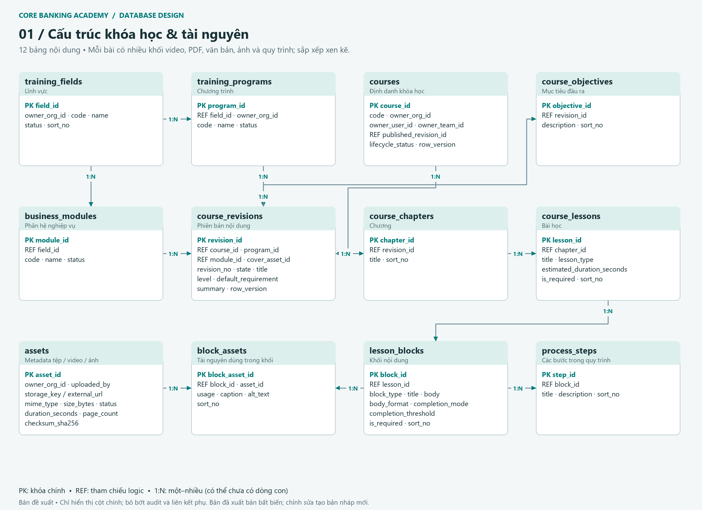
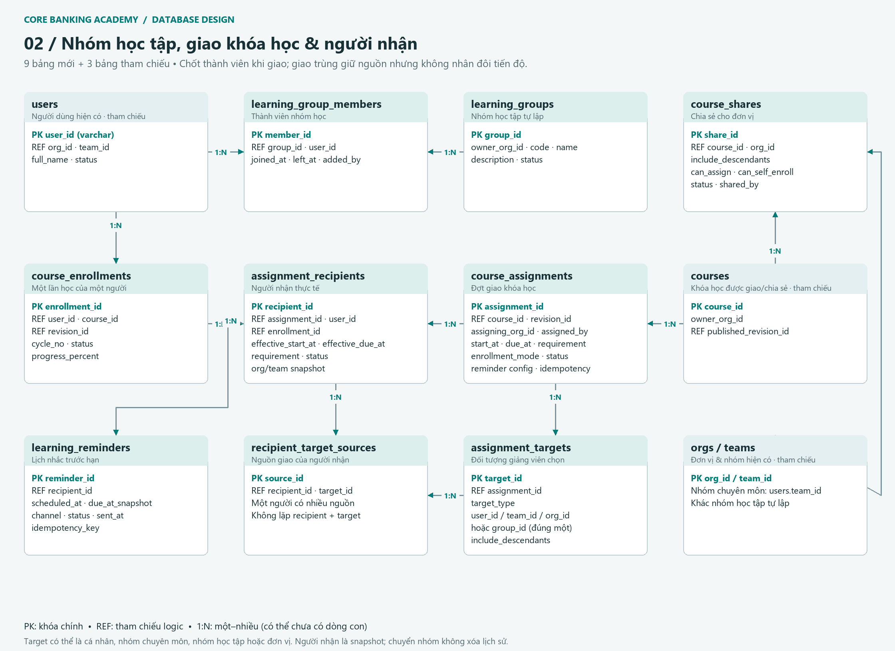

# API và dữ liệu Learning

Triển khai backend cho danh mục, tạo/sửa/sao chép/xuất bản khóa học, khối nội dung, tài nguyên, nhóm học, chia sẻ, giao học, tự đăng ký và tiến độ. Các quan hệ chỉ là cột ID scalar, không có FK/REFERENCES/cascade vật lý. Service kiểm tra tồn tại, sở hữu, quyền và vòng đời.

## Trạng thái kho tài nguyên

### Tiến độ học và điều kiện hoàn thành

`progressPercent` của lần học/thẻ khóa là trung bình tiến độ các bài bắt buộc, làm tròn xuống ba chữ số;
bài thi cuối riêng không được cộng vào mẫu số. Bài quiz nằm trong danh sách bài bắt buộc vẫn là một bài học.
100% tiến độ học chưa đồng nghĩa `status=completed`: cần đạt bài thi cuối khóa của đúng revision/lần học nếu có.
Khóa xuất bản phải có ít nhất một bài bắt buộc. Nội dung tùy chọn không làm giảm tiến độ bắt buộc.

GET chi tiết lần học trả thêm `completion`: `completedRequiredLessons`, `requiredLessons`,
`lessonsSatisfied`, `finalQuizId`, `finalExamStatus` (`NOT_REQUIRED`, `NOT_TAKEN`, `NOT_PASSED`, `PASSED`),
`allSatisfied`. Thi đã đạt nghĩa là có ít nhất một lượt SUBMITTED/AUTO_SUBMITTED đạt trên đúng enrollment;
lượt chu kỳ cũ không được dùng. `allSatisfied` là đánh giá điều kiện hiện tại, còn `enrollment.status/completedAt`
giữ lịch sử đã công nhận (chấm lại không tự thu hồi hoàn thành). FE hiển thị hai thông tin riêng, không tự tính kết quả.
Cấu hình dùng `course_completion_rules` và liên kết bài thi cuối theo revision; chưa thêm survey/attendance.
Giữ tên kỹ thuật cột/API `progress_percent`/`progressPercent`; đổi ý nghĩa được triển khai đồng bộ bằng script
`docs/sql/upgrade/2026-11-06-learning-completion.sql` và BE/FE mới.

File upload mới được lưu trong AIStor/S3 private, không lưu local lâu dài và không fallback khi S3 lỗi. BE local dùng endpoint AIStor Ubuntu truy cập được từ máy chạy BE; endpoint phải được người vận hành công bố hoặc cấp đường kết nối phù hợp. API upload/content giữ nguyên; không trả key/credential/public URL. Cấu hình, staging disk và nghiệm thu thật xem [triển khai AIStor](../operations/DEPLOY_UBUNTU.md#aistor-integration). Chưa deploy hoặc migrate dữ liệu server trong thay đổi source này.

### Contract tải tài nguyên

GET `/api/v1/learning-assets/{assetId}/content` giữ JWT/policy hiện có. Không Range trả 200; một Range dạng bytes=start-end, bytes=start- hoặc bytes=-suffix trả 206 với Content-Range/Content-Length/Accept-Ranges. Range sai, ngoài file hoặc nhiều range trả HTTP 416/CORE-RANGE_NOT_SATISFIABLE và Content-Range bytes */total. If-Range strong ETag khớp cho phép Range; không khớp hoặc dạng ngày trả toàn file. HEAD trả metadata/header mà không GET object.

Lỗi S3/metadata không nhất quán là lỗi hệ thống 500, không đổi thành ASSET_INVALID. Lỗi trước khi stream theo BaseResponse; sau khi binary đã bắt đầu, kết nối có thể kết thúc thiếu byte, không chèn JSON. Row storageType=local trả HTTP 200/ERROR, mã LEARNING-ASSET_STORAGE_UNSUPPORTED, yêu cầu chuyển dữ liệu. Player học viên dùng media cookie sau khi claim session; xem contract dưới đây. Không đưa token vào URL.

## Sơ đồ quan hệ dữ liệu

Ba ảnh dưới đây mô tả các bảng và cột chính để đọc cùng [hướng dẫn từng bảng](#hướng-dẫn-sử-dụng-từng-bảng).
Ảnh nằm tại `docs/diagrams/`, cùng phạm vi tài liệu dùng chung của repository, không phụ thuộc `docs/local/`.
Mở ảnh ở kích thước gốc để xem rõ tên cột.

- `PK` là khóa chính của bảng. `REF` là cột lưu ID của bảng khác; **không có khóa ngoại vật lý**.
- Mũi tên đi từ bảng cha sang bảng con; `1:N` là một–nhiều, có thể chưa có dòng con khi lưu nháp.
- Ảnh lược bớt cột audit, version và một số liên kết phụ. Định nghĩa đầy đủ hiện hành nằm trong
  [SQL Learning](../sql/learning_hub_learning.sql) và các entity của module Learning.

### 1. Khóa học, chương, bài học và tài nguyên



`courses` giữ định danh khóa, `course_revisions` giữ từng bản nội dung. Cây học tập là
**phiên bản khóa → chương → bài → khối nội dung**. Một bài có nhiều khối video/PDF/văn bản/ảnh/quy trình
được sắp xếp bằng `sort_no`; `block_assets` liên kết khối với tài nguyên tái sử dụng trong `assets`.

### 2. Nhóm học tập, giao khóa và người nhận



`assignment_targets` lưu đối tượng giảng viên chọn; `assignment_recipients` chốt từng người thực nhận khi giao.
`recipient_target_sources` giữ đủ nguồn khi một người được chọn qua nhiều nhóm hoặc cá nhân.
`course_enrollments` giữ một lần học, có thể đáp ứng nhiều nghĩa vụ giao cùng bản/kỳ mà không nhân đôi tiến độ.
`teams` là nhóm chuyên môn có sẵn; `learning_groups` là nhóm học tự lập có thành viên nhiều–nhiều.

### 3. Tiến độ và điều kiện hoàn thành


`lesson_progress` lưu tiến độ bài; `block_progress` giữ vị trí/tình trạng từng khối trong một lần học.
`video_watch_ranges` lưu các khoảng đã xem để tính coverage, không suy hoàn thành từ vị trí tua xa nhất.
Quan hệ revision → `course_completion_rules` có tối đa một dòng cấu hình mỗi bản, được tạo khi tạo revision.

`DraftRequest.finalQuizId` (nullable, số nguyên dương) chọn bài thi `FINAL_EXAM` cùng khóa để xét hoàn thành.
Sau khi lưu nháp, `CourseDetail` trả cùng giá trị ở `finalQuizId` và `completionRule.finalQuizId`. Không gửi hoặc gửi `null` khi lưu toàn
bộ bản nháp sẽ bỏ lựa chọn này; các bài quiz bắt buộc trong cây nội dung vẫn phải đạt. Khi xuất bản, đề đã chọn phải
đang `PUBLISHED`. Sao chép revision cùng khóa giữ lựa chọn; sao chép thành khóa mới xóa liên kết bài thi.
Backend đòi hoàn thành mọi bài học bắt buộc và đạt bài thi đã chọn, dựa trên kết quả của chính lần học hiện tại;
không tính bài quiz tùy chọn và không tự thu hồi lịch sử hoàn thành đã cấp. Bài thi ngoài cây được tính thêm một
thành phần tiến độ nên học xong nội dung chưa thể lên 100% khi còn thiếu bài thi. Migration DB hiện có:
[`2026-11-05-required-final-quiz.sql`](../sql/upgrade/2026-11-05-required-final-quiz.sql).

Các bảng `assessment_revisions` và `assessment_attempts` trong ảnh thể hiện **phần thiết kế tiếp theo,
chưa triển khai**; không nằm trong DDL Learning hiện tại. `course_assessments` đã có bảng điểm nối,
nhưng chưa có API Quiz Engine hoạt động (riêng dòng `placement=final` đang được dùng cho bài thi cuối khóa, xem mục bài kiểm tra cuối khóa bên dưới). Phần này không phải bằng chứng hệ thống đã chấm thi.

## Contract chung

- Business API dưới /api/v1, JWT hiện có; envelope BaseResponse giữ SUCCESS/ERROR và messageCode. Validation/lỗi nghiệp vụ trả HTTP 200/ERROR, thiếu xác thực 401, thiếu quyền 403, lỗi hệ thống 500.
- 50 operation công khai, Swagger tại /swagger-ui.html. [Bộ cURL và thứ tự kiểm tra](LEARNING_CURL.md), [Postman collection](../postman/learning.postman_collection.json).
- Swagger khai báo HTTP 200 cùng schema DTO cho từng API JSON; kiểm tra `status=SUCCESS` hoặc `ERROR` trong body. Tải tài nguyên trả binary HTTP 200, hoặc 206 khi dùng Range hợp lệ, không bọc BaseResponse.
- POST `/courses` nhận thêm `draft` (tùy chọn): nội dung bản nháp như PUT `/courses/{id}/revisions/{revisionId}` nhưng không có `expectedVersion` (`programId`, `moduleId`, `title`, `summary`, `level`, `defaultRequirement`, `coverAssetId`, `coverIcon`, `coverColor`, `objectives`, `chapters`, `rewardPoints`, `finalQuizId`). Có `draft` thì khóa, revision 1 và cả cây nội dung được ghi trong một transaction với cùng kiểm tra như lưu nháp; lỗi bất kỳ rollback toàn bộ nên không để lại khóa rỗng (mã `code` vẫn còn trống). `draft.title` ưu tiên hơn `title` ngoài. Không có `draft` thì giữ nguyên hành vi cũ. Response vẫn là `CourseDetail`, `revision.rowVersion` dùng ngay làm `expectedVersion` cho lần lưu kế tiếp. Audit chỉ ghi `COURSE_CREATED`.
- Phân trang page từ 0, size 1..100. Danh sách khóa hỗ trợ q, fieldId, programId, moduleId, level, requirement, learningStatus, state và sort=id/title/updateTime/dueAt,asc|desc. Scope được tính từ grant hiện tại và lọc trước pagination/count.
- Bộ lọc quản lý `state=draft|published` lọc trạng thái revision; `state=paused|archived` lọc lifecycle của khóa.
- Read model entity scalar dùng id làm khóa hiển thị. expectedVersion lấy rowVersion của đúng bản ghi: nội dung dùng revision, đổi lifecycle dùng course, thay thành viên dùng group, tiến độ dùng block_progress (chưa có dòng: 0).
- Lưu draft bằng PUT thay toàn bộ cây và cấp lại ID con; lấy lại ID sau mỗi lần lưu. Published revision bất biến; draft/copy tạo cây độc lập, không reset enrollment cũ.
- Giao học kích hoạt ngay và chốt người nhận kể cả startAt trong tương lai. Tối đa 500 người/đợt. Cùng khóa/bản/lần học giữ một enrollment; nhiều nguồn giữ đủ recipients/target_sources. Retake không cho tạo khi còn lần học đang mở, cần chính sách đóng kỳ riêng nếu muốn chuyển.
- Quản lý đợt giao sau khi tạo (API 37–40): danh sách theo đơn vị giao chỉ cần quyền quản lý `assigningOrgId`, lọc `courseId` tùy chọn, sort `id|startAt|dueAt|title`; mỗi dòng kèm `courseCode`, `courseTitle` (tên bản đã giao), `targets`, `people` (người nhận active), `completed` (lần học `completed`), `progressPercent` (completed*100/people, làm tròn xuống) và `overdue` (chưa hoàn thành, `effectiveDueAt` đã qua). Đổi lịch thay `startAt/dueAt/reminderEnabled/reminderDaysBefore` cho đợt và mọi người nhận active, hủy nhắc `pending` rồi lập lại; cần `expectedVersion` của đợt. Nhắc học ngay tạo nhắc in-app cho người nhận active chưa hoàn thành, tối đa một lần mỗi người mỗi ngày Asia/Ho_Chi_Minh (khóa `manual:recipient:{id}:{yyyy-MM-dd}`); đợt không có hạn trả lỗi validation `dueAt`. Thu hồi cả đợt chuyển `status=revoked`, thu hồi mọi người nhận active với cùng lý do, hủy nhắc; enrollment/điểm/tiến độ giữ nguyên. Đợt đã thu hồi không đổi lịch/nhắc được (`LEARNING-CONFLICT`); gọi thu hồi lại trả kết quả hiện tại.
- enrollment_origin giữ nguồn tạo lần học ban đầu; self_enrolled_at ghi nhận quyền tự đăng ký riêng nếu học viên đăng ký thêm sau khi đã được giao. Thu hồi giao không xóa quyền tự đăng ký còn hợp lệ và không viết lại nguồn ban đầu.
- Date/time trong JSON là ISO-8601 có offset hoặc Z. API nhận thời điểm đầy đủ; FE quy đổi ngày chọn sang cuối ngày Asia/Bangkok khi cần. Thời lượng lưu giây.
- Nội dung text hiện hỗ trợ Markdown/plain, từ chối HTML. FE phải render an toàn và sanitize Markdown/link theo ngữ cảnh; API không cung cấp HTML đã sanitize.
- Viewer/nội dung file chỉ mở khi khóa active, danh mục published và có nguồn học hợp lệ đã tới startAt (hoặc tự đăng ký còn quyền). Danh sách vẫn giữ metadata lịch sử khi khóa paused/archived; không dùng GET enrollment để bỏ qua lịch mở/thu hồi quyền học.
- Upload vào bucket S3 private; file local chỉ dùng staging tạm và được dọn; file signature + extension và giới hạn byte được kiểm tra. Thời lượng video/số trang PDF được BE kiểm bằng ffprobe/PDFBox; MP4 remux faststart, chưa transcode. Không trả storage key hoặc URL local. Download truyền stream S3 theo single byte range, học viên phải gửi enrollmentId và blockId.
- Nhắc học là thông báo in-app đến thời điểm đã lên lịch, không tích hợp email/SMTP. reward_points chỉ cấu hình, chưa cộng sổ gamification.
- Bài học loại quiz (`lessonType=quiz`) không có block và trỏ tới một đề của Assessment qua `quizId` (cột `course_lessons.quiz_id`, ID logic không FK; bài `content` luôn có `quizId=null`). Bản nháp được phép để `quizId` trống; `quizId` phải là đề của đúng khóa này và chưa xóa, nếu không trả `LEARNING-QUIZ_INVALID`. Xuất bản đòi mọi bài quiz trỏ tới đề PUBLISHED của khóa, nếu không trả `LEARNING-QUIZ_LESSON_UNLINKED`. Tạo bản nháp từ bản đã xuất bản giữ `quizId`; sao chép khóa sang khóa mới xóa `quizId` vì đề thuộc khóa cũ. Learning chỉ kiểm tra qua cổng `LearningQuizDirectory` (do Assessment hiện thực), không import class Assessment.
- Đạt đề thì bài quiz trỏ tới đề đó lên 100% và tiến độ khóa được tính lại (xem `docs/api/ASSESSMENT.md`). Bài quiz không cần mở để được thi: điều kiện `requireLessonsCompleted` của đề chỉ đếm bài `content`.
- **Bài kiểm tra cuối khóa.** `CourseDetail` có thêm `finalQuizId` (nullable, ở cấp cao nhất, không đổi trường cũ). PUT `/courses/{id}/revisions/{revisionId}` và `draft` của POST `/courses` nhận thêm `finalQuizId` (tùy chọn):
  - Phải là đề `FINAL_EXAM` chưa xóa của đúng khóa này; đề thiếu, đã xóa, của khóa khác hoặc loại khác (ví dụ `PRACTICE`) trả `LEARNING-QUIZ_INVALID` với lỗi trường `finalQuizId`. Đề còn `DRAFT` vẫn được lưu; việc đề phải đã xuất bản chỉ bị chặn khi xuất bản.
  - **Lưu không gửi `finalQuizId` (hoặc null) là xóa bài thi cuối khóa của bản nháp**, như mọi trường khác của cây nháp. Máy khách cũ không biết trường này vì vậy sẽ xóa lựa chọn khi lưu.
  - Lưu đồng bộ `course_completion_rules.final_quiz_id` và dòng `course_assessments` có `placement=final`: mỗi revision có tối đa một dòng, được thay mới ở mỗi lần lưu nháp với `assessment_revision_id` = **ID đề** (đề không có phiên bản; cột chỉ mang tên cũ), `lesson_id=null`, `is_required=true`, `sort_no=0`, `opens_at`/`closes_at=null`; `pass_score_percent`, `max_attempts`, `allow_retake` chụp từ đề tại thời điểm lưu chỉ để hiển thị. Khi đọc, ưu tiên dòng `placement=final`; nếu chưa có thì dùng `final_quiz_id`, để giữ cấu hình của cả hai dạng dữ liệu. DB đang chạy cần migration `2026-11-05-required-final-quiz.sql` trước khi nâng backend.
  - Tạo bản nháp từ bản đã xuất bản giữ `finalQuizId`; sao chép khóa sang khóa mới xóa nó vì đề thuộc khóa cũ.
  - Xuất bản: đề phải `PUBLISHED`, chưa xóa, `FINAL_EXAM` và của khóa này, nếu không trả `LEARNING-FINAL_EXAM_UNPUBLISHED`. Mã `LEARNING-QUIZ_UNAVAILABLE` vẫn còn trong danh sách mã nhưng xuất bản không còn trả nó.
  - Hoàn thành khóa: lần học trên revision có bài thi cuối chỉ hoàn thành khi mọi bài bắt buộc đạt 100% **và** có ít nhất một lượt của chính học viên, đúng `enrollmentId`, đã chấm `SUBMITTED`/`AUTO_SUBMITTED` với `passed=true`. Không dùng kết quả của lần học cũ hoặc lượt `VOIDED`. Theo thứ tự nào cũng được: đạt đề kích hoạt tính lại khóa dù không có bài quiz nào trỏ tới đề. Bài thi ngoài cây tính thêm một thành phần tiến độ; đề đã là bài quiz bắt buộc không bị cộng hai lần. Hoàn thành chỉ tăng, chấm lại trượt về sau không hạ.
  - Quy tắc thuộc về revision: lần học trên revision cũ hơn hoặc revision không có bài thi cuối khóa hoạt động như trước.
- Thao tác ghi Learning dùng chung advisory transaction lock với Identity để bảo vệ grain và tham chiếu xuyên module khi chưa có UNIQUE/FK. Xóa team bị chặn nếu còn course, target hoặc snapshot học tập tham chiếu. Đây là lựa chọn ban đầu cho correctness; chưa benchmark tải lớn. Không mở rộng thành nhiều khóa trước khi đo và thiết kế thứ tự khóa.

<a id="my-learning-progress-design"></a>

## API media và tiến độ cá nhân

Đã triển khai theo `learning_hub_media_progress.sql` v2 rút gọn. Người vận hành xác nhận đã áp dụng SQL;
ứng dụng vẫn `ddl-auto=validate`, Flyway off. Các API mới dưới đây cần schema extension trước khi khởi động.
Không có job tự abort/xóa media S3 theo retention; hủy upload là yêu cầu trực tiếp qua API, xóa asset là xóa mềm.
Phần Nginx cần cấu hình vận hành riêng, chưa tự triển khai lên server. Quiz Engine/activity/streak/năng lực chưa có nguồn thực.

### API bổ sung

Prefix `/api/v1`; endpoint nghiệp vụ dùng BaseResponse, lỗi logic HTTP 200/ERROR, xác thực 401, quyền 403, hệ thống 500.

| API | Trách nhiệm |
|---|---|
| GET `/learning-assets` | Thư viện trong scope, q/mediaType/status, page/size/sort=id,name,createTime |
| POST `/learning-assets/uploads` | Khởi tạo/retry theo requestId, trả uploadId/assetId/partSize/expiresAt |
| GET `/learning-assets/uploads/{uploadId}` | Manifest phần đã ACK và trạng thái xuyên suốt upload/processing |
| PUT `/learning-assets/uploads/{uploadId}/parts/{partNumber}` | Bytes phần + X-Part-SHA256, kiểm size/hash và retry idempotent |
| POST `/learning-assets/uploads/{uploadId}/complete` | Kiểm manifest, đưa vào hàng đợi DB, chưa đồng nghĩa ready |
| DELETE `/learning-assets/uploads/{uploadId}` | Caller chủ phiên yêu cầu abort multipart chưa complete, retry được |
| DELETE `/learning-assets/{assetId}` | Xóa mềm asset chưa được tham chiếu, không tự xóa bytes S3 |
| POST `/me/learning/sessions` | Claim/handoff/takeover một phiên học trên toàn tài khoản |
| GET `/me/learning/progress/summary` | Counts theo cycle hiện hành của caller và `assessment` (điểm trên đề của các khóa hiện tại); chỉ trả chỉ số có nguồn thật |
| GET `/me/learning/progress/export` | CSV cùng filter/scope/sort của courses, tối đa 10.000 dòng |
| GET `/me/learning/facets` | Lĩnh vực, chương trình, phân hệ mà ít nhất một khóa trong danh mục của caller dùng |
| GET `/me/learning/courses/{courseId}` | `LearnerCourse { card, content }`: thẻ như `/catalog` và cây nội dung của một khóa caller thấy được |

Đã mở rộng GET `/me/learning/courses`: overdue=true/false, sort progressPercent/startedAt/lastAccessAt/completedAt;
trả thêm cycleNo, startedAt, lastAccessAt, completedAt, lastLessonId/lastBlockId, completedRequiredLessonCount,
requiredLessonCount, deadlineStatus, mediaAssetId, lastPdfPage, lastVideoPositionSeconds. Các field cũ được giữ.
Các field resume hiện trả phẳng trong CourseCard; không dùng object minh họa từ bản thiết kế cũ làm contract.
CourseCard trả thêm fieldId, fieldName, programName, moduleName và failed (thêm ở cuối, các field cũ giữ nguyên).
Tên lĩnh vực/chương trình/phân hệ là null khi khóa chưa gán chương trình hoặc phân hệ. failed = học viên đã thi bài thi
cuối khóa (PUBLISHED, chưa xóa) ít nhất một lượt đã chấm (SUBMITTED, AUTO_SUBMITTED) và chưa đạt lượt nào; Learning lấy
tập khóa qua cổng LearningQuizDirectory, không đọc bảng Assessment. Danh sách giảng viên (MANAGE) không gọi cổng và luôn
trả failed=false.
CourseCard trả thêm bestScorePercent ở cuối: điểm cao nhất (`bestScore`, % với 2 chữ số) của các lượt đã chấm trên bài thi
cuối khóa (FINAL_EXAM, PUBLISHED, chưa xóa) của khóa, theo cùng quy tắc `AttemptSummary` của đề. Null khi khóa không có bài
thi cuối, caller chưa có lượt chấm nào hoặc ở danh sách giảng viên (MANAGE, không gọi cổng). Có trên `/courses`,
`/catalog`, `/courses/{courseId}` (trong `card`) và trong CSV; mỗi trang chỉ một lần gọi `LearningQuizDirectory.scores`.
Đề luyện tập không được tính vào thẻ khóa học.
CourseCard trả thêm `rating` ở cuối: `{ average, count }` là trung bình các đánh giá bài học còn sống của khóa, làm tròn một
chữ số thập phân, và số đánh giá, **qua mọi phiên bản** của khóa. Null khi khóa chưa có đánh giá nào. Có trên `/courses`,
`/catalog`, `/courses/{courseId}` (trong `card`) và danh sách giảng viên (MANAGE); mỗi trang chỉ một truy vấn gom nhóm. CSV
không có cột này. Xem [Phản hồi bài học](#phản-hồi-bài-học).
CourseCard trả thêm `certificateId` ở cuối: `enrollmentId` của thẻ khi lần học của thẻ có `learningStatus = completed`, ngược
lại `null` (chưa đăng ký, đang học, ở danh sách giảng viên). Là giá trị suy ra từ hai field có sẵn, không phải cột và không
đổi SQL tìm kiếm; có trên `/courses`, `/catalog` và `/courses/{courseId}` (trong `card`). Thẻ chỉ mô tả lần học hiện tại,
nên học viên đang học lại một khóa đã hoàn thành có `certificateId = null`; chứng nhận của lần trước vẫn có trong danh sách.
Xem [Chứng nhận](#chứng-nhận).

Bộ lọc của danh sách học viên: GET `/me/learning/courses` và `/me/learning/catalog` nhận thêm `assigned` (true chỉ lấy
khóa caller có đợt giao còn hiệu lực, cùng biểu thức với cờ assigned của thẻ), `failed` (true chỉ lấy khóa trong tập
failed ở trên, false loại các khóa đó) và `overdue` (catalog nhận thêm; courses đã có). `/me/learning/progress/export`
nhận cùng bộ lọc với `/courses`. Các bộ lọc kết hợp được với nhau và với `learningStatus`; mỗi bộ lọc true/false.
Trên thẻ học viên, `assigned`, nghĩa vụ bắt buộc và `dueAt` chỉ xét recipient còn hiệu lực đã đến `effectiveStartAt`;
nếu chỉ có lượt giao tương lai thì không lấy hạn tương lai làm hạn hiện hành. Với `/me/learning/courses`, lọc
`requirement=mandatory` yêu cầu có nghĩa vụ bắt buộc hiện hành; lọc loại khóa trong catalog vẫn theo contract tìm kiếm catalog.

GET `/me/learning/facets` trả `{ fields[], programs[], modules[], fieldsWithUnclassifiedCourses[] }`, mỗi mục danh mục
gồm `{ id, code, name }`; chương trình và phân hệ có thêm `fieldId`. Chỉ có giá trị được ít nhất một khóa nhìn thấy trong
`/catalog` dùng (cùng quy tắc nhìn thấy, gồm
khóa đã đăng ký, khóa của đơn vị mình và khóa được chia sẻ), sắp theo `sortNo` rồi tên. Học viên không cần quyền đọc
`/training-catalog`.

`fieldsWithUnclassifiedCourses` chứa ID lĩnh vực có khóa chưa có phân hệ hợp lệ, hoặc `null` nếu khóa không có lĩnh vực.
GET `/me/learning/catalog?withoutModule=true` lọc nhóm này cùng các bộ lọc khác. Không gửi cùng `moduleId`.

GET `/me/learning/courses/{courseId}` trả `{ card: CourseCard, content: CourseDetail }`. `card` là kết quả search CATALOG
theo `courseId`, nên quy tắc nhìn thấy, bản revision và cờ failed giống `/catalog`. `content` là bản revision của `card`:
bản đã nhận khi caller có lần học, bản xuất bản hiện hành (kể cả sau khi có bản mới hơn thì lần học vẫn giữ bản cũ) khi chưa
đăng ký. Chưa đăng ký thì cây chương/bài được giữ, mỗi bài có `blocks` rỗng để không đọc được nội dung khi chưa học;
quyền đọc media không đổi. Khóa ngoài phạm vi hoặc không tồn tại trả `LEARNING-NOT_FOUND` (mã không tìm thấy sẵn có của
Learning, không thêm mã riêng cho khóa học).

GET `/me/learning/progress/summary` trả thêm `counts.assigned` và `counts.mandatory`: tổng của danh sách `/courses` với
`assigned=true` và `requirement=mandatory`, cùng truy vấn với danh sách nên tab "Được giao" và "Bắt buộc" luôn khớp số
trên danh sách.
GET enrollment đã có cây revision + tiến độ từng block, dùng để khôi phục player; không cần API resume riêng.

### Upload và kiểm file

Init ví dụ (ID và hash chỉ minh họa, phải lấy theo file/đơn vị thực):

```json
{
  "requestId": "550e8400-e29b-41d4-a716-446655440000",
  "ownerOrgId": 1,
  "originalName": "demo.pdf",
  "mimeType": "application/pdf",
  "sizeBytes": 12345,
  "checksumSha256": "aaaaaaaaaaaaaaaaaaaaaaaaaaaaaaaaaaaaaaaaaaaaaaaaaaaaaaaaaaaaaaaa"
}
```

- requestId UUID là khóa idempotency và trở thành uploadId; cùng actor/metadata trả lại asset cũ,
  thay metadata hoặc tái dùng ID của người khác bị từ chối. UUID không thay kiểm quyền.
- Phiên 24 giờ, phần 8 MiB, phần cuối đúng số byte còn lại. File gốc tối đa video 500.000.000 byte,
  PDF 20.000.000 byte, ảnh 5.000.000 byte, Office attachment 10.000.000 byte. FE tính SHA-256 tăng dần,
  không nạp cả video vào RAM. PUT part dùng application/octet-stream, không bọc JSON/form-data.
- Mỗi part có hash/size bất biến. ACK sau S3 + commit manifest; retry không cộng uploadedBytes lần hai.
  Part đang truyền có reservation; nếu BE chết, thử lại sau giới hạn timeout/reservation thay vì gửi song song cùng part.
- GET upload trả parts đã ACK; reconnect chỉ gửi phần thiếu. Mở browser lại có thể phải chọn lại đúng file;
  local storage chỉ giữ ID hỗ trợ tìm phiên, DB/S3 là nguồn chuẩn. UI hiển thị upload và processing riêng.
- Complete chuyển `completing` → `processing` → `ready` hoặc `failed`. Worker một luồng, hàng đợi/lease trong DB,
  retry hệ thống có giới hạn; mất ACK complete S3 được đối soát theo object key trước khi thử lại.
  Đối soát provider với manifest DB, kiểm lại whole-file SHA-256; ETag không thay SHA-256.
  Worker giữ lease 300 giây, gia hạn mỗi 60 giây; tối đa 3 lần thử lỗi hạ tầng trong một lượt xử lý.
  Nếu failed với LEARNING-MEDIA_PROCESSING_UNAVAILABLE, caller có thể POST complete để thử lại bytes đã lưu.
  Không áp dụng retry này cho checksum/codec/file không hợp lệ.
- GET upload trả mimeType/durationSeconds/pageCount/mediaCheckedAt sau xác minh; FE không tự suy ready từ uploadedBytes.
- PDFBox xác định số trang PDF, từ chối PDF mã hóa/lỗi; ffprobe xác định codec/duration.
  MP4 hợp lệ đến 500 MB được chuẩn hóa để phát trên trình duyệt. H.264/yuv420p + AAC được remux
  faststart; HEVC, video 10-bit, MPEG-4 hoặc audio khác được chuyển sang H.264/yuv420p + AAC.
  Audio là tùy chọn, chỉ track hình chính và track audio đầu tiên được dùng. File hỏng/mã hóa hoặc
  không có video vẫn trả lỗi xác minh. MP4 học tập áp dụng giới hạn dung lượng, không giới hạn 24 giờ.
  Timeout chuyển đổi riêng là `app.learning.media.transcode-timeout` (mặc định 6 giờ); worker tiếp tục
  gia hạn lease trong khi chạy. Bản chuyển đổi tối đa 1920×1080, bitrate theo thời lượng để giới hạn
  dung lượng rendition. File gốc và rendition có key/size/MIME/hash riêng.
  WebM giữ VP8/VP9 + Opus/Vorbis.
- POST upload một request cũ vẫn dùng được, nay kiểm file thật cùng pipeline đồng bộ; durationSeconds/pageCount
  vẫn nhận để tương thích nhưng không dùng làm dữ liệu xác minh. Không còn đường bỏ qua kiểm codec/page count.
- Cần `ffprobe`, `ffmpeg` trên PATH máy chạy BE hoặc cấu hình app.learning.media.ffprobe/ffmpeg.
  Dockerfile đã cài ffmpeg; local chưa cài thì video không thể ready, PDF không cần công cụ này.
  [FFprobe](https://ffmpeg.org/ffprobe.html), [MP4 faststart](https://ffmpeg.org/ffmpeg-formats.html#mov_002c-mp4_002c-ismv).
- Chỉ asset ready, chưa xóa mềm, đúng quyền/đơn vị mới được attach. Dùng chung qua tham chiếu;
  xóa block không xóa file. Asset còn được revision, attachment, cover hoặc tiến độ tham chiếu không được xóa mềm.
  Tài nguyên/upload hết hạn vẫn giữ để vận hành đối soát; chưa có tự purge hoặc tự abort theo lịch.

Khối văn bản HTML hỗ trợ bảng (`table/thead/tbody/tr/th/td`, colspan/rowspan 1–100) và ảnh nội tuyến.
Ảnh lưu bằng ``, kèm `assets[{assetId:123,usage:"image"}]` của chính khối.
Ảnh PNG/JPEG/WebP dùng cùng upload chia phần và hạn mức 5 MB, tối đa 20 ảnh mỗi khối.
Backend kiểm ownership/readiness và tham chiếu asset, loại URL ảnh bên ngoài, event handler và script.
Frontend tải blob qua API content có token, học viên gửi enrollmentId/blockId. URL blob chỉ tồn tại lúc xem.
Chế độ mã HTML và dán bảng qua clipboard dùng chung sanitizer. Script nhập trong chế độ mã được hiển thị
dưới dạng `pre/code` trong nội dung bài học.

### Nguồn mã nghiệp vụ, giới hạn và cấu hình

- `learning.constants.LearningCodes`: mã trạng thái/loại nội dung/sự kiện và allowlist/regex dùng chung.
  Giá trị JSON/DB giữ nguyên; revision, catalog, assignment và upload có nhóm riêng.
- `learning.constants.LearningLimits`: giới hạn số bài/khối/người nhận, dung lượng, kích thước part,
  giới hạn CSV và quy tắc coverage. DTO/service/thông báo dùng cùng giá trị khi cùng ràng buộc.
- `learning.config.LearningMediaProperties`: cấu hình dưới prefix `app.learning.media`.
  Các mặc định bên dưới giữ hành vi hiện tại; không cần bổ sung `.env` khi không override.

| Thuộc tính | Mặc định | Ý nghĩa |
|---|---|---|
| session-lease | 60s | Thời hạn quyền ghi tiến độ |
| media-token-ttl | 5m | Hạn cookie, vẫn bị giới hạn bởi JWT gốc |
| upload-ttl | 24h | Thời hạn upload mới; không đổi phiên đã lưu |
| processing-lease | 5m | Lease worker, được gia hạn theo claim |
| processing-heartbeat | 1m | Chu kỳ gia hạn claim worker |
| retry-delay | 30s | Khoảng chờ giữa lần xử lý lỗi hạ tầng |
| reservation-grace | 30s | Biên thời gian cộng sau timeout multipart thực tế |
| max-event-gap | 30s | Khoảng checkpoint tối đa được dùng tính coverage |
| probe-timeout | 120s | Timeout mỗi lệnh ffprobe/ffmpeg |
| poll-ms | 3000 | Chu kỳ poll worker, đơn vị mili giây; giữ tên cấu hình cũ |
| initial-delay | 15s | Chờ trước lần poll đầu |
| max-processing-attempts | 3 | Số lần xử lý lỗi hạ tầng trong một lượt |
| ffprobe / ffmpeg | ffprobe / ffmpeg | Tên lệnh hoặc đường dẫn executable |
| gateway-key | rỗng | Key nội bộ; vẫn hỗ trợ MEDIA_GATEWAY_KEY, không công bố giá trị |

Duration nhận đơn vị như `60s`, `5m`, `24h`; phải dương. Heartbeat phải nhỏ hơn processing-lease;
max-event-gap phải nhỏ hơn session-lease. Cấu hình sai làm startup thất bại rõ ràng.
Đổi timeout/lease cần cân đối với nhịp checkpoint FE và kiểm chứng trên topology thật.

### Phiên học và checkpoint

Claim sau khi lấy enrollment detail:

```json
{
  "enrollmentId": 101,
  "blockId": 401,
  "takeover": false
}
```

Response data có sessionId, sessionFence, leaseExpiresAt, lastAcceptedSequence, enrollmentId/blockId/assetId,
expectedVersion và resume (BlockProgressView hoặc null). Cookie `academy_media` HttpOnly được đặt riêng cho player.
Một learning lease trên user bao trùm mọi course/block, không giới hạn việc đọc dashboard hoặc mọi phiên login.

- Thiết bị khác đang học: LEARNING-SESSION_IN_USE. FE hỏi xác nhận, sau đó gửi takeover=true để chuyển.
- Đổi bài trong cùng player: gửi previousSessionId/previousFence đang giữ; server kiểm rồi cấp session/fence mới.
  Không tự takeover khi render. Retry claim cùng cặp/session và cùng block trả phiên hiện hành.
- Lease 60 giây. FE checkpoint khoảng 10 giây, khi pause/ended, đổi bài, PDF đổi trang và trước logout.
  Chỉ báo đã lưu sau ACK; đóng browser/crash chỉ bảo đảm tới checkpoint đã commit, không hứa không mất byte cuối.
- PUT progress giữ URL cũ, **bổ sung các field session bắt buộc**. FE phải claim trước, không còn ghi chỉ bằng
  expectedVersion/sequence cũ. Sequence bắt đầu 1 trong phiên mới, không phải số tăng toàn đời một block.

Ví dụ lưu trang PDF (expectedVersion lấy từ session hoặc response tiến độ gần nhất):

```json
{
  "sessionId": "550e8400-e29b-41d4-a716-446655440001",
  "sessionFence": 1,
  "expectedVersion": 0,
  "sequence": 1,
  "eventType": "PDF_PAGE",
  "assetId": 501,
  "playing": false,
  "complete": false,
  "pdfPage": 12
}
```

- eventType: OPEN/PLAY/HEARTBEAT/PAUSE/SEEK/PDF_PAGE/COMPLETE/CLOSE. Video gửi videoPositionSeconds;
  chỉ gửi watchedFromSeconds/watchedToSeconds cho đoạn phát từ checkpoint trước, không gửi cho SEEK/OPEN.
  playing=true khi thực sự phát, false khi pause/close; backend kiểm sự kiện trước, vị trí và thời gian server.
- Một request tiến độ đang chờ cho mỗi player; retry nguyên payload nếu mất response. Cùng sequence/hash cuối
  được ACK lại không side effect, không gia hạn lease; cùng sequence khác payload hoặc sequence nhảy bị từ chối.
  Sau xung đột lấy lại enrollment/session hiện hành; không sửa version rồi tự gửi lại vô hạn.
- Response PUT progress có session receipt: sessionId/sessionFence/lastAcceptedSequence/leaseState/leaseExpiresAt.
  FE dùng hạn tuyệt đối từ server; ACK trùng không có nghĩa lease vừa được gia hạn. data.block.rowVersion là
  expectedVersion cho lần ghi tiếp theo; leaseState=released sau CLOSE.
- CLOSE lưu checkpoint và release trong cùng transaction, retry CLOSE vẫn ACK tới lần claim mới.
  Session/fence sai hoặc đã chuyển thiết bị không được ghi, kể cả gửi trực tiếp URL.
- Resume có thể lùi khi tua/lật lại trang; coverage và kết quả đã hoàn thành không giảm.
  Hợp khoảng video không cộng trùng khi xem lại; tua tới cuối không tính đoạn tua qua.
  Credit tối đa theo 2x và đồng hồ server giữa heartbeat liên tiếp, gap trên 30 giây không được backfill coverage.
- Video chạm ngưỡng thì block hoàn thành; PDF manual cần xác nhận, pdf_end chỉ chứng minh mở trang cuối.
  Bài cần đủ các block required; khóa cần đủ bài required. Bài quiz chỉ hoàn thành khi học viên đạt đề trỏ tới (không có block để tự đánh dấu).
- Với block `attachment` có completion mode `open`, mở block hoặc gửi `OPEN` chưa tự hoàn thành. Client gửi sự kiện
  `COMPLETE` với `complete=true` sau khi tải thành công; BE kiểm tra session, quyền và áp dụng progress như các sự kiện khác.
  Đối với các loại block khác dùng mode `open`, hành vi hoàn thành khi mở vẫn giữ nguyên. Khối đã hoàn thành không bị hạ
  khi mở lại hoặc lần tải sau gặp lỗi.
- Block mới gắn media_asset_id. Legacy dùng block_assets primary khi scalar còn NULL; nếu hai nguồn lệch thì báo
  MEDIA_CHANGED, không chọn file tùy ý. Thay file tạo asset/revision mới, giữ tiến độ của enrollment revision cũ.

### Media cho browser và gateway

Player cùng origin qua dev/reverse proxy là hướng tích hợp khuyến nghị. POST sessions/PUT progress dùng Bearer như API khác;
video/iframe src dùng cookie media, không đưa JWT vào URL. Cookie sống tối đa 5 phút, được làm mới sau checkpoint,
không vượt hạn JWT gốc; lease thực 60 giây vẫn được kiểm trên mỗi request. HTTPS đặt Secure; proxy cần truyền đúng scheme.
Media token chỉ được dùng trên GET/HEAD content hoặc gateway authorization, không cấp quyền gọi API ghi/auth/me.
Học viên tải nội dung cần đúng enrollmentId/blockId, quyền còn hiệu lực và media token gắn session/fence hiện hành.
FE cùng origin tải attachment qua GET content với cả `blockId` và `enrollmentId` dùng cookie media, không gửi Bearer
access token trên request này; nếu gửi cả hai, resolver ưu tiên Bearer và access token thông thường không thay được media token.
CORS cho media/session/progress cho phép credentials với origin cấu hình cụ thể, không dùng wildcard.
FE khác port nhưng cùng site cần credentials:include/withCredentials; SameSite=Strict không dành cho nhúng khác site.
PDF content dùng X-Frame-Options=SAMEORIGIN; muốn iframe hoạt động hãy proxy FE/API về cùng origin.
Author preview tiếp tục dùng Bearer và quyền biên soạn. Bytes đã buffer không thể bị thu hồi, đây không phải DRM.

Gateway nội bộ (ẩn Swagger) GET `/learning-assets/{assetId}/gateway-authorization`:

- Cần Bearer/cookie hợp lệ và header X-Media-Gateway-Key khớp MEDIA_GATEWAY_KEY tối thiểu 32 byte.
  Mặc định key trống thì từ chối, không tự mở endpoint. X-Original-Method chỉ nhận GET/HEAD.
- Query blockId/enrollmentId như content; response 200 có X-Media-S3-Url ký 60 giây, chỉ cho Nginx gọi nội bộ.
  Không chuyển header/URL này cho FE. Mọi lỗi quyền/nghiệp vụ/tham số bị từ chối, hệ thống trả 5xx.
- Nginx auth_request dùng 2xx cho phép, 401/403 từ chối; không đọc BaseResponse.status.
  Nginx cần internal subrequest, forward auth/cookie tới BE, rồi proxy Range/HEAD tới URL S3 đã ký;
  xóa Authorization/Cookie của người dùng trước khi chuyển sang S3, không bật shared cache bỏ qua auth.
- Chưa tự deploy/kiểm chứng Nginx/AIStor Ubuntu trong thay đổi này. Mặc định content vẫn qua ObjectDownloadHandler
  với Range/If-Range/HEAD như trước; chỉ nghiệm thu offload sau khi cấu hình proxy và thử player thật.

### Summary, CSV và thông tin gửi FE

Summary trả serverTime, timeZone=Asia/Ho_Chi_Minh và counts total/completed/inProgress/notStarted/overdue trên
cycle hiện hành; không phụ thuộc trang/tìm kiếm bảng, không đếm lặp nhiều đợt giao cùng enrollment.
activity/competency trả availability=unavailable; không tạo giờ học/streak/radar bằng số 0 giả.
Demo nên dùng bốn KPI Hoàn thành/Đang học/Chưa bắt đầu/Đang quá hạn.

`assessment` là `{ availability: "unavailable" }` khi các khóa hiện tại của caller (cùng tập khóa với `counts`, tức danh
sách `/courses`) không có đề PUBLISHED nào; ngược lại là `AssessmentOverview`, kể cả khi caller chưa thi lần nào:

| Field | Ý nghĩa |
|---|---|
| `availability` | Luôn `available` |
| `last` | Lượt chấm gần nhất qua mọi đề: `quizId`, `quizTitle`, `courseId`, `attemptId`, `scorePercent`, `passed` (kết quả của chính lượt đó), `submittedAt`; null khi chưa có lượt chấm |
| `bestScorePercent` | Điểm cao nhất (`bestScore`) qua các đề; null khi chưa có lượt chấm |
| `averageScorePercent` | Trung bình `finalScore` của từng đề đã có lượt chấm (một số cho mỗi đề, không phải mỗi lượt), 2 chữ số, làm tròn lên từ .5; null khi chưa có lượt chấm |
| `passedQuizCount` | Số đề có `passed = true` theo `scoreMethod` của đề |
| `quizCount` | Số đề PUBLISHED, chưa xóa của các khóa hiện tại, gồm cả đề luyện tập |

Lượt chấm là SUBMITTED hoặc AUTO_SUBMITTED; IN_PROGRESS và VOIDED không tính. Learning lấy điểm qua cổng
`LearningQuizDirectory.scores`; Assessment tính bằng cùng quy tắc `AttemptSummary` của màn giới thiệu đề
(`GET /me/quizzes/{quizId}`), nên con số trên tổng quan và trên đề không thể lệch nhau.

Ngày bắt đầu khác ngày ghi danh; completedAt giữ khi xem lại. Deadline là trạng thái riêng: no_deadline,
on_time_active, overdue_active, completed_on_time, completed_late. Hoàn thành muộn không còn trong KPI đang quá hạn.
CSV có các cột Mã khóa, Tên khóa, Lần học, Trạng thái, Tiến độ, Bắt đầu, Truy cập gần nhất, Hoàn thành, Hạn, Trạng thái
hạn, Điểm cao nhất; cột mới nằm cuối để vị trí các cột cũ không đổi. Điểm cao nhất là `bestScorePercent` của thẻ khóa
(ô trống khi null).
List/export cùng query/filter/sort/scope; CSV UTF-8 BOM, escape quote/newline và công thức bảng tính,
vượt 10.000 dòng báo lỗi rõ thay vì cắt im lặng. API summary độc lập với filter của bảng.

<a id="media-progress-scenarios"></a>

### Điểm học tập và bảng xếp hạng

XP đọc từ sổ ghi XP (`xp_ledger`, chỉ cộng thêm, một dòng mỗi lần nhận XP), không tính lại từ tiến độ nên xóa hoặc đổi khóa, đề không làm mất XP đã nhận. Chỉ học viên (`LEARNER`, scope `OWN`)
có điểm; vai trò khác nhận 403 `CORE-ACCESS_DENIED`. Hạng phụ thuộc phạm vi nên không nằm trong `/points`.

| API | Trách nhiệm |
|---|---|
| GET `/me/learning/points` | `MyPoints { total, parts { lessons, quizzes, firstTryBonus, courses }, streakDays }` của caller |
| GET `/me/learning/leaderboard?scope=team\|org\|all&period=week\|month\|all&offset` | `Leaderboard { period, offset, from, to, top, me, above, gapToAbove }`; `scope` mặc định `org`, `period` mặc định `month`, `offset` mặc định 0 (lùi về tuần/tháng trước, bỏ qua khi `period=all`); không phân trang, không tổng số người |
| GET `/me/learning/leaderboard/units?period=week\|month\|all&offset` | `UnitLeaderboard { period, offset, from, to, top, myUnit, myUnitTooSmall }`; `UnitRow { rank, orgId, unitName, averageXp, participationPercent, mine }`. Chỉ đơn vị từ 5 học viên được xếp hạng; `averageXp` = XP trung bình mỗi học viên có XP trong kỳ, `participationPercent` = % học viên có ít nhất một ngày học đủ điều kiện; top 10 + đơn vị của người gọi, không trả các hạng cuối; `myUnit` null và `myUnitTooSmall` true khi đơn vị chưa đủ 5 học viên; đồng điểm chung hạng |
| GET `/me/learning/preferences` | `LearnerPreferences { showOnLeaderboard }` của chính người gọi, mặc định `true`; chỉ học viên |
| PUT `/me/learning/preferences` | Body `{ showOnLeaderboard }` (bắt buộc). `false`: người khác không thấy tên trên bảng cá nhân và hạng khép lại (không có dòng "Ẩn danh"); chính học viên vẫn thấy hạng mình sẽ có nếu hiện; XP vẫn tính vào đơn vị. Chỉ sửa được tùy chọn của chính mình; trả giá trị đang áp dụng |

`LeaderboardRow { rank, userId, fullName, teamName, points, streakDays, me }`. `points` bằng `total` của `/points` cho cùng
người, nên thẻ điểm và bảng không lệch nhau.

Bảng xếp hạng (`/leaderboard`):

- **Ai được xếp hạng**: học viên active, đã đổi mật khẩu, có vai trò `LEARNER` scope `OWN`, cùng điều kiện với giao học
  (`UserRepository.findLearningCandidates`, dùng lại qua `LearningIdentityService.rankableLearners`). `team` là nhóm của
  caller, `org` là đơn vị của caller (không gồm đơn vị con), `all` là mọi học viên đủ điều kiện trong hệ thống, kể cả đơn vị
  khác (xem tên người của đơn vị khác là quyết định nghiệp vụ, mặc định bật như mockup "Toàn hệ thống").
- **Kỳ**: XP của kỳ là tổng các dòng sổ XP có `occurred_at` trong kỳ theo giờ Asia/Ho_Chi_Minh; `week` là thứ Hai đến Chủ nhật,
  `month` là tháng dương lịch, `all` là mọi lúc (khớp thẻ XP). `from`/`to` là ngày đầu và ngày cuối của kỳ (null khi `all`).
- **Trả về**: `top` là tối đa 10 người đầu; `me` là dòng của caller; khi caller ngoài top 10, `above` là 1-2 người ngay
  trên caller và `gapToAbove` là XP còn thiếu để vượt người gần nhất có XP cao hơn. Trong top 10 thì dòng của caller nằm
  ngay trong `top` (`me = true`), `above` rỗng và `gapToAbove` null.
- **Thứ tự**: XP giảm dần, cùng điểm xếp theo họ tên (Collator `vi`) rồi mã cán bộ. Cùng điểm chung hạng và hạng kế
  tiếp nhảy cóc (1, 1, 3). Người 0 điểm nằm cuối, cũng theo tên, và chung một hạng.
- **`me`** là dòng của caller (`me = true`), luôn có kể cả khi không nằm trong top; `rank` của `me` tính trong đúng phạm
  vi đang xem. Caller chưa thuộc nhóm nào xem `team` nhận `top` rỗng, `me.rank = null` và `me.teamName = null`.
- Điểm của cả phạm vi được tính rồi mới phân trang vì hạng phụ thuộc điểm của mọi người: một truy vấn gom tổng theo nguồn từ sổ XP
  và một truy vấn chuỗi cho cả phạm vi, không truy vấn theo từng người. Phạm vi vượt 5.000 học viên trả `LEARNING-LEADERBOARD_TOO_LARGE`.
  Đo trên PostgreSQL 16 (Testcontainers, dữ liệu tổng hợp 60 ngày học, 5 lần học × 12 bài hoàn thành, 3 đề đạt mỗi
  người): 7 người của bộ demo 3 ms, 500 người 57 ms, 4.900 người 540 ms cho điểm và 618 ms cho cả API. Nếu phạm vi
  thực tế vượt vài nghìn người, cân nhắc bảng tổng hợp hằng đêm thay vì tính khi đọc.
- Lỗi: `scope` ngoài `team|org|all`, `period` ngoài `week|month|all` hoặc `offset` âm hoặc quá 520 trả `CORE-VALIDATION_FAILED`; vai trò không phải
  học viên trả 403 `CORE-ACCESS_DENIED`.

Huy hiệu (`GET /me/learning/badges`): `MyBadges { earned: BadgeView[], notEarned: BadgeView[] }`, `BadgeView { badgeId, name,
description, icon, condition, earnedAt, retired, progress }`. Chỉ học viên (LEARNER, OWN); vai trò khác nhận 403.

- **Năm loại luật** (bảng `badge_definitions`, `rule_type` + `param_n` hoặc `param_program_id`): `COURSES_COMPLETED{n}` (số khóa
  khác nhau đã hoàn thành), `PROGRAM_COMPLETED{programId}` (mọi khóa đã xuất bản của chương trình, chương trình phải có ít
  nhất một khóa), `FIRST_TRY_PERFECT{n}` (số đề đạt 100% ngay lượt đầu), `ASSIGNED_BEFORE_DEADLINE{n}` (số đợt giao hoàn
  thành khóa trước hoặc đúng hạn; đợt không có hạn hoặc đã thu hồi không tính), `STREAK_WORKING_DAYS{n}` (chuỗi dài nhất theo
  ngày làm việc). `HOURS_LEARNED` được dành riêng, chưa xây.
- **Kiểm tra theo sự kiện**: `XpLedgerService` gọi `BadgeService.evaluate` trong giao dịch của sự kiện: bài học xong → chuỗi;
  đạt đề → đạt 100% lần đầu và chuỗi; xong khóa → số khóa, chương trình, trước hạn. Mỗi (người, huy hiệu) một dòng ở
  `user_badges` nên lặp sự kiện không trao hai lần; `source = EVENT` (sẽ có thông báo, ticket sau).
- **Trao bù khi tạo huy hiệu**: `BadgeService.backfill(badgeId)` trao âm thầm (`source = BACKFILL`, không thông báo) cho mọi người
  đã đủ điều kiện; chạy lại không trao thêm. Lần đọc huy hiệu đầu tiên tạo bộ khởi đầu (khóa đầu tiên, 10 khóa, mỗi chương trình
  đã xuất bản một huy hiệu, 100% lần đầu x3, trước hạn x3, chuỗi 5/20/60 ngày làm việc) rồi trao bù.
- **Không bao giờ thu hồi**: huy hiệu ngừng dùng (`status = retired`) không được trao và không trao bù nữa nhưng người đã nhận giữ
  nguyên và thấy `retired = true`; người chưa nhận không thấy nó.
- `progress { done, total }` chỉ có ở huy hiệu chương trình chưa nhận ("x/y khóa"); `condition` là câu điều kiện tiếng Việt do
  server dựng. `icon` là tên biểu tượng Lucide.
- Schema: `docs/sql/upgrade/2026-11-07-badges.sql` phải chạy **trước khi triển khai backend**.

Quản lý huy hiệu (chỉ quản trị hệ thống: ADMIN hoặc SUPER_ADMIN phạm vi GLOBAL, vai trò khác nhận 403), gốc
`/api/v1/admin/learning/badges`; `AdminBadgeView { badgeId, code, name, description, icon, ruleType, paramN, paramProgramId,
programName, condition, status, locked, holders, backfillStatus, backfillTotal, backfillDone }`:
- `GET` liệt kê mọi huy hiệu (kể cả `retired`). `POST` tạo, `PUT /{badgeId}` sửa (`SaveBadge { name ≤100, description ≤300, icon
  Lucide ^[a-z0-9-]{1,50}$, ruleType, paramN 1..1000 hoặc paramProgramId }`; luật `PROGRAM_COMPLETED` cần chương trình tồn tại,
  bốn luật còn lại cần `paramN`). Sai là `CORE-VALIDATION_FAILED` trên đúng trường. Mã (`code`) do server sinh (`CUSTOM_…`).
- **Khóa luật**: `locked = holders > 0`. Đổi `ruleType/paramN/paramProgramId` của huy hiệu đã có người nhận là
  `CORE-VALIDATION_FAILED` (`ruleType`, `LOCKED`); tên, mô tả, biểu tượng vẫn sửa được. Đổi luật khi chưa ai nhận thì trao bù lại.
- **Trao bù nền**: `POST` trả ngay với `backfillStatus = RUNNING`; `BadgeBackfillJob` (một luồng) tìm người đủ điều kiện rồi trao
  từng lô 200 người, mỗi lô một giao dịch kèm cập nhật `backfillDone/backfillTotal`, nên client thấy tiến độ bằng cách đọc lại
  `GET`. Kết thúc là `DONE`, lỗi là `FAILED`; trao âm thầm (không thông báo). Khởi động lại giữa chừng thì lần khởi động sau chạy
  lại các huy hiệu còn `RUNNING`. Huy hiệu bị ngừng dùng giữa chừng thì dừng trao.
- `POST /{badgeId}/retire` ngừng dùng: không trao nữa, người đã nhận giữ huy hiệu; gọi lại không đổi. Không có `badgeId`:
  `LEARNING-NOT_FOUND`.
- Audit: `BADGE_CREATED`, `BADGE_UPDATED`, `BADGE_RETIRED` (entity `badge`, id huy hiệu).
- Schema: `docs/sql/upgrade/2026-11-07-badge-backfill-progress.sql` (ba cột tiến độ ở `badge_definitions`) phải chạy **trước khi
  triển khai backend**.

Báo cáo tác động gamification, `GET /api/v1/reports/learning/gamification-impact?from&to&orgId` và `.../export` (CSV).
Phạm vi là phạm vi báo cáo của người gọi (SUPER_ADMIN, ADMIN, INSTRUCTOR, REPORT_VIEWER theo grant GLOBAL/ORG/TEAM; vai trò khác
403); server chốt học viên trong phạm vi, `orgId` chỉ thu hẹp thêm (ngoài phạm vi thì 0 học viên). Chỉ số tổng hợp, không có dòng
theo người, cả trên màn hình lẫn CSV (CSV dựng từ chính `ImpactReport`, mỗi dòng `Nhóm, Chỉ số, Giá trị` là một số trên màn hình):
- `from/to` là ngày giờ Việt Nam, cả hai bao gồm; mặc định 28 ngày kết thúc hôm nay, tối đa 366 ngày (sai là `CORE-VALIDATION_FAILED`).
- `weeklyActive`: học viên có dòng sổ XP (trừ `ADJUSTMENT`) trong tuần (thứ Hai là đầu tuần) và trong kỳ.
- `assigned`: lần giao chưa thu hồi có `effective_start_at` trong kỳ; `completed` là lần học `completed`; `completedOnTime` là xong
  trước hạn hoặc không có hạn; tỷ lệ là phần trăm một chữ số thập phân, `null` khi không có mẫu.
- `launchedAt` là `create_time` của phiên bản cấu hình 1; `comparison` là hai cửa sổ liền kề 28 ngày trước/sau mốc đó (không phụ
  thuộc kỳ đã chọn), `after = null` nếu chưa qua ngày nào; `weeklyActiveLearners` là số (học viên, tuần) hoạt động chia số tuần.
- `xpBySource`, `badges` (huy hiệu còn dùng kể cả 0 lượt, và huy hiệu đã ngừng có lượt trong kỳ), `levels` (học viên chưa có dòng
  cấp tính vào cấp 1), `optOut` (số người tắt hiển thị tên trên số học viên, không phụ thuộc kỳ).
- Tối đa 5.000 học viên (`LEARNING-LEADERBOARD_TOO_LARGE`), giống bảng xếp hạng.

Bốn nguồn XP và trọng số (phiên bản cấu hình 1 gieo từ `app.learning.points.*`, biến môi trường `APP_LEARNING_POINTS_LESSON`,
`_QUIZ_PASS`; từ đó trọng số nằm ở `gamification_config_versions` và đổi trọng số chỉ áp dụng từ lúc đổi, không đổi XP cũ):

| Phần | Nguồn | Trọng số mặc định |
|---|---|---|
| `lessons` | `LESSON`: mỗi bài học gốc hoàn thành một lần | 5 / bài |
| `quizzes` | `QUIZ_PASS`: mỗi đề đạt một lần | 30 / đề |
| `firstTryBonus` | `QUIZ_FIRST_TRY_BONUS`: đề đạt ngay lượt 1 với điểm từ ngưỡng | 20 / đề, ngưỡng 90% |
| `courses` | `COURSE`: thưởng của khóa khi hoàn thành, một lần mỗi khóa | theo khóa |

Chuỗi ngày học không còn cộng XP. `streakDays` là chuỗi hiện tại theo ngày làm việc (xem `/me/learning/streak`), chỉ để hiển thị.
Lịch sử trước khi có sổ được chuyển bằng `docs/sql/upgrade/2026-11-07-xp-ledger-backfill.sql` (chạy lại không ghi hai lần).

Quy tắc:

- **Bài học tính một lần** qua các lần học (cycle) và các phiên bản. Định danh bài là `coalesce(source_lesson_id, lesson_id)`.
  `source_lesson_id` luôn trỏ tới bài gốc đầu tiên: khi nhân bản bản nháp của cùng khóa (`POST /courses/{id}/draft`), bài
  mới nhận `coalesce(source.source_lesson_id, source.lesson_id)`. Bài của phiên bản tạo trước khi cột được ghi có giá trị
  null và tính là bài riêng, nên một người đã học lại khóa trên phiên bản cũ có thể được tính hai lần cho đến khi dữ
  liệu được đối soát. Sao chép khóa (`copy`) tạo bài mới và để trống cột này.
- **Khóa tính một lần**: học lại một khóa không cộng thêm điểm thưởng; lần học đang học dở hoặc đã rút không có điểm thưởng.
- **Đề tính một lần** dù đạt nhiều lượt; đề chưa xuất bản hoặc đã xóa không tính. Điểm đề đi qua cổng
  `LearningQuizDirectory.passedQuizCounts`, Learning không đọc bảng của Assessment.
- **Chuỗi ngày học** (`streakDays`) lấy từ chuỗi theo ngày làm việc của `/me/learning/streak` và không cộng XP.
- **Ngày học** ghi vào `learning_activity_days` khi một trong các thao tác sau thành công: mở phiên học
  (`POST /me/learning/sessions`), ghi tiến độ khối (`PUT .../blocks/{blockId}/progress`), bắt đầu hoặc nộp bài thi. Mỗi
  người mỗi ngày một dòng, kiểm tra dưới khóa advisory theo người dùng. Ghi nhận chạy sau khi thao tác commit, trong giao
  dịch riêng; lỗi ghi chỉ được log và không bao giờ làm hỏng thao tác của học viên.
- Schema: `docs/sql/upgrade/2026-11-02-learning-leaderboard.sql` phải chạy trên DB đã có dữ liệu **trước khi triển khai
  backend** (`ddl-auto=validate` từ chối khởi động nếu thiếu bảng); xem [SQL README](../sql/README.md#nâng-cấp-schema-upgrade).

### Ghi chú và đánh dấu

Học viên (`LEARNER`, scope `OWN`) giữ ghi chú và đánh dấu **riêng** trên bài học đang học; vai trò khác nhận 403
`CORE-ACCESS_DENIED`. Mọi API chỉ chạm dữ liệu của chính caller.

| API | Trách nhiệm |
|---|---|
| GET `/me/learning/lessons/{lessonId}/notes` | N1. `List<NoteView>` còn sống, mới nhất trước |
| POST `/me/learning/lessons/{lessonId}/notes` | N2. Body `{ anchor, text }` → `NoteView` |
| DELETE `/me/learning/notes/{noteId}` | N3. Xóa mềm; `data = null` |
| GET `/me/learning/lessons/{lessonId}/bookmarks` | N4. `List<BookmarkView>` còn sống, mới nhất trước |
| PUT `/me/learning/lessons/{lessonId}/bookmarks` | N5. Body `{ anchor, label? }` → `BookmarkToggle { saved, bookmark }`; bật hoặc tắt |
| GET `/me/learning/saved?kind=notes\|bookmarks&page&size` | N6. `SavedPage { page: PageResponse<SavedItemView>, counts { notes, bookmarks } }`; `kind` mặc định `notes`, `page` mặc định 0, `size` mặc định 20, tối đa 100 |
| DELETE `/me/learning/bookmarks/{bookmarkId}` | N7. Xóa mềm; `data = null`, dùng cho trang Đã lưu |

Dạng dữ liệu (`anchor` có cùng dạng ở request và response):

- `anchor { type, blockId, page, second }`: `type` là `none`, `pdf` hoặc `video`; trường không áp dụng là `null`.
- `NoteView { id, lessonId, anchor, text, createTime }`, `BookmarkView { id, lessonId, anchor, label, createTime }`.
- `SavedItemView { kind, id, lessonId, anchor, text, label, createTime, courseId, courseTitle, lessonTitle }`: `kind` là
  `note` (có `text`, `label = null`) hoặc `bookmark` (có `label`, `text = null`); `courseTitle`, `lessonTitle` là `null` nếu
  bài học không còn tra được.

Luật neo (kiểm trên tài nguyên thật của khối, không tin giá trị client gửi):

| `anchor.type` | Yêu cầu | Hợp lệ khi |
|---|---|---|
| `none` | không có `blockId`, `page`, `second`; chỉ cho ghi chú | luôn |
| `pdf` | `blockId` và `page`, không có `second` | khối loại `pdf` của chính bài đó, tài nguyên `ready` có `page_count`, `1 ≤ page ≤ page_count` |
| `video` | `blockId` và `second` (giây **nguyên**), không có `page` | khối loại `video` của chính bài đó, tài nguyên `ready` có `duration_seconds`, `0 ≤ second ≤ floor(duration_seconds)` |

Tài nguyên của khối là `media_asset_id` hoặc, nếu trống, tài nguyên `primary` đầu tiên của `block_assets`. Tài nguyên chưa
`ready`, đã xóa hoặc thiếu giới hạn thì từ chối loại neo đó thay vì nhận mọi giá trị. Đánh dấu chỉ nhận `pdf` và `video`.

Quy tắc:

- **Quyền vào bài**: bài phải thuộc phiên bản của một lần học (`course_enrollments`) của caller, bất kể trạng thái học
  trừ `withdrawn`, bằng một truy vấn. Ngoài ra là `LEARNING-NOT_FOUND`. Ghi chú ở lại bài và khối nơi nó được viết;
  phiên bản mới của khóa không mang ghi chú sang (bài mới có `lesson_id` mới).
- **Nội dung ghi chú**: `text` cắt khoảng trắng đầu cuối, 1 đến 4.000 ký tự; trống hoặc dài hơn là
  `CORE-VALIDATION_FAILED` (field `text`). `label` tối đa 200 ký tự; bỏ trống thì backend đặt
  `"{tên khối} — trang n"` hoặc `"{tên khối} — m:ss"`.
- **Lỗi**: anchor thiếu hoặc thừa trường theo loại, hoặc `type` ngoài `none|pdf|video` (đánh dấu: `none`) là
  `CORE-VALIDATION_FAILED`; khối không thuộc bài, sai loại hoặc vị trí ngoài tài nguyên là `LEARNING-INVALID_REFERENCE`.
- **Giới hạn**: tối đa 500 ghi chú và 500 đánh dấu còn sống mỗi người mỗi bài; vượt là `LEARNING-NOTE_LIMIT`. Bỏ một
  đánh dấu khi đã đủ 500 vẫn được. Đếm dưới khóa advisory `lesson-note:{userId}`.
- **Bật/tắt đánh dấu (N5)**: chạy dưới khóa advisory `lesson-bookmark:{userId}`. Nếu đã có đánh dấu còn sống cùng
  khối và vị trí thì xóa mềm nó (`saved = false`, `bookmark = null`); chưa có thì thêm (`saved = true`). Bảng không có
  UNIQUE; hai lần bật đồng thời được xếp hàng nên không bao giờ có hai dòng sống cho cùng một vị trí.
- **Xóa là xóa mềm** (`is_deleted`, `updated_by`, `row_version`). Ghi chú hoặc đánh dấu của người khác, không tồn tại hoặc
  đã xóa đều là `LEARNING-NOT_FOUND`, nên không lộ sự tồn tại.
- **N6 (Đã lưu)** không cần còn quyền vào bài: dữ liệu luôn của chính caller, nên mục của bài đã rút vẫn xem và xóa được.
  `counts` luôn có số của cả hai tab. `kind` ngoài `notes|bookmarks`, `size` ngoài 1-100 hoặc `page` âm là
  `CORE-VALIDATION_FAILED`.
- Ghi chú không tính là ngày học của chuỗi ngày học.
- Schema: `docs/sql/upgrade/2026-11-03-lesson-notes.sql` phải chạy trên DB đã có dữ liệu **trước khi triển khai
  backend** (`ddl-auto=validate` từ chối khởi động nếu thiếu bảng); xem [SQL README](../sql/README.md#nâng-cấp-schema-upgrade).

### Mốc video và transcript

Khối `video` có thể mang **mốc** (`videoChapters`) và **transcript** (`transcript`) để trình phát hiện hàng mốc và danh sách
đoạn có tìm kiếm. Không có API riêng: hai danh sách đi cùng khối trong lưu cây khóa (PUT
`/api/v1/courses/{courseId}/revisions/{revisionId}`) và trả về trong `LessonBlockView` ở mọi nơi có khối (cây biên soạn,
`GET /me/learning/courses/{courseId}`, `GET /me/learning/enrollments/{enrollmentId}`).

| Trường của khối | Kiểu | Ghi chú |
|---|---|---|
| `videoChapters` | `[{ startSeconds, title }]` | Request: bỏ qua, `null` hoặc `[]` đều nghĩa là không có mốc. Response: luôn là danh sách, `[]` khi không có |
| `transcript` | `[{ startSeconds, text }]` | Cùng quy tắc |

Giới hạn (vi phạm là `CORE-VALIDATION_FAILED`, `errors[0].field` là `videoChapters` hoặc `transcript`):

- Tối đa 50 mốc, tên 1-120 ký tự sau khi cắt khoảng trắng; tối đa 2000 đoạn, nội dung 1-1000 ký tự sau khi cắt.
- `startSeconds` là số không âm (cho phép phần thập phân), **tăng ngặt** trong từng danh sách, và không vượt
  `duration_seconds` của tài nguyên chính khi đã biết (chưa biết thì không kiểm).
- Chỉ khối `video` được mang hai danh sách; khối khác gửi danh sách không rỗng bị từ chối.

Lưu ý khi tích hợp:

- **Lưu cây thay thế toàn bộ khối**, nên một lần lưu không gửi hai danh sách sẽ **xóa** chúng. Client nào lưu cây (kể cả
  trình biên soạn khóa) phải gửi lại các danh sách đã tải về nếu muốn giữ.
- Danh sách rỗng được lưu thành `NULL` trong `lesson_blocks.video_chapters` và `lesson_blocks.transcript` (jsonb).
- Bản nháp mới nhân bản từ bản đã xuất bản giữ nguyên hai danh sách.
- Schema: `docs/sql/upgrade/2026-11-03-lesson-player-modes.sql` phải chạy trên DB đã có dữ liệu **trước khi triển khai
  backend** (`ddl-auto=validate` từ chối khởi động nếu thiếu cột); xem [SQL README](../sql/README.md#nâng-cấp-schema-upgrade).

### Phản hồi bài học

Dưới nội dung bài, học viên (`LEARNER`, scope `OWN`) đánh giá bài từ 1 đến 5 sao, gửi nhận xét **công khai** cho học viên
của bài, hỏi giảng viên và báo nội dung không phù hợp; hai loại sau chỉ người gửi thấy. Vai trò khác nhận 403
`CORE-ACCESS_DENIED`. Giảng viên xem câu hỏi và báo nội dung trên các khóa mình quản lý, và trả lời, ở mục "Hộp thư giảng viên" bên dưới.

| API | Trách nhiệm |
|---|---|
| GET `/me/learning/lessons/{lessonId}/feedback` | F1. `LessonFeedbackView { rating, myStars, comments, mine }` |
| PUT `/me/learning/lessons/{lessonId}/rating` | F2. Body `{ stars }` → `RatingResult { average, count, myStars }` |
| POST `/me/learning/lessons/{lessonId}/feedback` | F3. Body `{ kind, text, anchor }` → `FeedbackView` |
| GET `/me/learning/lessons/{lessonId}/comments?page&size` | F4. `PageResponse<CommentView>`; `page` mặc định 0, `size` mặc định 20, tối đa 100 |
| `CourseCard.rating` | F5. `{ average, count }` hoặc `null`; xem mục thẻ khóa học ở trên |

Dạng dữ liệu (`anchor` là `anchor` của ghi chú ở mục trên):

- `rating { average, count }`: `average` là số thập phân một chữ số (`4.3`), `count` là số đánh giá còn sống.
- `LessonFeedbackView`: `rating` là `null` khi bài chưa có đánh giá; `myStars` là `null` khi caller chưa đánh giá;
  `comments` là trang đầu (20, mới nhất trước) của nhận xét; `mine` là danh sách `FeedbackView` câu hỏi và báo nội dung của
  **chính caller**, mới nhất trước.
- `CommentView { id, authorName, text, anchor, createTime, mine }`: `authorName` là họ tên (`users.full_name`) của người
  gửi, `mine` là `true` khi do caller gửi.
- `FeedbackView { id, kind, text, anchor, status, reply, replyTime, createTime }`: `kind` là `comment`, `question` hoặc
  `report`; `status` là `null` với nhận xét, `new | answered | resolved` với câu hỏi và báo nội dung; `reply` và
  `replyTime` là `null` cho tới khi có trả lời.

Quy tắc:

- **Quyền vào bài** như ghi chú: bài thuộc phiên bản của một lần học của caller, trừ `withdrawn`; ngoài ra là
  `LEARNING-NOT_FOUND`. Người vào được bài thấy nhận xét và điểm đánh giá của bài, bất kể phiên bản khóa họ đang học.
- **Đánh giá (F2)**: `stars` là số nguyên từ 1 đến 5, ngoài khoảng đó là `CORE-VALIDATION_FAILED` (field `stars`, "Số sao
  phải từ 1 đến 5."). Mỗi người một đánh giá sống mỗi bài: `PUT` lại thì sửa tại chỗ. Chạy dưới khóa advisory
  `lesson-rating:{userId}` nên hai `PUT` đồng thời không để lại hai dòng. Đánh giá sửa tại chỗ nên không tính vào giới hạn
  gửi.
- **Nội dung (F3)**: `text` cắt khoảng trắng đầu cuối, 5 đến 1.000 ký tự. Ngắn hơn (kể cả trống) là
  `CORE-VALIDATION_FAILED` field `text` "Nội dung cần tối thiểu 5 ký tự."; dài hơn là "Nội dung tối đa 1000 ký tự.".
  `kind` ngoài `comment|question|report` (kể cả `rating`) là `CORE-VALIDATION_FAILED`.
- **Neo**: cùng luật với ghi chú (`none`, `pdf`, `video`, kiểm trên tài nguyên thật của khối); mọi loại gửi kèm vị trí
  hiện tại, `none` khi không có. Thiếu hoặc thừa trường theo loại là `CORE-VALIDATION_FAILED`; khối không thuộc bài, sai
  loại hoặc vị trí ngoài tài nguyên là `LEARNING-INVALID_REFERENCE`.
- **Giới hạn**: tối đa 20 lần gửi nhận xét, câu hỏi và báo nội dung mỗi người mỗi bài mỗi ngày học (từ 00:00 theo
  `Asia/Ho_Chi_Minh`, không theo UTC); lần thứ 21 là `LEARNING-FEEDBACK_LIMIT`. Đếm dưới khóa advisory
  `lesson-feedback:{userId}` nên các lần gửi đồng thời không cùng vượt giới hạn.
- **Quyền xem**: nhận xét hiện cho mọi học viên của bài, kèm tên người gửi (nội dung công khai, giao diện nói rõ điều
  này). Câu hỏi và báo nội dung chỉ trả cho người gửi, ở `mine`; không có API nào trả của người khác. Học viên chưa thể xóa
  nhận xét của mình.
- **Điểm đánh giá của khóa (F5)**: trung bình các đánh giá bài học còn sống có cùng `course_id`, qua mọi phiên bản, làm
  tròn một chữ số, nên đánh giá không mất khi khóa có phiên bản mới.
- Thông báo cho giảng viên là số câu hỏi và báo nội dung còn `status = new` trên khóa họ quản lý (xem `GET /instructor/feedback/summary`), tính khi đọc, không có bảng thông báo riêng; trả lời là đã xử lý. Nhận xét, câu hỏi và đánh giá không tính là ngày học của chuỗi ngày học.
- Schema: `docs/sql/upgrade/2026-11-04-lesson-feedback.sql` phải chạy trên DB đã có dữ liệu **trước khi triển khai
  backend** (`ddl-auto=validate` từ chối khởi động nếu thiếu bảng); xem [SQL README](../sql/README.md#nâng-cấp-schema-upgrade).

#### Hộp thư giảng viên

| API | Trách nhiệm |
|---|---|
| GET `/api/v1/instructor/feedback?status&page&size` | `PageResponse<InstructorFeedbackView>`, mới nhất trước; `status` (`new`, `answered`, `resolved`) bỏ trống là mọi trạng thái; `size` mặc định 20, tối đa 100 |
| GET `/api/v1/instructor/feedback/summary` | `{ newCount }`: số câu hỏi và báo nội dung chưa trả lời; `0` với người không quản lý khóa nào |
| POST `/api/v1/instructor/feedback/{feedbackId}/reply` | Body `{ reply, resolve? }` → `FeedbackView` |

- `InstructorFeedbackView { id, kind, text, anchor, status, reply, replyTime, createTime, lessonId, lessonTitle, courseId, courseCode, courseTitle, authorName }`; `kind` chỉ là `question` hoặc `report`. Nhận xét và đánh giá không hiện ở đây.
- **Phạm vi xem** giống tìm kiếm khóa `MANAGE`: toàn cục, đơn vị, nhóm hoặc khóa do chính caller tạo. Người không quản lý khóa nào nhận trang rỗng, không phải 403.
- **Trả lời**: người gọi phải quản lý đúng khóa chứa bài, nếu không là 403. `reply` cắt khoảng trắng, 1 đến 1.000 ký tự (`CORE-VALIDATION_FAILED` field `reply`). `status` thành `answered`, hoặc `resolved` khi `resolve = true`. Trả lời lại thay nội dung cũ. Nhận xét hoặc mục không tồn tại là `LEARNING-NOT_FOUND`. Chạy dưới khóa advisory `lesson-feedback-reply:{id}`.

### Chứng nhận

Chứng nhận là **một lần học (`course_enrollments`) đã hoàn thành** của chính caller: `status = 'completed'` và
`completed_at` có giá trị (`withdrawn` là một trạng thái riêng, không tính). Không có bảng chứng nhận, không có API cấp, thu
hồi hay tải PDF: hoàn thành do `LearningProgressService` quyết định, chứng nhận chỉ đọc kết quả. Chứng nhận giữ nguyên khi
khóa ra phiên bản mới vì trỏ vào phiên bản (`revisionId`) mà học viên đã học xong. Chỉ học viên (`LEARNER`, scope `OWN`);
vai trò khác nhận 403 `CORE-ACCESS_DENIED`. Ngoài phạm vi: xác thực công khai bằng mã, ảnh con dấu hoặc chữ ký.

| API | Trách nhiệm |
|---|---|
| GET `/me/learning/certificates?page&size` | C1. `PageResponse<CertificateView>`; `page` mặc định 0, `size` mặc định 20, tối đa 100 |
| GET `/me/learning/certificates/{enrollmentId}` | C2. `CertificateView` |
| `CourseCard.certificateId` | C3. `enrollmentId` khi lần học của thẻ đã hoàn thành, ngược lại `null`; xem mục thẻ khóa học ở trên |

`CertificateView { id, courseId, courseCode, courseTitle, cycleNo, revisionId, userId, fullName, completedAt,
bestScorePercent, verificationCode }`:

- `id` là `enrollmentId`, ổn định và mang theo lần học.
- `courseTitle` là tên của **phiên bản đã học xong** (`course_revisions.title`), có thể `null` như thẻ khóa học; giao diện
  hiển thị `courseCode` khi `null`.
- `fullName` là họ tên (`users.full_name`) của caller, lấy một lần cho cả trang.
- `completedAt` là `completed_at` của lần học.
- `bestScorePercent` là `bestScorePercent` của thẻ khóa học: điểm cao nhất bài thi cuối khóa (`FINAL_EXAM`) qua mọi lượt
  chấm của caller, lấy một lần gọi `LearningQuizDirectory.scores` cho cả trang; `null` khi khóa không có bài thi cuối hoặc
  chưa có lượt chấm. Vì tính qua mọi lượt chấm, chứng nhận của một lần học cũ có thể thấy điểm của lượt thi sau đó.
- `verificationCode` là `CBA-{courseCode}-{userId}-{cycleNo}` viết hoa, ví dụ `CBA-FE-DEMO-C4-000004-1`. Có `cycleNo`
  để hai lần học của cùng một khóa có hai mã khác nhau. Mã được suy ra khi đọc, chưa có API tra cứu.

Quy tắc:

- **Thứ tự (C1)**: `completed_at` mới nhất trước, cùng thời điểm thì `id` lớn trước. `size` ngoài 1 đến 100 hoặc `page`
  âm là `CORE-VALIDATION_FAILED`; trang quá cuối trả `items` rỗng với `totalElements` đúng.
- **Không tìm thấy (C2)**: lần học của người khác, chưa hoàn thành (kể cả `withdrawn` hoặc `completed` thiếu `completed_at`)
  và `id` không tồn tại đều là `LEARNING-NOT_FOUND`, để không lộ lần học nào tồn tại.
- **Mỗi lần học một chứng nhận**: học lại (`cycleNo` tăng) và hoàn thành lần nữa cho chứng nhận thứ hai của cùng khóa.
- Schema: không đổi, không có bước SQL khi triển khai.

Ví dụ `GET /me/learning/certificates/12` (phần `data`):

```json
{
  "id": 12,
  "courseId": 4,
  "courseCode": "FE-DEMO-C4",
  "courseTitle": "Khóa kiểm thử",
  "cycleNo": 1,
  "revisionId": 4,
  "userId": "000004",
  "fullName": "Học viên Demo",
  "completedAt": "2026-10-27T03:00:00Z",
  "bestScorePercent": null,
  "verificationCode": "CBA-FE-DEMO-C4-000004-1"
}
```

Lỗi (`status = ERROR`, HTTP 200): `{ "messageCode": "LEARNING-NOT_FOUND", "data": null }`.

### Đối chiếu tình huống demo và phần phát triển tiếp

| ID | Xử lý hiện tại / giới hạn |
|---|---|
| M01 | Upload phần 8 MiB + hash, manifest DB; FE hiển thị byte ACK/ETA và bước xử lý riêng |
| M02 | GET manifest để tiếp tục phần thiếu; mở browser lại chọn đúng file theo size/hash |
| M03 | Probe codec/PDF trước ready; faststart cho MP4, chưa transcode codec khác |
| M04 | Một asset nhiều liên kết; copy khóa giữ tham chiếu file |
| M05 | Gỡ liên kết không xóa file; xóa asset đang có tham chiếu bị chặn, chưa tự purge |
| M06 | BE Range/HEAD có sẵn; gateway backend đã có, Nginx offload cần cấu hình/đo trên topology thật |
| M07 | Cookie media + enrollment/lease/role được kiểm từng request; link không tự cấp quyền |
| M08 | Khuyến nghị giữ asset/revision bất biến; không migrate người đang học sang file mới tự động |
| P01 | Checkpoint DB và resume, retry idempotent; chỉ cam kết dữ liệu đã ACK |
| P02 | Resume đúng trang/asset cũ; file 8 trang mới không tự kế thừa trang 12/40 |
| P03 | Seek không cộng coverage; video complete không lấy từ nút FE |
| P04 | Hợp khoảng xem, không cộng trùng khi phát lại |
| P05 | Một writer theo tài khoản; takeover/handoff tăng fence, phiên cũ bị chặn |
| P06 | Ngưỡng 80% của 20 phút cần 16 phút hợp khoảng hợp lệ |
| P07 | Cần đủ block required theo policy đã xuất bản |
| P08 | Nội dung và kết quả quiz tách biệt; Quiz Engine chưa có, không bật assessment có hiệu lực |
| P09 | completed_late tách overdue_active, giữ ngày hoàn thành thực |

Sau demo: Quiz Engine thật; activity ledger/daily facts để tính giờ học/streak; taxonomy câu hỏi cho năng lực;
transcode/ABR/HLS nếu có nhu cầu đo được; retention/cleanup vận hành có phê duyệt riêng.
Không tự mở rộng sang gamification, offline learning hoặc tách microservices ở cụm API này.

### Kiểm chứng và giới hạn nghiệm thu

Đã chạy API thật qua Spring Security/JPA/JDBC với PostgreSQL WASM cô lập và S3 giả lập giao thức MinIO:
201 xác nhận sau chuẩn hóa constants/config qua upload PDF hai phần, resume/hash/idempotency, quyền cookie/Range/HEAD, takeover,
checkpoint/hoàn thành, CSV, gateway và giữ tiến độ sau restart BE. Video coverage dùng metadata/đồng hồ
kiểm soát để xác minh policy; chưa phải thử ffprobe/ffmpeg hoặc phát video trên browser thật.
Có kiểm tra thêm PDF hỏng, PDF mã hóa và ZIP Office hỏng trả lỗi file nghiệp vụ.
Cấu hình media đã qua 14 xác nhận default/override và từ chối cấu hình không hợp lệ.
Không dùng DB/credential/AIStor thật để chạy bộ kiểm tra này.

Đóng gói JAR thành công với `mvn -DskipTests package`. `mvn clean verify` chạy 93 test, có 1 failure
ở `PdfTextExtractorTest` (Knowledge, khác biệt xuống dòng Windows), 33 test cần Docker bị skip.
Đây là giới hạn kiểm chứng còn lại, không coi build JAR là toàn bộ test đã pass.

Cần nghiệm thu trên Ubuntu: codec/remux với file thật, CORS/cookie qua topology FE/proxy thực tế,
Nginx offload nếu bật, khả năng phục hồi và tải đồng thời. Dữ liệu media cũ trước extension cần được
rà soát metadata; không có job tự suy số trang/thời lượng hoặc di chuyển file lịch sử.

## SQL và triển khai

Review [learning_hub_learning.sql](../sql/learning_hub_learning.sql), chạy một lần sau Identity trên môi trường được phép. File không tạo/xóa database, không seed/reset/cấp quyền và không tự chạy startup. Không chạy lại trên schema đã có các bảng này. Bảng Learning có created_by/updated_by/row_version/create_time/update_time và comment/index; không sửa 8 bảng Identity.

Sau baseline, áp dụng [extension media/progress v2](../sql/learning_hub_media_progress.sql) trước khi chạy source này.
Entity/repository/API đã sử dụng các cột và bảng extension; file SQL không tự chạy lúc startup.
Backup cả DB và kho file. Rollback dữ liệu đã ghi cần restore/kế hoạch riêng, không tự DROP bảng.
Extension có thay CHECK/index có tên; xem [hướng dẫn SQL](../sql/README.md). Giữ ddl-auto=validate/Flyway off.
Chưa tự áp dụng DDL lên DB cấu hình thật của người dùng.

## API mới

| STT | Method / đường dẫn | Mục đích |
|---|---|---|
| 1 | GET `/api/v1/training-catalog/fields` | Danh sách fields |
| 2 | POST `/api/v1/training-catalog/fields` | Tạo fields |
| 3 | PUT `/api/v1/training-catalog/fields/{fieldId}` | Cập nhật fields |
| 4 | GET `/api/v1/training-catalog/programs` | Danh sách programs |
| 5 | POST `/api/v1/training-catalog/programs` | Tạo programs |
| 6 | PUT `/api/v1/training-catalog/programs/{programId}` | Cập nhật programs |
| 7 | GET `/api/v1/training-catalog/modules` | Danh sách modules |
| 8 | POST `/api/v1/training-catalog/modules` | Tạo modules |
| 9 | PUT `/api/v1/training-catalog/modules/{moduleId}` | Cập nhật modules |
| 10 | POST `/api/v1/courses` | Tạo khóa học và bản nháp đầu tiên (có thể kèm `draft`) |
| 11 | GET `/api/v1/courses/{courseId}` | Xem cây nội dung để biên soạn |
| 12 | PUT `/api/v1/courses/{courseId}/revisions/{revisionId}` | Lưu toàn bộ nội dung bản nháp |
| 13 | POST `/api/v1/courses/{courseId}/revisions/{revisionId}/publish` | Xuất bản khóa học |
| 14 | POST `/api/v1/courses/{courseId}/draft` | Mở bản nháp để chỉnh sửa |
| 15 | POST `/api/v1/courses/{courseId}/copy` | Sao chép thành khóa mới |
| 16 | PATCH `/api/v1/courses/{courseId}/state` | Tạm dừng hoặc lưu trữ khóa học |
| 17 | GET `/api/v1/courses/{courseId}/shares` | Xem chia sẻ khóa học |
| 18 | PUT `/api/v1/courses/{courseId}/shares` | Chia sẻ hoặc thu hồi chia sẻ |
| 19 | POST `/api/v1/courses/{courseId}/assignments` | Giao khóa học cho cá nhân/nhóm/đơn vị |
| 20 | GET `/api/v1/courses/{courseId}/assignments` | Xem đợt giao trong scope đơn vị; người quản lý khóa không cần share để đọc, tạo lượt giao mới vẫn kiểm tra share |
| 21 | POST `/api/v1/courses/{courseId}/enrollments` | Tự đăng ký khóa học tự chọn |
| 22 | GET `/api/v1/learning-groups` | Danh sách nhóm học tập |
| 23 | POST `/api/v1/learning-groups` | Tạo nhóm học tập |
| 24 | GET `/api/v1/learning-groups/{groupId}` | Xem nhóm và thành viên |
| 25 | PUT `/api/v1/learning-groups/{groupId}/members` | Thay danh sách thành viên nhóm học |
| 26 | GET `/api/v1/instructor/courses` | Danh sách khóa học giảng viên |
| 27 | GET `/api/v1/learning-assignments/{assignmentId}` | Xem đợt giao và người nhận |
| 28 | POST `/api/v1/learning-assignments/recipients/{recipientId}/revoke` | Thu hồi một nghĩa vụ giao học |
| 29 | GET `/api/v1/me/learning/courses` | Khóa học của tôi |
| 30 | GET `/api/v1/me/learning/catalog` | Danh mục khóa học của học viên |
| 31 | GET `/api/v1/me/learning/enrollments/{enrollmentId}` | Xem nội dung và vị trí tiếp tục học |
| 32 | PUT `/api/v1/me/learning/enrollments/{enrollmentId}/blocks/{blockId}/progress` | Ghi tương tác học và tổng hợp tiến độ |
| 33 | GET `/api/v1/me/learning/reminders` | Dòng thông báo của học viên: nhắc hạn (`kind = DEADLINE`) và thông báo gamification chưa đọc (`BADGE_EARNED`, `LEVEL_UP`, mới nhất trước, `subject` là tên huy hiệu hoặc tên cấp, `recipientId` null). Thông báo chỉ tạo khi đạt do sự kiện: trao bù huy hiệu khi tạo huy hiệu không tạo thông báo, lần đầu có cấp (cấp 1) cũng không; mỗi (người, huy hiệu) và mỗi (người, cấp) một thông báo |
| 34 | POST `/api/v1/me/learning/reminders/{reminderId}/read` | Đánh dấu đã đọc nhắc học |
| 34a | POST `/api/v1/me/learning/reminders/{reminderId}/seen` | Ghi `sentAt` khi toast của thông báo đã hiện; thông báo vẫn nằm trong dòng cho đến khi đọc; ghi lại không đổi gì; người khác nhận 403 |
| 34b | GET `/api/v1/me/learning/reminders/inbox` | Hộp thư của học viên, gồm thông báo chưa đọc (`pending`) và lịch sử đã đọc (`sent`). |
| 34c | DELETE `/api/v1/me/learning/reminders/{reminderId}` | Ẩn thông báo khỏi hộp thư bằng trạng thái `cancelled`. Trả thông báo sau cập nhật. Chỉ người nhận được xóa. |
| 35 | POST `/api/v1/learning-assets` | Upload tài nguyên |
| 36 | GET `/api/v1/learning-assets/{assetId}/content` | Tải tài nguyên |
| 37 | GET `/api/v1/learning-assignments` | Danh sách đợt giao của đơn vị qua mọi khóa, kèm số liệu người nhận |
| 38 | PUT `/api/v1/learning-assignments/{assignmentId}/schedule` | Đổi lịch đợt giao |
| 39 | POST `/api/v1/learning-assignments/{assignmentId}/remind` | Nhắc học ngay |
| 40 | POST `/api/v1/learning-assignments/{assignmentId}/revoke` | Thu hồi cả đợt giao |

### Xuất bản kèm đối tượng giao và chia sẻ

`POST /courses/{courseId}/revisions/{revisionId}/publish` nhận `PublishRequest`:
`{expectedVersion, assignments?, shareOrgIds?, reviewConfirmed?}`. Chỉ có `expectedVersion` thì hành vi như trước.

- `assignments` tối đa 20 dòng, mỗi dòng `{startAt, dueAt?, reminderEnabled, reminderDaysBefore (0–365), target}`;
  `target` là `TargetInput` (user | team | org | learning_group). `shareOrgIds` tối đa 50 đơn vị. Hai danh sách null
  được hiểu là rỗng.
- Tất cả chạy trong **một transaction**, theo thứ tự: xuất bản, từng chia sẻ, từng dòng giao. Lỗi ở bất kỳ bước nào hủy
  cả việc xuất bản (revision vẫn là bản nháp, không còn lượt giao hay chia sẻ nào) nên có thể gửi lại sau khi sửa.
- **Chia sẻ:** đơn vị đã có chia sẻ đang hoạt động được bỏ qua (không ghi, không audit). Còn lại đi qua cùng quy tắc
  của `PUT /shares` với `includeDescendants`=true, `canAssign`=true, `canSelfEnroll`=false, `active`=true.
- **Lượt giao:** mỗi dòng đi qua logic của `POST /assignments` với `revisionId` là bản vừa xuất bản,
  `assigningOrgId` là đơn vị sở hữu khóa, `title` null, `requirement` là `defaultRequirement` của bản đó,
  `enrollmentMode`=`continue`, `idempotencyKey`=`publish-{revisionId}-{chỉ số dòng}`.
- **Lỗi theo dòng:** trả `CORE-VALIDATION_FAILED` với đúng một phần tử `errors`: `field` là `assignments[i]` hoặc
  `shareOrgIds[j]`, `code` và `message` là của lỗi gốc (ví dụ `LEARNING-EMPTY_TARGET`, `OUT_OF_RANGE`,
  `LEARNING-INVALID_REFERENCE`). Lỗi quyền với người nhận cũng trả theo dòng đó với `CORE-ACCESS_DENIED`, không phải
  403 trần. Lỗi kiểm tra định dạng giữ đường dẫn thường, ví dụ `assignments[0].target`.
- **Nội dung do AI tạo:** revision có `aiGenerated`=true (xem `revision.aiGenerated` trong chi tiết khóa) chỉ xuất bản khi
  `reviewConfirmed`=true; thiếu hoặc false trả `CORE-VALIDATION_FAILED` với `errors[0]` có `field`=`reviewConfirmed`,
  `code`=`REVIEW_REQUIRED` và revision vẫn là bản nháp. Khi xuất bản, `review_confirmed_by` / `review_confirmed_at` của
  revision ghi người và thời điểm xác nhận (`docs/sql/upgrade/2026-11-14-course-revision-review-confirmed.sql`), và audit
  `COURSE_PUBLISHED` mang `aiGenerated`, `reviewConfirmedBy`, `reviewConfirmedAt`. Revision không có cờ xuất bản như cũ,
  bỏ qua `reviewConfirmed`. Bản nháp tạo bằng `POST /courses/{id}/draft` (sao từ bản xuất bản) giữ `aiGenerated` nhưng
  không giữ xác nhận, nên phải xác nhận lại.
- **Audit:** theo thứ tự `COURSE_PUBLISHED`, `COURSE_SHARED` cho từng chia sẻ mới, rồi các sự kiện giao học.
- **Khóa ghi:** `assign` và `share` gọi lại `LearningWriteLock.acquire()` trong cùng transaction; đó là
  `pg_advisory_xact_lock` của PostgreSQL, cho phép cùng một session lấy lại nhiều lần nên không tự khóa chết.

## Hướng dẫn sử dụng từng bảng


### 15.1 Cách hiểu cột ID khi không có khóa ngoại

Ví dụ dữ liệu minh họa, không phải dữ liệu được thêm vào DB:

```text
course_revisions: revision_id=101, course_id=10, revision_no=1
course_chapters:  chapter_id=201, revision_id=101, title="Chương 1"
course_lessons:   lesson_id=301, chapter_id=201, title="Bài 1"
                 lesson_id=302, chapter_id=201, title="Bài 2"
lesson_blocks:   block_id=401, lesson_id=301, block_type="video"
                 block_id=402, lesson_id=301, block_type="pdf"
```

- Hai dòng bài học cùng chapter_id=201 thể hiện một chương có nhiều bài. DB chỉ lưu giá trị ID; ứng dụng kiểm tra chương 201 có tồn tại và có được phép thêm bài hay không.
- Đọc bài theo chương: lọc course_lessons.chapter_id bằng chapter_id cần xem. Đọc cả cây thì JOIN bằng các cột ID tương ứng.
- Xóa một dòng chương không làm DB tự xóa bài. Service phải từ chối nếu còn dữ liệu cần giữ, hoặc xử lý cây draft trong transaction theo chính sách đã nêu.
- Không dùng cột chứa danh sách ID dạng “301,302”; mỗi đối tượng con là một dòng. Quan hệ nhiều-nhiều dùng bảng nối.

### 15.2 Các bảng có sẵn được tái sử dụng

| Bảng | Mỗi dòng là gì? | Dùng khi nào? |
|---|---|---|
| `users` | Một tài khoản/hồ sơ cán bộ, ID dạng chuỗi. | Chọn giảng viên, người giao, học viên; lấy org/team hiện tại và trạng thái. Không tạo bảng học viên riêng chứa lại hồ sơ. |
| `orgs` | Một đơn vị/phòng trong cây tổ chức. | Xác định đơn vị sở hữu khóa, đơn vị được chia sẻ, đối tượng giao và scope. |
| `teams` | Một nhóm chuyên môn thuộc tổ chức. | Giao cho nhóm công tác có sẵn; thành viên hiện tại được xác định qua users.team_id. |
| `roles` | Một vai trò nghiệp vụ. | Tái sử dụng LEARNER, INSTRUCTOR và các vai trò quản trị hiện có. |
| `user_roles` | Một lần gán vai trò kèm scope cho người dùng. | Backend kiểm tra actor được tạo/sửa/giao/xem báo cáo trong phạm vi nào. Không dùng enrollment thay role. |
| `functions` | Một màn hình/chức năng điều hướng. | Dựng menu theo contract hiện có; không dùng làm quyền ghi dữ liệu. |
| `role_functions` | Một liên kết vai trò với màn hình. | Hiển thị menu tương ứng với vai trò, không thay kiểm tra action/scope ở backend. |
| `audit_log` | Một sự kiện nghiệp vụ. | Ghi tạo/sửa/xuất bản/giao/thu hồi và tác nhân cùng transaction. Không dùng audit để tính tiến độ chính. |

### 15.3 Danh mục và nội dung khóa học — 12 bảng

| Bảng | Một dòng lưu gì / bảng dùng để làm gì? | Khi ghi, khi đọc và ID liên kết |
|---|---|---|
| `training_fields` | Một lĩnh vực đào tạo, ví dụ “Nghiệp vụ Core Banking”. | Quản trị tạo danh mục trước; wizard và bộ lọc đọc. Các chương trình/phân hệ lưu field_id của dòng này. |
| `training_programs` | Một chương trình trong lĩnh vực, ví dụ “Nền tảng nghiệp vụ”. | Tạo trước hoặc qua quản trị danh mục; bước 1 chọn program_id. field_id cho biết chương trình thuộc lĩnh vực nào. |
| `business_modules` | Một phân hệ để phân loại, ví dụ “Tiền gửi”. | Tạo trong danh mục; bước 1 chọn module_id, danh sách dùng để lọc. field_id phải khớp lĩnh vực của chương trình được chọn. |
| `courses` | Một khóa học có ID/mã và chủ sở hữu ổn định qua các lần sửa. | Tạo một lần khi tạo khóa mới. Các bản nội dung lưu course_id; published_revision_id cho biết bản đang công bố. Không tạo course mới mỗi lần sửa bài. |
| `course_revisions` | Một bản nội dung của khóa, ví dụ v1 đã xuất bản hoặc v2 đang nháp. | Tạo draft khi bắt đầu hoặc clone khi sửa bản published. Wizard lưu nội dung vào draft; enrollment giữ revision_id cụ thể để bảo toàn lịch sử. |
| `course_objectives` | Một mục tiêu đầu ra, ví dụ “Thực hiện được quy trình EOD”. | Mỗi lần bấm “Thêm mục tiêu” tạo một dòng thuộc revision_id, sắp xếp bằng sort_no. Trang giới thiệu đọc danh sách này. |
| `course_chapters` | Một chương trong một bản khóa học. | Bước 2 thêm/sửa/sắp xếp chương trên draft. revision_id xác định bản nội dung; đọc để dựng mục lục. |
| `course_lessons` | Một bài học hoặc bài quiz trong chương. | Bấm “Thêm bài học” tạo dòng có chapter_id. Lưu tên, loại, thời lượng dự kiến và thứ tự; viewer dùng để mở bài và chuyển bài. |
| `lesson_blocks` | Một khối video/PDF/văn bản/quy trình/ảnh/tệp trong bài. | Mỗi lần thêm khối tạo một dòng có lesson_id. Nội dung chữ ở body; tệp liên kết qua block_assets. Đọc theo sort_no để hiển thị xen kẽ. |
| `process_steps` | Một bước của một khối quy trình, ví dụ “Bước 1: Kiểm tra điều kiện”. | Khi lưu khối process, tách từng bước thành dòng có block_id; viewer đọc theo sort_no. Không tạo bảng quy trình riêng cho mỗi bài. |
| `assets` | Một tài nguyên được tải lên hoặc quản lý bằng địa chỉ hợp lệ. | Tạo lúc bắt đầu upload, cập nhật trạng thái sau xử lý; lưu tên/MIME/size/storage_key. Viewer dùng metadata để xin quyền mở/tải; file thật nằm trong kho tệp. |
| `block_assets` | Một lần sử dụng asset trong một khối nội dung. | Khi chọn tệp cho khối, lưu block_id + asset_id và caption/thứ tự. Cho phép tái sử dụng file mà không copy file; cùng một ảnh có thể có chú thích khác nhau trong hai khối. |

Phân biệt quan trọng: `courses` là khóa nào; `course_revisions` là phiên bản nào; `assets` là file nào; `block_assets` là file đó được dùng ở đâu.

### 15.4 Nhóm học tập và chia sẻ — 3 bảng

| Bảng | Một dòng lưu gì / bảng dùng để làm gì? | Khi ghi, khi đọc và ID liên kết |
|---|---|---|
| `learning_groups` | Một nhóm học tự lập, ví dụ “Cán bộ mới tháng 10”. | Tạo khi cần gom học viên ngoài nhóm chuyên môn. Chủ nhóm thuộc owner_org_id; selector giao học đọc nhóm này. |
| `learning_group_members` | Một lần tham gia nhóm học của một người. | Thêm thành viên bằng group_id + user_id; rời nhóm ghi left_at. Khi giao khóa, lấy các dòng còn hiệu lực để resolve người nhận. |
| `course_shares` | Một quyền khai thác khóa học được cấp cho đơn vị nhận. | Khi tick chia sẻ, lưu course_id + org_id và quyền giao/tự đăng ký. Backend kiểm tra khi đơn vị nhận giao khóa. Không tạo enrollment cho toàn bộ đơn vị chỉ vì có share. |

Ví dụ một người tham gia ba nhóm học: có ba dòng learning_group_members cùng user_id, khác group_id; không sửa users.team_id để biểu diễn ba nhóm đó.

### 15.5 Giao khóa học, hồ sơ học và nhắc hạn — 6 bảng

| Bảng | Một dòng lưu gì / bảng dùng để làm gì? | Khi ghi, khi đọc và ID liên kết |
|---|---|---|
| `course_assignments` | Một đợt giao một bản khóa học với thời gian và yêu cầu cụ thể. | Giảng viên tạo đợt giao, chọn course_id/revision_id, hạn và continue/retake. Một đợt giao có N target và N người nhận. |
| `assignment_targets` | Một cá nhân/nhóm/đơn vị mà giảng viên chọn. | Khi chọn đối tượng, lưu assignment_id và đúng một user_id/team_id/org_id/group_id theo target_type. Đọc lại để biết ý định giao ban đầu. |
| `assignment_recipients` | Một người thực tế nhận khóa trong một đợt giao. | Khi kích hoạt, resolve target rồi tạo một dòng cho mỗi assignment_id + user_id. Lưu enrollment_id và hạn riêng; dashboard/báo cáo dùng để biết ai được giao và nghĩa vụ nào còn hiệu lực. |
| `recipient_target_sources` | Một nguồn target tạo ra người nhận. | Sau deduplicate người nhận, nối recipient_id với từng target_id mà người đó thuộc. Dùng giải thích vì sao được giao và xử lý nguồn trùng; không lưu tiến độ ở bảng này. |
| `course_enrollments` | Một lần học của một người đối với một bản khóa học. | Tạo khi giao hoặc tự đăng ký nếu chưa có lần học tương thích. Giữ user_id, course_id, revision_id, cycle_no, trạng thái và tổng tiến độ; là gốc để truy vấn bài đã học/lượt thi. |
| `learning_reminders` | Một lịch/sự kiện nhắc hạn cho một nghĩa vụ giao học. | Tạo từ recipient_id và deadline khi bật nhắc. Worker đọc pending đến giờ, kiểm tra nghĩa vụ còn cần nhắc, gửi qua kênh đã cấu hình rồi cập nhật trạng thái. Không gửi nhắc chỉ bằng đọc ngày từ giao diện. |

Ví dụ giao nhóm A gồm An và Bình, đồng thời chọn thêm cá nhân An:

```text
course_assignments:       1 dòng (đợt giao)
assignment_targets:       2 dòng (nhóm A, cá nhân An)
assignment_recipients:    2 dòng (An, Bình)
recipient_target_sources: 3 dòng (An←nhóm A, An←cá nhân, Bình←nhóm A)
course_enrollments:       tối đa 2 dòng mới; tái sử dụng nếu đã học cùng bản/kỳ
```

Nếu sau đó giao thêm cho An ở một đợt khác, tạo recipient mới cho đợt mới và có thể giữ enrollment_id cũ. Đây là lý do phải tách đợt giao khỏi hồ sơ học.

### 15.6 Tiến độ học tập — 3 bảng

| Bảng | Một dòng lưu gì / bảng dùng để làm gì? | Khi ghi, khi đọc và ID liên kết |
|---|---|---|
| `lesson_progress` | Tiến độ của một bài trong một lần học. | Tạo/cập nhật theo enrollment_id + lesson_id khi học; dùng dựng mục lục đã học/chưa học và tổng hợp tiến độ khóa. Không tạo lại dòng mỗi lần mở bài. |
| `block_progress` | Tiến độ/vị trí gần nhất của một khối trong một lần học. | Tạo/cập nhật theo enrollment_id + block_id. Video cập nhật vị trí giây, PDF cập nhật trang; lần mở tiếp theo đọc lại đúng dòng này. |
| `video_watch_ranges` | Một khoảng video đã xem được hệ thống chấp nhận. | Ghi/gộp khoảng theo block_progress_id. Tính độ dài hợp các khoảng để lấy tỷ lệ đã xem, tránh xem lại cộng trùng hoặc tua cuối thành hoàn thành. |

Ví dụ cùng bài có video A và video B: hai block_id và hai block_progress khác nhau; video A dừng giây 120 không ghi đè vị trí giây 45 của video B.

### 15.7 Điều kiện hoàn thành và điểm nối kiểm tra — 2 bảng

| Bảng | Một dòng lưu gì / bảng dùng để làm gì? | Khi ghi, khi đọc và ID liên kết |
|---|---|---|
| `course_completion_rules` | Bộ điều kiện hoàn thành chung của một revision. | Bước 3 lưu một dòng/revision_id; backend đọc khi đánh giá hoàn thành. reward_points chỉ cấu hình thưởng, không lưu số dư/điểm đã cộng của từng người. |
| `course_assessments` | Một bài kiểm tra được gắn vào revision tại bài học hoặc cuối khóa. | Bước 3 chọn assessment_revision_id, vị trí, điểm đạt và số lần thi. lesson_id chỉ có khi gắn vào bài. Một revision có thể có nhiều liên kết; lượt thi phải biết link_id đang đáp ứng. |

### 15.8 Các bảng Quiz Engine mới chỉ đề xuất ở mục 9

Những bảng này chưa nằm trong 26 bảng chi tiết kể trên. Giải thích để phân biệt mục đích, chưa mở rộng task thành triển khai thi.

| Bảng | Mục đích và cách sử dụng |
|---|---|
| `assessments` | Định danh ổn định của một bài kiểm tra để tái sử dụng ở nhiều khóa; không giữ lịch sử làm bài của người học. |
| `assessment_revisions` | Một bản cấu hình đề thi; xuất bản bản mới khi đổi thời lượng, cách chọn/trộn câu hoặc chính sách xem đáp án. course_assessments giữ ID bản này. |
| `questions` | Định danh ổn định của một câu hỏi trong ngân hàng câu hỏi. |
| `question_revisions` | Một bản nội dung câu hỏi, loại một/nhiều đáp án, độ khó và giải thích. Sửa câu hỏi tạo bản mới để không đổi đề đã thi. |
| `question_options` | Một phương án trả lời của một question revision. Một câu có nhiều dòng phương án; đáp án đúng là dữ liệu backend được bảo vệ. |
| `assessment_question_rules` | Một luật chọn câu cho một assessment revision: câu cố định hoặc chọn ngẫu nhiên theo bộ lọc/số lượng. Được đọc lúc tạo đề thực tế cho attempt. |
| `assessment_attempts` | Một lượt thi của enrollment đối với course_assessment link; lưu thời điểm, số lượt, trạng thái, điểm và kết quả đạt. Tạo lúc bắt đầu và chấm khi nộp/hết giờ. |
| `attempt_questions` | Một câu cụ thể đã được đưa vào lượt thi, gồm snapshot nội dung/thứ tự/phương án/điểm và dữ liệu chấm riêng phía backend. Giữ nguyên dù ngân hàng thay đổi. |
| `attempt_answers` | Câu trả lời học viên chọn cho một attempt_question. Cho phép nhiều phương án với câu multi; backend dùng để chấm và xem lại theo policy. |

### 15.9 Thứ tự sử dụng trong các luồng chính

1. **Chuẩn bị danh mục:** training_fields → training_programs, business_modules; users/orgs/teams và quyền đã có từ Identity.
2. **Tạo khóa:** courses → course_revisions draft → course_objectives → course_chapters → course_lessons → lesson_blocks; thêm assets/block_assets và process_steps theo loại khối.
3. **Thiết lập điều kiện:** course_completion_rules và course_assessments nếu dùng kiểm tra; xuất bản revision rồi cập nhật courses.published_revision_id trong transaction.
4. **Giao học:** chuẩn bị learning_groups/members hoặc dùng team/org có sẵn → kiểm tra course_shares nếu giao từ đơn vị nhận → course_assignments → assignment_targets → resolve/deduplicate → course_enrollments + assignment_recipients + recipient_target_sources → learning_reminders.
5. **Học viên mở danh sách:** tìm enrollment của caller, lấy revision tương ứng, tổng hợp nghĩa vụ từ recipients/assignments; danh mục tự chọn còn gồm khóa được phép khám phá mà chưa có enrollment.
6. **Học và tiếp tục:** cập nhật block_progress/video_watch_ranges → tổng hợp lesson_progress → cập nhật trạng thái, % và con trỏ tiếp tục của course_enrollments. Các bước liên quan cần giữ nhất quán theo mục 8.
7. **Thi và hoàn thành:** tạo attempt, chốt câu/đáp án theo đề, lưu answers, backend chấm → kiểm tra completion_rules/course_assessments → cập nhật enrollment khi đủ điều kiện.
8. **Sửa khóa/học lại:** clone nội dung sang revision mới; hoặc tạo enrollment cycle mới khi học lại. Không sửa/xóa kết quả lịch sử để phục vụ nội dung mới.

### 15.10 Các bảng không được gộp chỉ vì tên gần giống

| Cặp bảng | Khác nhau ở đâu? |
|---|---|
| courses / course_revisions | Một khóa ổn định / một bản nội dung của khóa. |
| teams / learning_groups | Nhóm chuyên môn trong Identity / nhóm học tự lập nhiều-nhiều. |
| course_shares / course_assignments | Cấp đơn vị quyền khai thác khóa / giao nghĩa vụ học cụ thể. |
| assignment_targets / assignment_recipients | Đối tượng giảng viên chọn / từng người thực tế được giao. |
| assignment_recipients / course_enrollments | Một nghĩa vụ trong một đợt / một lần học có thể đáp ứng nhiều nghĩa vụ. |
| lesson_progress / block_progress | Tổng tiến độ bài / chi tiết tiến độ và vị trí từng khối. |
| assets / block_assets | File/tài nguyên gốc / một lần dùng file trong nội dung. |
| course_assessments / assessment_attempts | Cấu hình kiểm tra trong khóa / một lần học viên thực hiện kiểm tra đó. |

<a id="dashboard-reporting"></a>

## 16. Trang chủ học viên và báo cáo đào tạo

Chạy `learning_hub_reporting.sql` một lần sau Assessment trước khi dùng các API này. File không cần chạy lại
nếu đã áp dụng; thay đổi comment trong source không phải nâng cấp schema. Không có bảng snapshot ngày,
điểm thưởng hoặc streak trong phạm vi này. Tất cả API JSON dùng BaseResponse, size 1..100, page từ 0.

| Method / URL | FE sử dụng |
|---|---|
| GET `/api/v1/me/learning/dashboard` | KPI, tiếp tục học, tối đa 5 hạn gần nhất và điểm thi cuối khóa |
| GET `/api/v1/me/learning/dashboard/competencies?method=BEST&page=0&size=20` | Radar/dạng bảng, chọn BEST hoặc LAST |
| GET `/api/v1/me/learning/dashboard/programs?page=0&size=20` | Tiến độ các chương trình |
| GET `/api/v1/reports/learning/summary` | KPI quản lý theo bộ lọc |
| GET `/api/v1/reports/learning/enrollments` | Chi tiết học viên/khóa, phân trang |
| GET `/api/v1/reports/learning/groups?groupBy=course` | Tổng hợp theo user/course/program/org/team |
| GET `/api/v1/reports/learning/enrollments/export` | CSV cùng filter/scope/sort, tối đa 10.000 dòng |

### Trang chủ và quy ước hiển thị

Dashboard trả `dataAsOf`, `timeZone`, `learning` và `assessment`; tên người dùng lấy từ `/auth/me`.
`learning.counts` có enrollments/learners/courses/assigned/mandatory/completed/inProgress/notStarted/overdue,
`averageProgress` và `completionRate`. Trên dashboard một người, enrollment hiện hành được chọn theo từng khóa,
không cộng các cycle cũ hoặc nhiều đợt giao cùng enrollment. Hai chỉ số % khác nhau:

- `completionRate` = số khóa hoàn thành / tổng khóa * 100 (1/5 = 20%).
- `averageProgress` = trung bình % tiến độ của các khóa (có thể là 39% dù mới hoàn thành 1/5).

`assigned`/`mandatory`/`dueAt` lấy nghĩa vụ còn hiệu lực đã đến thời điểm bắt đầu. Khóa chưa đến ngày giao vẫn có
thể có enrollment nhưng chưa tính vào assigned hiện hành. `overdue` là nghĩa vụ đã quá hạn và khóa chưa hoàn thành;
hạn được tính theo đồng hồ DB mỗi request, không lưu cờ quá hạn cố định. Mọi count rỗng là 0; điểm chưa có là null.

`learning.nextAction` trả enrollmentId/courseId/courseTitle/lessonId/blockId/blockType/quizId/assetId,
lastPdfPage/lastVideoPositionSeconds; null nếu không còn nội dung phù hợp. Ưu tiên lần học truy cập gần nhất
đang được phép học, khối cũ chưa xong, rồi nội dung chưa hoàn thành theo thứ tự chương/bài/khối. Bài quiz có thể
không có blockId nhưng có quizId. Tiến độ đã hoàn thành không bị hạ khi xem lại. FE vẫn claim session trước khi
đọc media/ghi tiến độ; vị trí điều hướng không thay thế kiểm quyền tại API nội dung.

`learning.deadlines` chứa tối đa 5 dòng enrollment chưa hoàn thành có hạn, sắp hạn tăng dần, bao gồm đang quá hạn;
`canStudy=false` thì không cho mở player trực tiếp. Dùng API `/me/learning/courses` hiện có cho card/phân trang/tìm kiếm
và `/me/learning/enrollments/{id}` cho cây nội dung; dashboard không tải cây bài hoặc gọi S3.

`assessment.counts` là số đề cuối khóa đã có kết quả và số đề đạt theo scoreMethod hiện tại. latest/best gồm
quizId/quizTitle/courseId/attemptId/enrollmentId/scorePercent/passed/submittedAt; tính trên lịch sử thi của caller,
không gồm PRACTICE hoặc VOIDED. Nhãn thẻ nên ghi rõ "Điểm thi cuối khóa gần nhất/cao nhất". Radar mới mặc định
chọn BEST mỗi đề, có thể chọn LAST; khác API `/me/competency` cũ tổng hợp toàn bộ lượt. Nhóm không xuất hiện là
chưa được đánh giá, không render thành 0. `percent = SUM(earnedScore)/SUM(maxScore)*100`; điểm 0 có dữ liệu là hợp lệ.

Tiến độ chương trình trả page `items` theo grain chương trình, gồm counts và hai tỷ lệ. Không diễn giải thành
thứ tự tiên quyết giữa các khóa. Nhóm có id=null là chưa gắn chương trình/đơn vị/nhóm, không là lỗi API.

### Bộ lọc và phạm vi báo cáo quản lý

Filter chung: `q` (mã/tên khóa, tối đa 100 ký tự, LIKE literal), `userId`, `orgId` (gồm cây con active), `teamId`,
`courseId`, `programId`, `fieldId`, `status` (not_started/in_progress/completed), `overdue`, `from`, `to`.
`from <= enrolledAt < to`: đây là báo cáo hiện trạng của nhóm ghi danh trong kỳ, không phải số liệu tại một ngày
trong quá khứ. Summary/list/groups/export dùng cùng filter và scope. Chỉ lấy cycle hiện hành, không gồm withdrawn.
Sort chi tiết: id/progressPercent/dueAt/lastAccessAt/enrolledAt, kèm `,asc`/`,desc`; groups sort theo id ổn định.

Chi tiết trả `items[].enrollment` và fullName/orgName/teamName ở ngoài. Tên được lấy theo lô một trang, không
query từng học viên. Groups trả id/name/enrollments/learners/courses/completed/inProgress/notStarted/overdue,
averageProgress/completionRate; số người duy nhất giữa các nhóm không cộng trực tiếp thành tổng người duy nhất.

Scope theo grant hiện tại của SUPER_ADMIN/ADMIN/INSTRUCTOR/REPORT_VIEWER: GLOBAL/ORG gồm cây con active/TEAM.
OWN không cấp quyền báo cáo; học viên dùng các API `/me`. Bộ lọc chỉ thu hẹp scope. Dữ liệu tiến độ quản lý xét
org/team snapshot của enrollment, báo cáo Assessment xét snapshot lúc thi; không tự coi hai mốc này là giống nhau.
Không trả mật khẩu, đáp án, storage key hoặc raw token. Người xem báo cáo không có quyền sửa dữ liệu qua các API này.

### Hiệu năng và đồng bộ

Dashboard dùng snapshot REPEATABLE READ ngắn cho các KPI cùng request; không cache kết quả qua người dùng/quyền.
Read model Assessment cập nhật trong transaction chấm/hủy/chấm lại; video heartbeat không ghi các bảng này.
Báo cáo năng lực hiện có vẫn giữ policy mọi lượt trong filter nhưng đọc điểm đã gộp theo attempt, giảm join đáp án.
Báo cáo có kỳ/đơn vị không dùng kết quả suốt lịch sử của quiz_user_results để thay thế filter gốc.

Native query áp scope/filter trước aggregate và phân trang; không gọi GET danh sách từng người. CSV có giới hạn,
BOM/escape và bảo vệ công thức. Hai bảng read model không có JPA entity: repository native đọc/ghi projection,
không auto DDL. Không kết luận throughput/latency production từ kiểm thử dữ liệu nhỏ; cần EXPLAIN và đo tải đại diện.
