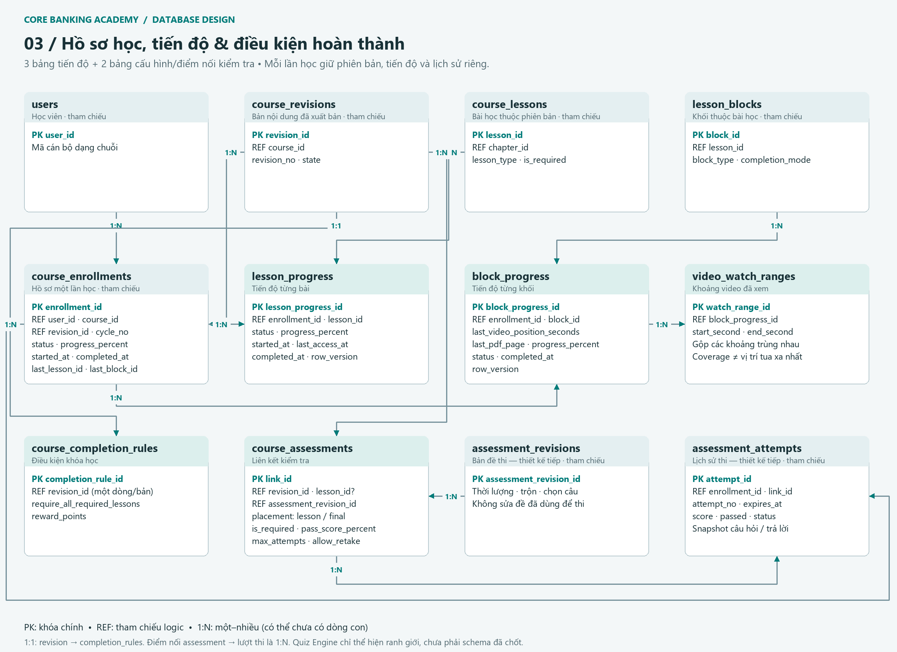

# API và dữ liệu Learning

Triển khai backend cho danh mục, tạo/sửa/sao chép/xuất bản khóa học, khối nội dung, tài nguyên, nhóm học, chia sẻ, giao học, tự đăng ký và tiến độ. Các quan hệ chỉ là cột ID scalar, không có FK/REFERENCES/cascade vật lý. Service kiểm tra tồn tại, sở hữu, quyền và vòng đời.

## Trạng thái kho tài nguyên

File upload mới được lưu trong AIStor/S3 private, không lưu local lâu dài và không fallback khi S3 lỗi. BE local dùng endpoint AIStor Ubuntu truy cập được từ máy chạy BE; endpoint phải được người vận hành công bố hoặc cấp đường kết nối phù hợp. API upload/content giữ nguyên; không trả key/credential/public URL. Cấu hình, staging disk và nghiệm thu thật xem [triển khai AIStor](../operations/DEPLOY_UBUNTU.md#aistor-integration). Chưa deploy hoặc migrate dữ liệu server trong thay đổi source này.

### Contract tải tài nguyên

GET `/api/v1/learning-assets/{assetId}/content` giữ JWT/policy hiện có. Không Range trả 200; một Range dạng bytes=start-end, bytes=start- hoặc bytes=-suffix trả 206 với Content-Range/Content-Length/Accept-Ranges. Range sai, ngoài file hoặc nhiều range trả HTTP 416/CORE-RANGE_NOT_SATISFIABLE và Content-Range bytes */total. If-Range strong ETag khớp cho phép Range; không khớp hoặc dạng ngày trả toàn file. HEAD trả metadata/header mà không GET object.

Lỗi S3/metadata không nhất quán là lỗi hệ thống 500, không đổi thành ASSET_INVALID. Lỗi trước khi stream theo BaseResponse; sau khi binary đã bắt đầu, kết nối có thể kết thúc thiếu byte, không chèn JSON. Row storageType=local trả HTTP 200/ERROR, mã LEARNING-ASSET_STORAGE_UNSUPPORTED, yêu cầu chuyển dữ liệu. FE player phải có cách gắn Bearer cho request media; thẻ video/iframe src đơn thuần chưa đủ, không đưa token vào URL.

## Sơ đồ quan hệ dữ liệu

Ba ảnh dưới đây mô tả các bảng và cột chính để đọc cùng [hướng dẫn từng bảng](#hướng-dẫn-sử-dụng-từng-bảng).
Ảnh nằm tại `docs/diagrams/`, cùng phạm vi tài liệu dùng chung của repository, không phụ thuộc `docs/local/`.
Mở ảnh ở kích thước gốc để xem rõ tên cột.

- `PK` là khóa chính của bảng. `REF` là cột lưu ID của bảng khác; **không có khóa ngoại vật lý**.
- Mũi tên đi từ bảng cha sang bảng con; `1:N` là một–nhiều, có thể chưa có dòng con khi lưu nháp.
- Ảnh lược bớt cột audit, version và một số liên kết phụ. Định nghĩa đầy đủ hiện hành nằm trong
  [SQL Learning](../sql/learning_hub_learning.sql) và các entity của module Learning.

### 1. Khóa học, chương, bài học và tài nguyên


`courses` giữ định danh khóa, `course_revisions` giữ từng bản nội dung. Cây học tập là
**phiên bản khóa → chương → bài → khối nội dung**. Một bài có nhiều khối video/PDF/văn bản/ảnh/quy trình
được sắp xếp bằng `sort_no`; `block_assets` liên kết khối với tài nguyên tái sử dụng trong `assets`.

### 2. Nhóm học tập, giao khóa và người nhận


`assignment_targets` lưu đối tượng giảng viên chọn; `assignment_recipients` chốt từng người thực nhận khi giao.
`recipient_target_sources` giữ đủ nguồn khi một người được chọn qua nhiều nhóm hoặc cá nhân.
`course_enrollments` giữ một lần học, có thể đáp ứng nhiều nghĩa vụ giao cùng bản/kỳ mà không nhân đôi tiến độ.
`teams` là nhóm chuyên môn có sẵn; `learning_groups` là nhóm học tự lập có thành viên nhiều–nhiều.

### 3. Tiến độ và điều kiện hoàn thành



`lesson_progress` lưu tiến độ bài; `block_progress` giữ vị trí/tình trạng từng khối trong một lần học.
`video_watch_ranges` lưu các khoảng đã xem để tính coverage, không suy hoàn thành từ vị trí tua xa nhất.
Quan hệ revision → `course_completion_rules` có tối đa một dòng cấu hình mỗi bản, được tạo khi tạo revision.

Các bảng `assessment_revisions` và `assessment_attempts` trong ảnh thể hiện **phần thiết kế tiếp theo,
chưa triển khai**; không nằm trong DDL Learning hiện tại. `course_assessments` đã có bảng điểm nối,
nhưng chưa có API Quiz Engine hoạt động. Phần này không phải bằng chứng hệ thống đã chấm thi.

## Contract chung

- Business API dưới /api/v1, JWT hiện có; envelope BaseResponse giữ SUCCESS/ERROR và messageCode. Validation/lỗi nghiệp vụ trả HTTP 200/ERROR, thiếu xác thực 401, thiếu quyền 403, lỗi hệ thống 500.
- 36 operation mới, Swagger tại /swagger-ui.html. [Bộ cURL và thứ tự kiểm tra](LEARNING_CURL.md), [Postman collection](../postman/learning.postman_collection.json).
- Swagger khai báo HTTP 200 cùng schema DTO cho từng API JSON; kiểm tra `status=SUCCESS` hoặc `ERROR` trong body. Tải tài nguyên trả binary HTTP 200, hoặc 206 khi dùng Range hợp lệ, không bọc BaseResponse.
- Phân trang page từ 0, size 1..100. Danh sách khóa hỗ trợ q, fieldId, programId, moduleId, level, requirement, learningStatus, state và sort=id/title/updateTime/dueAt,asc|desc. Scope được tính từ grant hiện tại và lọc trước pagination/count.
- Read model entity scalar dùng id làm khóa hiển thị. expectedVersion lấy rowVersion của đúng bản ghi: nội dung dùng revision, đổi lifecycle dùng course, thay thành viên dùng group, tiến độ dùng block_progress (chưa có dòng: 0).
- Lưu draft bằng PUT thay toàn bộ cây và cấp lại ID con; lấy lại ID sau mỗi lần lưu. Published revision bất biến; draft/copy tạo cây độc lập, không reset enrollment cũ.
- Giao học kích hoạt ngay và chốt người nhận kể cả startAt trong tương lai. Tối đa 500 người/đợt. Cùng khóa/bản/lần học giữ một enrollment; nhiều nguồn giữ đủ recipients/target_sources. Retake không cho tạo khi còn lần học đang mở, cần chính sách đóng kỳ riêng nếu muốn chuyển.
- enrollment_origin giữ nguồn tạo lần học ban đầu; self_enrolled_at ghi nhận quyền tự đăng ký riêng nếu học viên đăng ký thêm sau khi đã được giao. Thu hồi giao không xóa quyền tự đăng ký còn hợp lệ và không viết lại nguồn ban đầu.
- Date/time trong JSON là ISO-8601 có offset hoặc Z. API nhận thời điểm đầy đủ; FE quy đổi ngày chọn sang cuối ngày Asia/Bangkok khi cần. Thời lượng lưu giây.
- Nội dung text hiện hỗ trợ Markdown/plain, từ chối HTML. FE phải render an toàn và sanitize Markdown/link theo ngữ cảnh; API không cung cấp HTML đã sanitize.
- Viewer/nội dung file chỉ mở khi khóa active, danh mục published và có nguồn học hợp lệ đã tới startAt (hoặc tự đăng ký còn quyền). Danh sách vẫn giữ metadata lịch sử khi khóa paused/archived; không dùng GET enrollment để bỏ qua lịch mở/thu hồi quyền học.
- Upload vào bucket S3 private; file local chỉ dùng staging tạm và được dọn; file signature + extension và giới hạn byte được kiểm tra. Metadata thời lượng video/số trang PDF do giảng viên xác nhận; chưa có probe/transcode. Không trả storage key hoặc URL local. Download truyền stream S3 theo single byte range, học viên phải gửi enrollmentId và blockId.
- Nhắc học là thông báo in-app đến thời điểm đã lên lịch, không tích hợp email/SMTP. reward_points chỉ cấu hình, chưa cộng sổ gamification.
- Quiz Engine chưa triển khai: không cho lưu quiz lesson/cấu hình assessment có hiệu lực. course_assessments là bảng điểm nối dành cho bước phát triển sau, không phải API chấm thi.
- Thao tác ghi Learning dùng chung advisory transaction lock với Identity để bảo vệ grain và tham chiếu xuyên module khi chưa có UNIQUE/FK. Xóa team bị chặn nếu còn course, target hoặc snapshot học tập tham chiếu. Đây là lựa chọn ban đầu cho correctness; chưa benchmark tải lớn. Không mở rộng thành nhiều khóa trước khi đo và thiết kế thứ tự khóa.

## SQL và triển khai

Review [learning_hub_learning.sql](../sql/learning_hub_learning.sql), chạy một lần sau Identity trên môi trường được phép. File không tạo/xóa database, không seed/reset/cấp quyền và không tự chạy startup. Không chạy lại trên schema đã có các bảng này. Bảng Learning có created_by/updated_by/row_version/create_time/update_time và comment/index; không sửa 8 bảng Identity.

Backup cả DB và kho file. Nếu đã ghi dữ liệu, rollback bằng restore/kế hoạch riêng; không có script DROP tự động. Giữ ddl-auto=validate/Flyway off. Chưa tự áp dụng DDL lên DB cấu hình thật của người dùng.

## API mới

| STT | Method / đường dẫn | Mục đích |
|---|---|---|
| 1 | GET `/api/v1/training-catalog/fields` | Danh sách fields |
| 2 | POST `/api/v1/training-catalog/fields` | Tạo fields |
| 3 | PUT `/api/v1/training-catalog/fields/{fieldId}` | Cập nhật fields |
| 4 | GET `/api/v1/training-catalog/programs` | Danh sách programs |
| 5 | POST `/api/v1/training-catalog/programs` | Tạo programs |
| 6 | PUT `/api/v1/training-catalog/programs/{programId}` | Cập nhật programs |
| 7 | GET `/api/v1/training-catalog/modules` | Danh sách modules |
| 8 | POST `/api/v1/training-catalog/modules` | Tạo modules |
| 9 | PUT `/api/v1/training-catalog/modules/{moduleId}` | Cập nhật modules |
| 10 | POST `/api/v1/courses` | Tạo khóa học và bản nháp đầu tiên |
| 11 | GET `/api/v1/courses/{courseId}` | Xem cây nội dung để biên soạn |
| 12 | PUT `/api/v1/courses/{courseId}/revisions/{revisionId}` | Lưu toàn bộ nội dung bản nháp |
| 13 | POST `/api/v1/courses/{courseId}/revisions/{revisionId}/publish` | Xuất bản khóa học |
| 14 | POST `/api/v1/courses/{courseId}/draft` | Mở bản nháp để chỉnh sửa |
| 15 | POST `/api/v1/courses/{courseId}/copy` | Sao chép thành khóa mới |
| 16 | PATCH `/api/v1/courses/{courseId}/state` | Tạm dừng hoặc lưu trữ khóa học |
| 17 | GET `/api/v1/courses/{courseId}/shares` | Xem chia sẻ khóa học |
| 18 | PUT `/api/v1/courses/{courseId}/shares` | Chia sẻ hoặc thu hồi chia sẻ |
| 19 | POST `/api/v1/courses/{courseId}/assignments` | Giao khóa học cho cá nhân/nhóm/đơn vị |
| 20 | GET `/api/v1/courses/{courseId}/assignments` | Xem các đợt giao của đơn vị |
| 21 | POST `/api/v1/courses/{courseId}/enrollments` | Tự đăng ký khóa học tự chọn |
| 22 | GET `/api/v1/learning-groups` | Danh sách nhóm học tập |
| 23 | POST `/api/v1/learning-groups` | Tạo nhóm học tập |
| 24 | GET `/api/v1/learning-groups/{groupId}` | Xem nhóm và thành viên |
| 25 | PUT `/api/v1/learning-groups/{groupId}/members` | Thay danh sách thành viên nhóm học |
| 26 | GET `/api/v1/instructor/courses` | Danh sách khóa học giảng viên |
| 27 | GET `/api/v1/learning-assignments/{assignmentId}` | Xem đợt giao và người nhận |
| 28 | POST `/api/v1/learning-assignments/recipients/{recipientId}/revoke` | Thu hồi một nghĩa vụ giao học |
| 29 | GET `/api/v1/me/learning/courses` | Khóa học của tôi |
| 30 | GET `/api/v1/me/learning/catalog` | Danh mục khóa học của học viên |
| 31 | GET `/api/v1/me/learning/enrollments/{enrollmentId}` | Xem nội dung và vị trí tiếp tục học |
| 32 | PUT `/api/v1/me/learning/enrollments/{enrollmentId}/blocks/{blockId}/progress` | Ghi tương tác học và tổng hợp tiến độ |
| 33 | GET `/api/v1/me/learning/reminders` | Thông báo nhắc học đến hạn |
| 34 | POST `/api/v1/me/learning/reminders/{reminderId}/read` | Đánh dấu đã đọc nhắc học |
| 35 | POST `/api/v1/learning-assets` | Upload tài nguyên |
| 36 | GET `/api/v1/learning-assets/{assetId}/content` | Tải tài nguyên |

## Hướng dẫn sử dụng từng bảng


### 15.1 Cách hiểu cột ID khi không có khóa ngoại

Ví dụ dữ liệu minh họa, không phải dữ liệu được thêm vào DB:

```text
course_revisions: revision_id=101, course_id=10, revision_no=1
course_chapters:  chapter_id=201, revision_id=101, title="Chương 1"
course_lessons:   lesson_id=301, chapter_id=201, title="Bài 1"
                 lesson_id=302, chapter_id=201, title="Bài 2"
lesson_blocks:   block_id=401, lesson_id=301, block_type="video"
                 block_id=402, lesson_id=301, block_type="pdf"
```

- Hai dòng bài học cùng chapter_id=201 thể hiện một chương có nhiều bài. DB chỉ lưu giá trị ID; ứng dụng kiểm tra chương 201 có tồn tại và có được phép thêm bài hay không.
- Đọc bài theo chương: lọc course_lessons.chapter_id bằng chapter_id cần xem. Đọc cả cây thì JOIN bằng các cột ID tương ứng.
- Xóa một dòng chương không làm DB tự xóa bài. Service phải từ chối nếu còn dữ liệu cần giữ, hoặc xử lý cây draft trong transaction theo chính sách đã nêu.
- Không dùng cột chứa danh sách ID dạng “301,302”; mỗi đối tượng con là một dòng. Quan hệ nhiều-nhiều dùng bảng nối.

### 15.2 Các bảng có sẵn được tái sử dụng

| Bảng | Mỗi dòng là gì? | Dùng khi nào? |
|---|---|---|
| `users` | Một tài khoản/hồ sơ cán bộ, ID dạng chuỗi. | Chọn giảng viên, người giao, học viên; lấy org/team hiện tại và trạng thái. Không tạo bảng học viên riêng chứa lại hồ sơ. |
| `orgs` | Một đơn vị/phòng trong cây tổ chức. | Xác định đơn vị sở hữu khóa, đơn vị được chia sẻ, đối tượng giao và scope. |
| `teams` | Một nhóm chuyên môn thuộc tổ chức. | Giao cho nhóm công tác có sẵn; thành viên hiện tại được xác định qua users.team_id. |
| `roles` | Một vai trò nghiệp vụ. | Tái sử dụng LEARNER, INSTRUCTOR và các vai trò quản trị hiện có. |
| `user_roles` | Một lần gán vai trò kèm scope cho người dùng. | Backend kiểm tra actor được tạo/sửa/giao/xem báo cáo trong phạm vi nào. Không dùng enrollment thay role. |
| `functions` | Một màn hình/chức năng điều hướng. | Dựng menu theo contract hiện có; không dùng làm quyền ghi dữ liệu. |
| `role_functions` | Một liên kết vai trò với màn hình. | Hiển thị menu tương ứng với vai trò, không thay kiểm tra action/scope ở backend. |
| `audit_log` | Một sự kiện nghiệp vụ. | Ghi tạo/sửa/xuất bản/giao/thu hồi và tác nhân cùng transaction. Không dùng audit để tính tiến độ chính. |

### 15.3 Danh mục và nội dung khóa học — 12 bảng

| Bảng | Một dòng lưu gì / bảng dùng để làm gì? | Khi ghi, khi đọc và ID liên kết |
|---|---|---|
| `training_fields` | Một lĩnh vực đào tạo, ví dụ “Nghiệp vụ Core Banking”. | Quản trị tạo danh mục trước; wizard và bộ lọc đọc. Các chương trình/phân hệ lưu field_id của dòng này. |
| `training_programs` | Một chương trình trong lĩnh vực, ví dụ “Nền tảng nghiệp vụ”. | Tạo trước hoặc qua quản trị danh mục; bước 1 chọn program_id. field_id cho biết chương trình thuộc lĩnh vực nào. |
| `business_modules` | Một phân hệ để phân loại, ví dụ “Tiền gửi”. | Tạo trong danh mục; bước 1 chọn module_id, danh sách dùng để lọc. field_id phải khớp lĩnh vực của chương trình được chọn. |
| `courses` | Một khóa học có ID/mã và chủ sở hữu ổn định qua các lần sửa. | Tạo một lần khi tạo khóa mới. Các bản nội dung lưu course_id; published_revision_id cho biết bản đang công bố. Không tạo course mới mỗi lần sửa bài. |
| `course_revisions` | Một bản nội dung của khóa, ví dụ v1 đã xuất bản hoặc v2 đang nháp. | Tạo draft khi bắt đầu hoặc clone khi sửa bản published. Wizard lưu nội dung vào draft; enrollment giữ revision_id cụ thể để bảo toàn lịch sử. |
| `course_objectives` | Một mục tiêu đầu ra, ví dụ “Thực hiện được quy trình EOD”. | Mỗi lần bấm “Thêm mục tiêu” tạo một dòng thuộc revision_id, sắp xếp bằng sort_no. Trang giới thiệu đọc danh sách này. |
| `course_chapters` | Một chương trong một bản khóa học. | Bước 2 thêm/sửa/sắp xếp chương trên draft. revision_id xác định bản nội dung; đọc để dựng mục lục. |
| `course_lessons` | Một bài học hoặc bài quiz trong chương. | Bấm “Thêm bài học” tạo dòng có chapter_id. Lưu tên, loại, thời lượng dự kiến và thứ tự; viewer dùng để mở bài và chuyển bài. |
| `lesson_blocks` | Một khối video/PDF/văn bản/quy trình/ảnh/tệp trong bài. | Mỗi lần thêm khối tạo một dòng có lesson_id. Nội dung chữ ở body; tệp liên kết qua block_assets. Đọc theo sort_no để hiển thị xen kẽ. |
| `process_steps` | Một bước của một khối quy trình, ví dụ “Bước 1: Kiểm tra điều kiện”. | Khi lưu khối process, tách từng bước thành dòng có block_id; viewer đọc theo sort_no. Không tạo bảng quy trình riêng cho mỗi bài. |
| `assets` | Một tài nguyên được tải lên hoặc quản lý bằng địa chỉ hợp lệ. | Tạo lúc bắt đầu upload, cập nhật trạng thái sau xử lý; lưu tên/MIME/size/storage_key. Viewer dùng metadata để xin quyền mở/tải; file thật nằm trong kho tệp. |
| `block_assets` | Một lần sử dụng asset trong một khối nội dung. | Khi chọn tệp cho khối, lưu block_id + asset_id và caption/thứ tự. Cho phép tái sử dụng file mà không copy file; cùng một ảnh có thể có chú thích khác nhau trong hai khối. |

Phân biệt quan trọng: `courses` là khóa nào; `course_revisions` là phiên bản nào; `assets` là file nào; `block_assets` là file đó được dùng ở đâu.

### 15.4 Nhóm học tập và chia sẻ — 3 bảng

| Bảng | Một dòng lưu gì / bảng dùng để làm gì? | Khi ghi, khi đọc và ID liên kết |
|---|---|---|
| `learning_groups` | Một nhóm học tự lập, ví dụ “Cán bộ mới tháng 10”. | Tạo khi cần gom học viên ngoài nhóm chuyên môn. Chủ nhóm thuộc owner_org_id; selector giao học đọc nhóm này. |
| `learning_group_members` | Một lần tham gia nhóm học của một người. | Thêm thành viên bằng group_id + user_id; rời nhóm ghi left_at. Khi giao khóa, lấy các dòng còn hiệu lực để resolve người nhận. |
| `course_shares` | Một quyền khai thác khóa học được cấp cho đơn vị nhận. | Khi tick chia sẻ, lưu course_id + org_id và quyền giao/tự đăng ký. Backend kiểm tra khi đơn vị nhận giao khóa. Không tạo enrollment cho toàn bộ đơn vị chỉ vì có share. |

Ví dụ một người tham gia ba nhóm học: có ba dòng learning_group_members cùng user_id, khác group_id; không sửa users.team_id để biểu diễn ba nhóm đó.

### 15.5 Giao khóa học, hồ sơ học và nhắc hạn — 6 bảng

| Bảng | Một dòng lưu gì / bảng dùng để làm gì? | Khi ghi, khi đọc và ID liên kết |
|---|---|---|
| `course_assignments` | Một đợt giao một bản khóa học với thời gian và yêu cầu cụ thể. | Giảng viên tạo đợt giao, chọn course_id/revision_id, hạn và continue/retake. Một đợt giao có N target và N người nhận. |
| `assignment_targets` | Một cá nhân/nhóm/đơn vị mà giảng viên chọn. | Khi chọn đối tượng, lưu assignment_id và đúng một user_id/team_id/org_id/group_id theo target_type. Đọc lại để biết ý định giao ban đầu. |
| `assignment_recipients` | Một người thực tế nhận khóa trong một đợt giao. | Khi kích hoạt, resolve target rồi tạo một dòng cho mỗi assignment_id + user_id. Lưu enrollment_id và hạn riêng; dashboard/báo cáo dùng để biết ai được giao và nghĩa vụ nào còn hiệu lực. |
| `recipient_target_sources` | Một nguồn target tạo ra người nhận. | Sau deduplicate người nhận, nối recipient_id với từng target_id mà người đó thuộc. Dùng giải thích vì sao được giao và xử lý nguồn trùng; không lưu tiến độ ở bảng này. |
| `course_enrollments` | Một lần học của một người đối với một bản khóa học. | Tạo khi giao hoặc tự đăng ký nếu chưa có lần học tương thích. Giữ user_id, course_id, revision_id, cycle_no, trạng thái và tổng tiến độ; là gốc để truy vấn bài đã học/lượt thi. |
| `learning_reminders` | Một lịch/sự kiện nhắc hạn cho một nghĩa vụ giao học. | Tạo từ recipient_id và deadline khi bật nhắc. Worker đọc pending đến giờ, kiểm tra nghĩa vụ còn cần nhắc, gửi qua kênh đã cấu hình rồi cập nhật trạng thái. Không gửi nhắc chỉ bằng đọc ngày từ giao diện. |

Ví dụ giao nhóm A gồm An và Bình, đồng thời chọn thêm cá nhân An:

```text
course_assignments:       1 dòng (đợt giao)
assignment_targets:       2 dòng (nhóm A, cá nhân An)
assignment_recipients:    2 dòng (An, Bình)
recipient_target_sources: 3 dòng (An←nhóm A, An←cá nhân, Bình←nhóm A)
course_enrollments:       tối đa 2 dòng mới; tái sử dụng nếu đã học cùng bản/kỳ
```

Nếu sau đó giao thêm cho An ở một đợt khác, tạo recipient mới cho đợt mới và có thể giữ enrollment_id cũ. Đây là lý do phải tách đợt giao khỏi hồ sơ học.

### 15.6 Tiến độ học tập — 3 bảng

| Bảng | Một dòng lưu gì / bảng dùng để làm gì? | Khi ghi, khi đọc và ID liên kết |
|---|---|---|
| `lesson_progress` | Tiến độ của một bài trong một lần học. | Tạo/cập nhật theo enrollment_id + lesson_id khi học; dùng dựng mục lục đã học/chưa học và tổng hợp tiến độ khóa. Không tạo lại dòng mỗi lần mở bài. |
| `block_progress` | Tiến độ/vị trí gần nhất của một khối trong một lần học. | Tạo/cập nhật theo enrollment_id + block_id. Video cập nhật vị trí giây, PDF cập nhật trang; lần mở tiếp theo đọc lại đúng dòng này. |
| `video_watch_ranges` | Một khoảng video đã xem được hệ thống chấp nhận. | Ghi/gộp khoảng theo block_progress_id. Tính độ dài hợp các khoảng để lấy tỷ lệ đã xem, tránh xem lại cộng trùng hoặc tua cuối thành hoàn thành. |

Ví dụ cùng bài có video A và video B: hai block_id và hai block_progress khác nhau; video A dừng giây 120 không ghi đè vị trí giây 45 của video B.

### 15.7 Điều kiện hoàn thành và điểm nối kiểm tra — 2 bảng

| Bảng | Một dòng lưu gì / bảng dùng để làm gì? | Khi ghi, khi đọc và ID liên kết |
|---|---|---|
| `course_completion_rules` | Bộ điều kiện hoàn thành chung của một revision. | Bước 3 lưu một dòng/revision_id; backend đọc khi đánh giá hoàn thành. reward_points chỉ cấu hình thưởng, không lưu số dư/điểm đã cộng của từng người. |
| `course_assessments` | Một bài kiểm tra được gắn vào revision tại bài học hoặc cuối khóa. | Bước 3 chọn assessment_revision_id, vị trí, điểm đạt và số lần thi. lesson_id chỉ có khi gắn vào bài. Một revision có thể có nhiều liên kết; lượt thi phải biết link_id đang đáp ứng. |

### 15.8 Các bảng Quiz Engine mới chỉ đề xuất ở mục 9

Những bảng này chưa nằm trong 26 bảng chi tiết kể trên. Giải thích để phân biệt mục đích, chưa mở rộng task thành triển khai thi.

| Bảng | Mục đích và cách sử dụng |
|---|---|
| `assessments` | Định danh ổn định của một bài kiểm tra để tái sử dụng ở nhiều khóa; không giữ lịch sử làm bài của người học. |
| `assessment_revisions` | Một bản cấu hình đề thi; xuất bản bản mới khi đổi thời lượng, cách chọn/trộn câu hoặc chính sách xem đáp án. course_assessments giữ ID bản này. |
| `questions` | Định danh ổn định của một câu hỏi trong ngân hàng câu hỏi. |
| `question_revisions` | Một bản nội dung câu hỏi, loại một/nhiều đáp án, độ khó và giải thích. Sửa câu hỏi tạo bản mới để không đổi đề đã thi. |
| `question_options` | Một phương án trả lời của một question revision. Một câu có nhiều dòng phương án; đáp án đúng là dữ liệu backend được bảo vệ. |
| `assessment_question_rules` | Một luật chọn câu cho một assessment revision: câu cố định hoặc chọn ngẫu nhiên theo bộ lọc/số lượng. Được đọc lúc tạo đề thực tế cho attempt. |
| `assessment_attempts` | Một lượt thi của enrollment đối với course_assessment link; lưu thời điểm, số lượt, trạng thái, điểm và kết quả đạt. Tạo lúc bắt đầu và chấm khi nộp/hết giờ. |
| `attempt_questions` | Một câu cụ thể đã được đưa vào lượt thi, gồm snapshot nội dung/thứ tự/phương án/điểm và dữ liệu chấm riêng phía backend. Giữ nguyên dù ngân hàng thay đổi. |
| `attempt_answers` | Câu trả lời học viên chọn cho một attempt_question. Cho phép nhiều phương án với câu multi; backend dùng để chấm và xem lại theo policy. |

### 15.9 Thứ tự sử dụng trong các luồng chính

1. **Chuẩn bị danh mục:** training_fields → training_programs, business_modules; users/orgs/teams và quyền đã có từ Identity.
2. **Tạo khóa:** courses → course_revisions draft → course_objectives → course_chapters → course_lessons → lesson_blocks; thêm assets/block_assets và process_steps theo loại khối.
3. **Thiết lập điều kiện:** course_completion_rules và course_assessments nếu dùng kiểm tra; xuất bản revision rồi cập nhật courses.published_revision_id trong transaction.
4. **Giao học:** chuẩn bị learning_groups/members hoặc dùng team/org có sẵn → kiểm tra course_shares nếu giao từ đơn vị nhận → course_assignments → assignment_targets → resolve/deduplicate → course_enrollments + assignment_recipients + recipient_target_sources → learning_reminders.
5. **Học viên mở danh sách:** tìm enrollment của caller, lấy revision tương ứng, tổng hợp nghĩa vụ từ recipients/assignments; danh mục tự chọn còn gồm khóa được phép khám phá mà chưa có enrollment.
6. **Học và tiếp tục:** cập nhật block_progress/video_watch_ranges → tổng hợp lesson_progress → cập nhật trạng thái, % và con trỏ tiếp tục của course_enrollments. Các bước liên quan cần giữ nhất quán theo mục 8.
7. **Thi và hoàn thành:** tạo attempt, chốt câu/đáp án theo đề, lưu answers, backend chấm → kiểm tra completion_rules/course_assessments → cập nhật enrollment khi đủ điều kiện.
8. **Sửa khóa/học lại:** clone nội dung sang revision mới; hoặc tạo enrollment cycle mới khi học lại. Không sửa/xóa kết quả lịch sử để phục vụ nội dung mới.

### 15.10 Các bảng không được gộp chỉ vì tên gần giống

| Cặp bảng | Khác nhau ở đâu? |
|---|---|
| courses / course_revisions | Một khóa ổn định / một bản nội dung của khóa. |
| teams / learning_groups | Nhóm chuyên môn trong Identity / nhóm học tự lập nhiều-nhiều. |
| course_shares / course_assignments | Cấp đơn vị quyền khai thác khóa / giao nghĩa vụ học cụ thể. |
| assignment_targets / assignment_recipients | Đối tượng giảng viên chọn / từng người thực tế được giao. |
| assignment_recipients / course_enrollments | Một nghĩa vụ trong một đợt / một lần học có thể đáp ứng nhiều nghĩa vụ. |
| lesson_progress / block_progress | Tổng tiến độ bài / chi tiết tiến độ và vị trí từng khối. |
| assets / block_assets | File/tài nguyên gốc / một lần dùng file trong nội dung. |
| course_assessments / assessment_attempts | Cấu hình kiểm tra trong khóa / một lần học viên thực hiện kiểm tra đó. |
